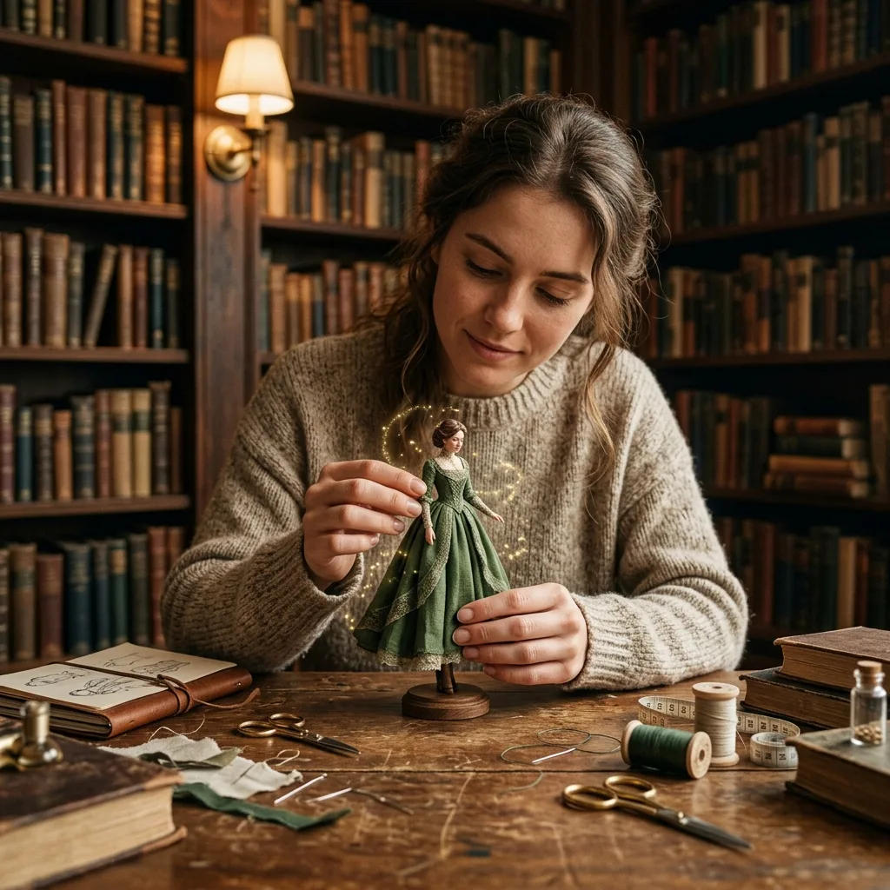

# Scene of a young woman sitting at a wooden

[← Back to the collection](../../README.md) · Category: [Photography](../../gallery/photography.md) · Model: `Vinano Image v2` · ID: `vn-00600`

<a href="https://vinano.ai?utm_source=github&utm_medium=readme&utm_campaign=awesome-image-video-prompts-updating&utm_content=prompt-page-image"></a>

<sub>Preview generated with <a href="https://vinano.ai?utm_source=github&utm_medium=readme&utm_campaign=awesome-image-video-prompts-updating&utm_content=prompt-page-caption">vinano.ai</a></sub>

## Prompt

```text
A hyper-realistic cinematic scene of a young woman sitting at a wooden desk in a vintage library filled old books. She is delicately holding and adjusting a tiny miniature version of herself standing on the table. The miniature woman wears an elegant flowing green dress fine fabric details and subtle glowing particles around her. The larger woman looks focused and gentle, as if crafting or designing the tiny figure. Soft warm lighting from vintage wall lamps creates a cozy atmosphere, sewing tools like scissors, threads, measuring tape, and fabric pieces scattered on the desk. Shallow depth of field, ultra-detailed, 8K, realistic skin textures, soft shadows, magical realism, cinematic composition. Emphasise material texture and natural light so the final frame feels tactile and premium.
```

## Try it on vinano.ai

1. Copy the prompt above.
2. Open **[vinano.ai](https://vinano.ai?utm_source=github&utm_medium=readme&utm_campaign=awesome-image-video-prompts-updating&utm_content=prompt-page-try)**, paste it into the image generator and pick a model.
3. Swap any placeholders (brand, product, city, person…) for your own details, then generate.

More prompts like this: [Photography gallery](../../gallery/photography.md) · [all categories](../../README.md#contents)
