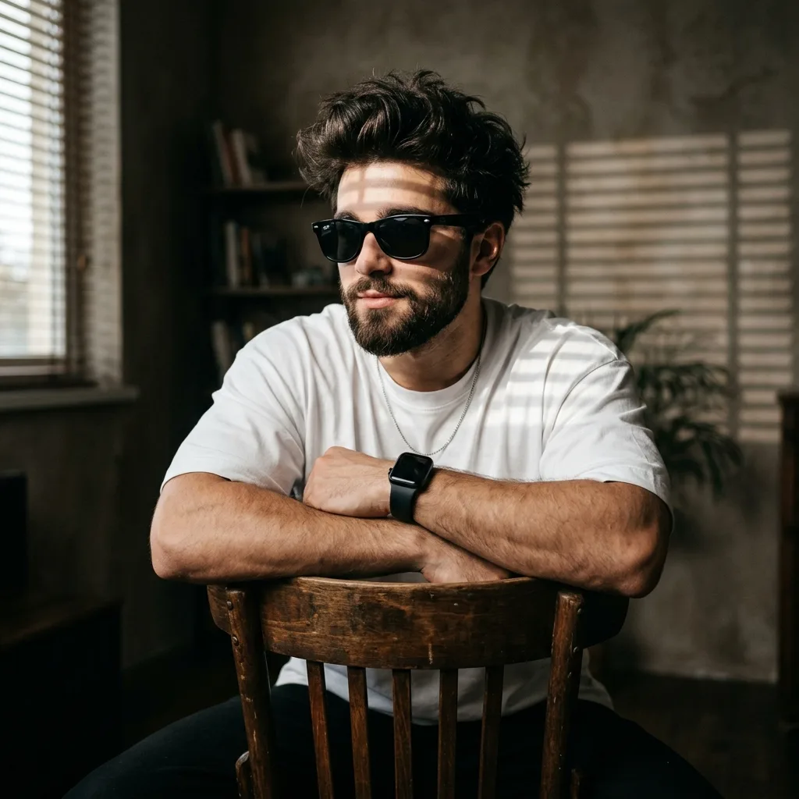

# High-resolution, cinematic portrait of a young man messy, voluminous

[← Back to the collection](../../README.md) · Category: [Photography](../../gallery/photography.md) · Model: `Vinano Image v2` · ID: `vn-00601`

<a href="https://vinano.ai?utm_source=github&utm_medium=readme&utm_campaign=awesome-image-video-prompts-updating&utm_content=prompt-page-image"></a>

<sub>Preview generated with <a href="https://vinano.ai?utm_source=github&utm_medium=readme&utm_campaign=awesome-image-video-prompts-updating&utm_content=prompt-page-caption">vinano.ai</a></sub>

## Prompt

```text
A high-resolution, cinematic portrait of a young man messy, voluminous dark hair and a well-groomed beard. He is wearing classic black wayfarer-style sunglasses and a clean, oversized white t-shirt. The man is seated backward on a vintage dark wood chair, resting his muscular, crossed forearms comfortably along the top of the curved backrest. On his left wrist, he wears a sleek black smartwatch a rectangular face.

The scene is defined by dramatic, high-contrast lighting filtered through Venetian blinds, casting sharp, rhythmic horizontal shadow bars across his face, torso, and the textured, warm-grey plaster wall in the background. The atmosphere is moody and serene, a shallow depth of field that keeps the focus sharp on the man’s expression and the texture of his hair, while the lower portion of the chair and his black trousers softly blur into the foreground. The color palette is neutral and sophisticated, dominated by crisp whites, deep blacks, and warm earthy wood tones.

Preserve realistic proportions and depth for a confident, professional finish.
```

## Try it on vinano.ai

1. Copy the prompt above.
2. Open **[vinano.ai](https://vinano.ai?utm_source=github&utm_medium=readme&utm_campaign=awesome-image-video-prompts-updating&utm_content=prompt-page-try)**, paste it into the image generator and pick a model.
3. Swap any placeholders (brand, product, city, person…) for your own details, then generate.

More prompts like this: [Photography gallery](../../gallery/photography.md) · [all categories](../../README.md#contents)
