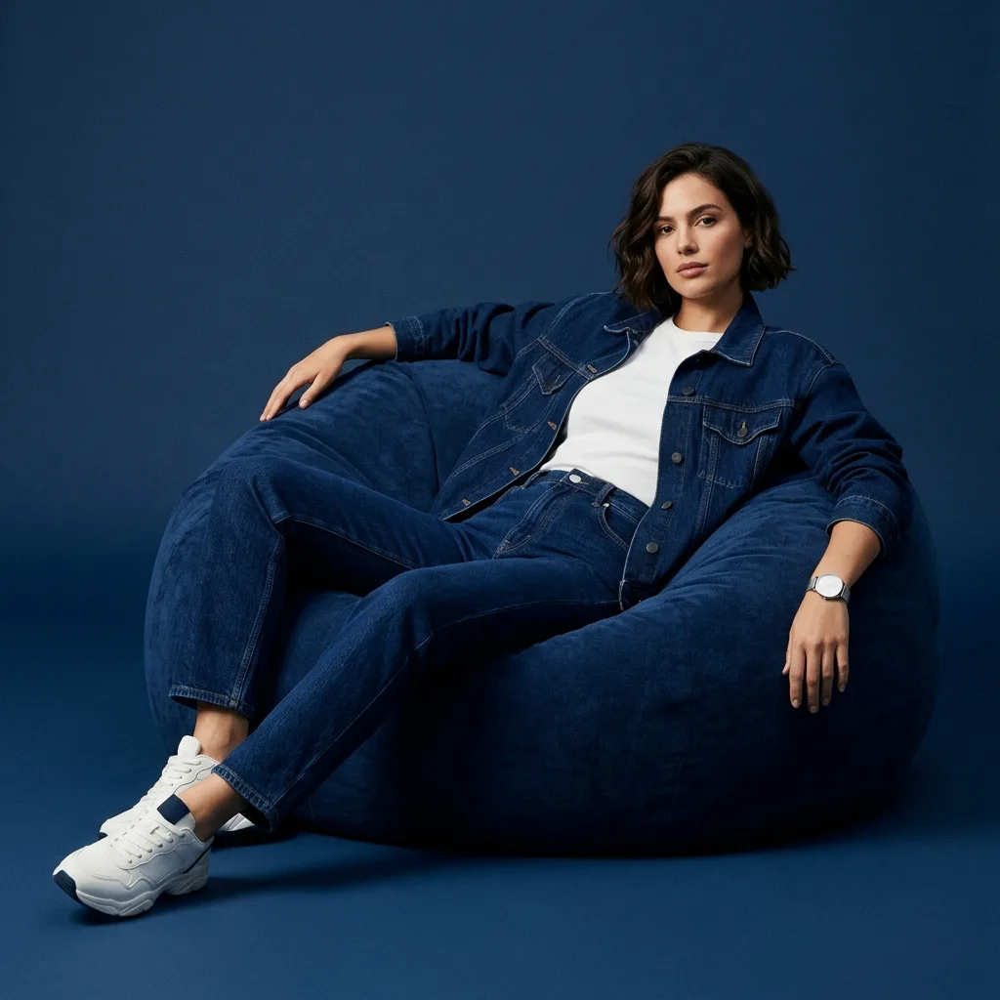

# Photography prompt #603

[← Back to the collection](../../README.md) · Category: [Photography](../../gallery/photography.md) · Model: `Vinano Image v2` · ID: `vn-00603`

<a href="https://vinano.ai?utm_source=github&utm_medium=readme&utm_campaign=awesome-image-video-prompts-updating&utm_content=prompt-page-image"></a>

<sub>Preview generated with <a href="https://vinano.ai?utm_source=github&utm_medium=readme&utm_campaign=awesome-image-video-prompts-updating&utm_content=prompt-page-caption">vinano.ai</a></sub>

## Prompt

```text
Hyper-realistic cinematic full-body fashion photoshoot of the uploaded woman (age 26, 5'5"), exact face and hairstyle from the uploaded image, perfectly styled. Leaning back confidently on a deep navy-blue bean bag, one arm resting on the edge of the bag, legs slightly apart, projecting calm confidence and poise. Wearing a bold all-navy look: navy blue denim jacket over a fitted white T-shirt, navy blue denim jeans, chunky sneakers, and a sleek silver watch. Solid navy-blue background, professional studio lighting, sharp focus, high fashion editorial aesthetic. provide four more photos. Aim for an editorial, design-driven look with deliberate negative space.
```

## Try it on vinano.ai

1. Copy the prompt above.
2. Open **[vinano.ai](https://vinano.ai?utm_source=github&utm_medium=readme&utm_campaign=awesome-image-video-prompts-updating&utm_content=prompt-page-try)**, paste it into the image generator and pick a model.
3. Swap any placeholders (brand, product, city, person…) for your own details, then generate.

More prompts like this: [Photography gallery](../../gallery/photography.md) · [all categories](../../README.md#contents)
