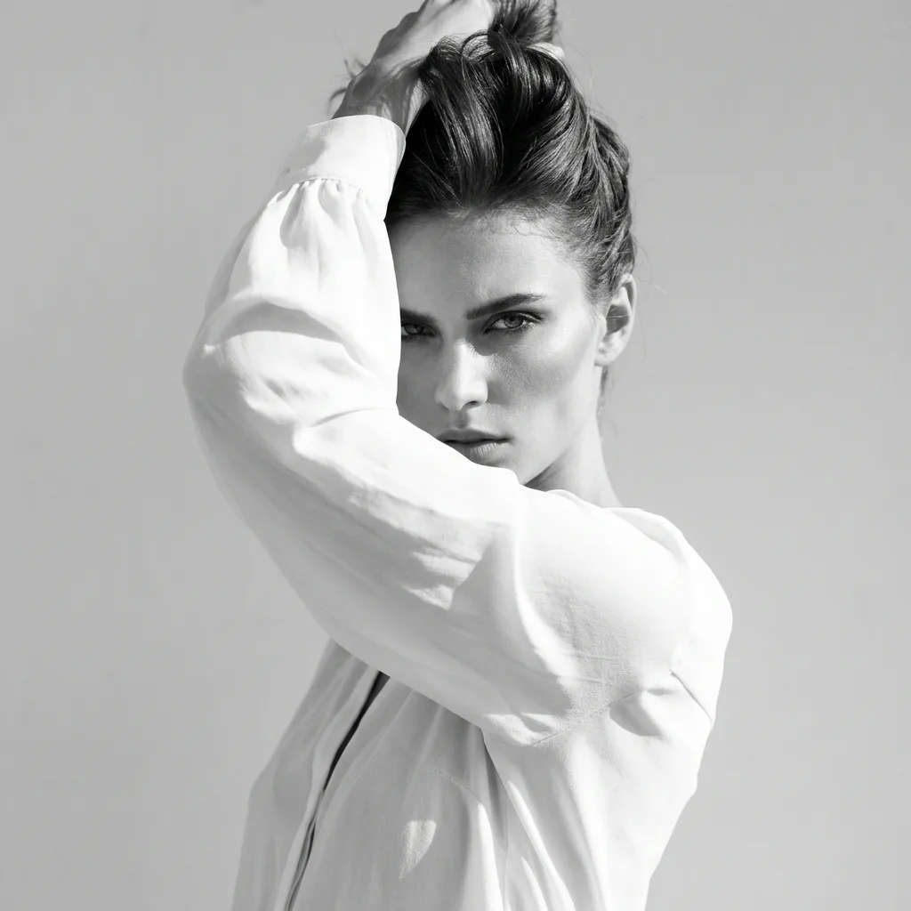

# Use the attached image of the model as facial

[← Back to the collection](../../README.md) · Category: [Photography](../../gallery/photography.md) · Model: `Vinano Image v2` · ID: `vn-00608`

<a href="https://vinano.ai?utm_source=github&utm_medium=readme&utm_campaign=awesome-image-video-prompts-updating&utm_content=prompt-page-image"></a>

<sub>Preview generated with <a href="https://vinano.ai?utm_source=github&utm_medium=readme&utm_campaign=awesome-image-video-prompts-updating&utm_content=prompt-page-caption">vinano.ai</a></sub>

## Prompt

```text
Use the attached image of the model as facial reference and physical features. Black and white high-fashion editorial portrait of uploaded person, wearing a loose white blouse. She poses one arm raised, partially covering her face while holding her hair up, creating a dramatic and artistic composition. Her gaze is intense and captivating, directed toward the camera, exuding a strong, enigmatic aura. Background: refined minimalist plain wall sharp natural daylight casting defined shadows, adding depth and contrast. Lighting: harsh natural sunlight, high-contrast setup highlighting facial contours, sharp cheekbones, and texture of the hair and fabric. Pose: bold and expressive, arm lifted framing the face, emphasizing raw emotion and editorial style. Camera: eye-level angle, close-up framing focusing on facial expression, texture, and dramatic shadow play. Captured a Canon EOS R5 full-frame DSLR, 85mm f/1.8 lens for crisp detail, tonal depth, and fine grain. Style: high-fashion editorial in monochrome. Maintain consistent colour harmony and crisp focus across the whole frame.
```

## Try it on vinano.ai

1. Copy the prompt above.
2. Open **[vinano.ai](https://vinano.ai?utm_source=github&utm_medium=readme&utm_campaign=awesome-image-video-prompts-updating&utm_content=prompt-page-try)**, paste it into the image generator and pick a model.
3. Swap any placeholders (brand, product, city, person…) for your own details, then generate.

More prompts like this: [Photography gallery](../../gallery/photography.md) · [all categories](../../README.md#contents)
