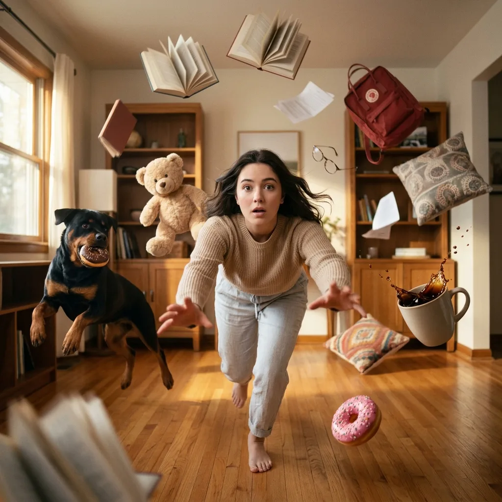

# Surreal scene of a young woman falling forward through

[← Back to the collection](../../README.md) · Category: [Photography](../../gallery/photography.md) · Model: `Vinano Image v2` · ID: `vn-00613`

<a href="https://vinano.ai?utm_source=github&utm_medium=readme&utm_campaign=awesome-image-video-prompts-updating&utm_content=prompt-page-image"></a>

<sub>Preview generated with <a href="https://vinano.ai?utm_source=github&utm_medium=readme&utm_campaign=awesome-image-video-prompts-updating&utm_content=prompt-page-caption">vinano.ai</a></sub>

## Prompt

```text
Cinematic surreal scene of a young woman falling forward through a swirling vortex of everyday objects inside a cozy room, arms reaching toward the camera as if trying to regain balance. Around her, objects float in chaotic slow motion: an excited Rottweiler dog mid-jump holding a donut, a soft teddy bear drifting weightlessly, open books pages flipping in the air, scattered papers, a red backpack, eyeglasses spinning, pillows floating, a leather wallet, and a mug of coffee splashing dramatically liquid suspended in mid-air. A pink frosted donut tumbles near the floor while sunlight streams through a window casting soft shadows. The woman wears a casual beige sweater and light pants, barefoot, hair slightly flowing from motion. Ultra-realistic filmic, cinematic lighting, dynamic motion blur, shallow depth of field, high detail, dramatic perspective, 35mm lens, surreal storytelling atmosphere, studio-quality photography, 8K. Keep edges clean and the overall composition balanced for a polished, gallery-ready result.
```

## Try it on vinano.ai

1. Copy the prompt above.
2. Open **[vinano.ai](https://vinano.ai?utm_source=github&utm_medium=readme&utm_campaign=awesome-image-video-prompts-updating&utm_content=prompt-page-try)**, paste it into the image generator and pick a model.
3. Swap any placeholders (brand, product, city, person…) for your own details, then generate.

More prompts like this: [Photography gallery](../../gallery/photography.md) · [all categories](../../README.md#contents)
