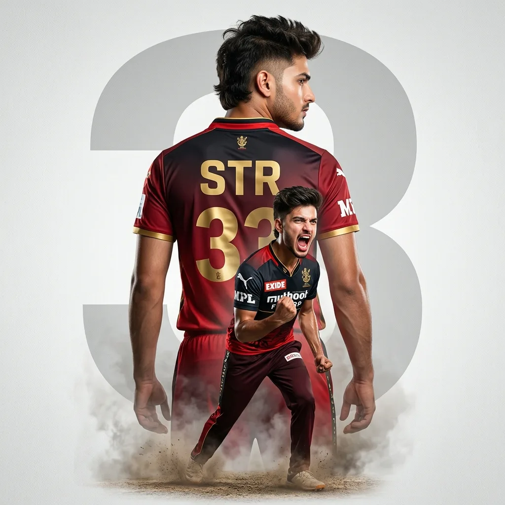

# Cricket poster featuring a young Indian male cricketer

[← Back to the collection](../../README.md) · Category: [Photography](../../gallery/photography.md) · Model: `Vinano Image Pro` · ID: `vn-00618`

<a href="https://vinano.ai?utm_source=github&utm_medium=readme&utm_campaign=awesome-image-video-prompts-updating&utm_content=prompt-page-image"></a>

<sub>Preview generated with <a href="https://vinano.ai?utm_source=github&utm_medium=readme&utm_campaign=awesome-image-video-prompts-updating&utm_content=prompt-page-caption">vinano.ai</a></sub>

## Prompt

```text
An ultra-realistic cinematic cricket poster featuring a young Indian male cricketer the uploaded reference face exactly (100% facial accuracy). He has a fair-whitish glass skin tone, soft red lips, sharp jawline, light stubble beard, and a voluminous slightly messy fade mullet hairstyle natural texture. The composition is a triple-layer cinematic layout on a clean, textured light-grey studio background, a large, softly embedded “77” subtly visible behind the subject. Primary dominant pose (upper background): The cricketer is shown from the back, standing tall and confident, wearing an official Chennai Super Kings (CSK) jersey in bright yellow blue accents. Bold blue typography on the jersey reads “VIJAY” the number “77” below it. His athletic physique is emphasized, shoulders squared, as he slightly turns his head over the shoulder, revealing an intense, fearless side profile. Foreground action pose (half body): A powerful celebration moment captures him mid-roar, mouth open in victory, right fist clenched and arm flexed. He wears the complete CSK match kit, including yellow-blue trousers, and ground texture. The CSK logo and sponsor details appear authentic and sharp. Sweat highlights on the skin add realism, cinematic rim lighting separating the face from the background. Atmosphere & lighting: Premium cinematic studio lighting balanced highlights and shadows enhances fabric folds, muscle definition, and facial contours. Subtle smoke and dust effects rise from the base, adding intensity without obscuring details. No blur, no distortion. Camera & quality: DSLR photography look, 85mm lens feel, shallow depth where needed, ultra-sharp focus, realistic proportions, professional color grading rich yellow, blue, and gold tones. true-to-life photorealistic, 8K resolution, vertical poster composition, IPL magazine-cover style. No cartoon look, no extra limbs, no facial alteration, no watermark.

RCB:

An ultra-realistic cinematic cricket poster featuring a young Indian male cricketer the uploaded reference face exactly (100% facial accuracy). He has a fair-whitish glass skin tone, soft red lips, sharp jawline, light stubble beard, and a voluminous slightly messy fade mullet hairstyle natural texture.
The composition is a triple-layer cinematic layout on a clean, textured light-grey studio background, a large, softly embedded “3” subtly visible behind the subject.
Primary dominant pose (upper background):
The cricketer is shown from the back, standing tall and confident, wearing an official Royal Challengers Bangalore (RCB) jersey in deep red and black gold accents. Bold golden typography on the jersey reads “STR” the number “33” below it. His athletic physique is emphasized, shoulders squared, as he slightly turns his head over the shoulder, revealing an intense, fearless side profile.
Foreground action pose (half body):
A powerful celebration moment captures him mid-roar, mouth open in victory, right fist clenched and arm flexed. He wears the complete RCB match kit, including black-red trousers, and ground texture. The RCB logo and sponsor details appear authentic and sharp.
Sweat highlights on the skin add realism, cinematic rim lighting separating the face from the background.
Atmosphere & lighting:
Premium cinematic studio lighting balanced highlights and shadows enhances fabric folds, muscle definition, and facial contours. Subtle smoke and dust effects rise from the base, adding intensity without obscuring details. No blur, no distortion.
Camera & quality:
DSLR photography look, 85mm lens feel, shallow depth where needed, ultra-sharp focus, realistic proportions, professional color grading rich reds, blacks, and gold tones.
true-to-life photorealistic, 8K resolution, vertical poster composition, IPL magazine-cover style.
No cartoon look, no extra limbs, no facial alteration, no watermark.

Emphasise material texture and natural light so the final frame feels tactile and premium.
```

## Try it on vinano.ai

1. Copy the prompt above.
2. Open **[vinano.ai](https://vinano.ai?utm_source=github&utm_medium=readme&utm_campaign=awesome-image-video-prompts-updating&utm_content=prompt-page-try)**, paste it into the image generator and pick a model.
3. Swap any placeholders (brand, product, city, person…) for your own details, then generate.

More prompts like this: [Photography gallery](../../gallery/photography.md) · [all categories](../../README.md#contents)
