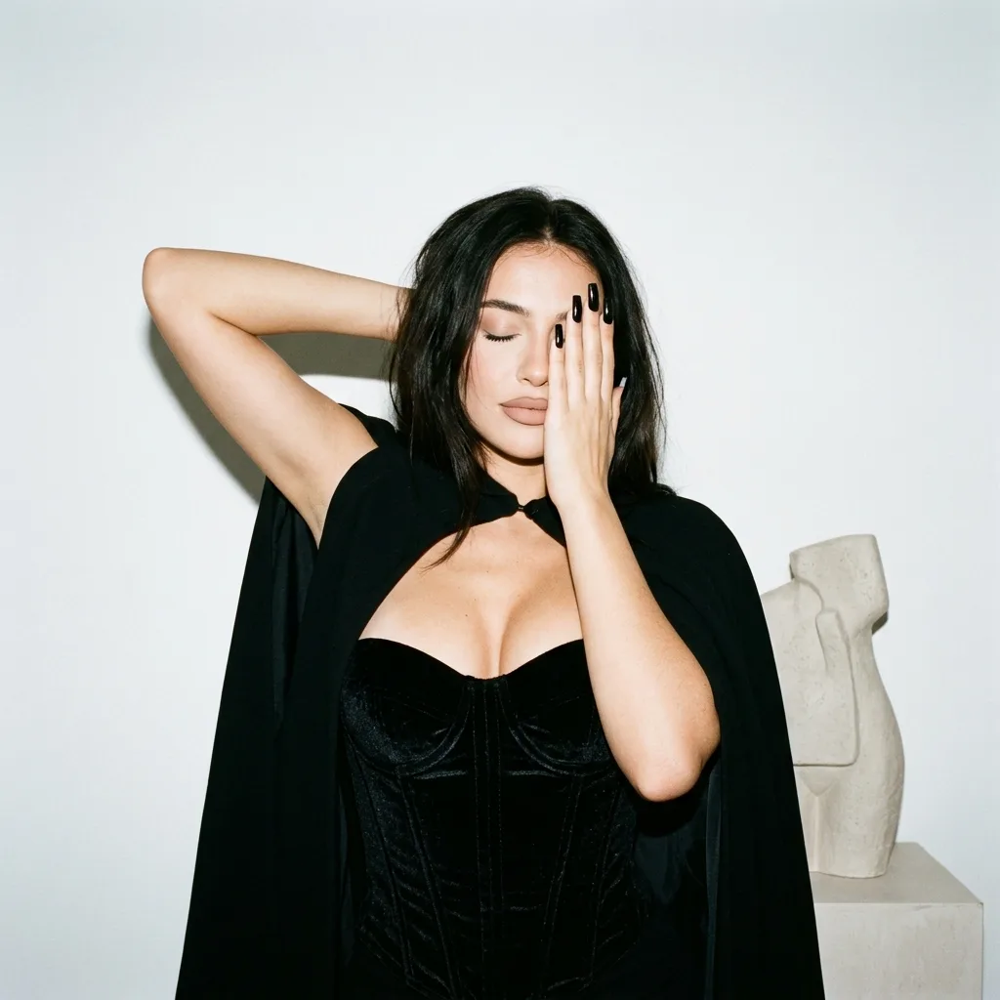

# Do not alter the sensitivity of the face

[← Back to the collection](../../README.md) · Category: [Photography](../../gallery/photography.md) · Model: `Vinano Image v2` · ID: `vn-00621`

<a href="https://vinano.ai?utm_source=github&utm_medium=readme&utm_campaign=awesome-image-video-prompts-updating&utm_content=prompt-page-image"></a>

<sub>Preview generated with <a href="https://vinano.ai?utm_source=github&utm_medium=readme&utm_campaign=awesome-image-video-prompts-updating&utm_content=prompt-page-caption">vinano.ai</a></sub>

## Prompt

```text
{
 "image_style": {
 "type": "true-to-life photorealistic",
 "aesthetic": "Instagram shot",
 "effects": ["film grain",
 "direct flash"]
 },
 "composition": {
 "framing": "waist-up photograph",
 "aspect_ratio": "9:16"
 },
 "subject": {
 "description": "young woman",
 "constraint_note": "do not alter the sensitivity of the face and features",
 "pose": {
 "orientation": "facing the camera directly",
 "head": "tilted slightly to the side",
 "eyes": "closed",
 "action": "covering her face her hand, pulling her elbow away and lifting it to the side",
 "mood": ["elegant",
 "pensive",
 "playful"]
 },
 "appearance": {
 "attire": ["black velvet corset",
 "expensive black cape"],
 "hair": "loose",
 "makeup": {
 "style": "nude",
 "lipstick": "matte nude"
 },
 "details": ["décolletage highlighted",
 "long, square black nails"]
 }
 },
 "setting": {
 "background": "white wall",
 "foreground_elements": "art object placed in front of the wall"
 }
}

Maintain consistent colour harmony and crisp focus across the whole frame.
```

## Try it on vinano.ai

1. Copy the prompt above.
2. Open **[vinano.ai](https://vinano.ai?utm_source=github&utm_medium=readme&utm_campaign=awesome-image-video-prompts-updating&utm_content=prompt-page-try)**, paste it into the image generator and pick a model.
3. Swap any placeholders (brand, product, city, person…) for your own details, then generate.

More prompts like this: [Photography gallery](../../gallery/photography.md) · [all categories](../../README.md#contents)
