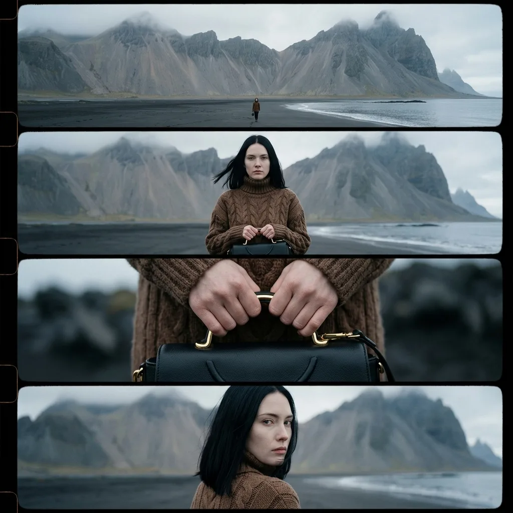

# Vertical cinematic editorial image composed of four horizontal film

[← Back to the collection](../../README.md) · Category: [Photography](../../gallery/photography.md) · Model: `Vinano Image v2` · ID: `vn-00623`

<a href="https://vinano.ai?utm_source=github&utm_medium=readme&utm_campaign=awesome-image-video-prompts-updating&utm_content=prompt-page-image"></a>

<sub>Preview generated with <a href="https://vinano.ai?utm_source=github&utm_medium=readme&utm_campaign=awesome-image-video-prompts-updating&utm_content=prompt-page-caption">vinano.ai</a></sub>

## Prompt

```text
A vertical cinematic editorial image composed of four horizontal film frames stacked vertically within a portrait (4:5) format. Cold Nordic coastline black sand beach, calm ocean water, and massive jagged gray mountains in the background covered mist and low clouds. Overcast sky, soft diffused daylight, desaturated cool tones.

Frame 1 (top):
Wide landscape shot of a lone woman walking along the shoreline, very small in frame, mountains dominating the scene, strong negative space, flat horizon.
Frame 2:
Medium frontal shot of the same woman standing still, centered. Pale skin, straight black shoulder-length hair moving slightly in wind, neutral serious expression. Wearing a brown cable-knit turtleneck sweater dress. Holding a black leather handbag.
Frame 3:
Extreme close-up of both hands gripping a structured black leather handbag a curved gold metal handle. Sleeves visible, background heavily blurred.
Frame 4 (bottom):
Over-the-shoulder portrait as she turns her head back toward the camera, sharp eyes, calm intense expression, mountains softly blurred behind.

Ultra-realistic photography, cinematic film still, editorial fashion look, natural skin texture, no glam lighting, shallow depth of field, muted Nordic color grading, realistic proportions, 35mm lens feel, cold atmosphere.

Keep edges clean and the overall composition balanced for a polished, gallery-ready result.
```

## Try it on vinano.ai

1. Copy the prompt above.
2. Open **[vinano.ai](https://vinano.ai?utm_source=github&utm_medium=readme&utm_campaign=awesome-image-video-prompts-updating&utm_content=prompt-page-try)**, paste it into the image generator and pick a model.
3. Swap any placeholders (brand, product, city, person…) for your own details, then generate.

More prompts like this: [Photography gallery](../../gallery/photography.md) · [all categories](../../README.md#contents)
