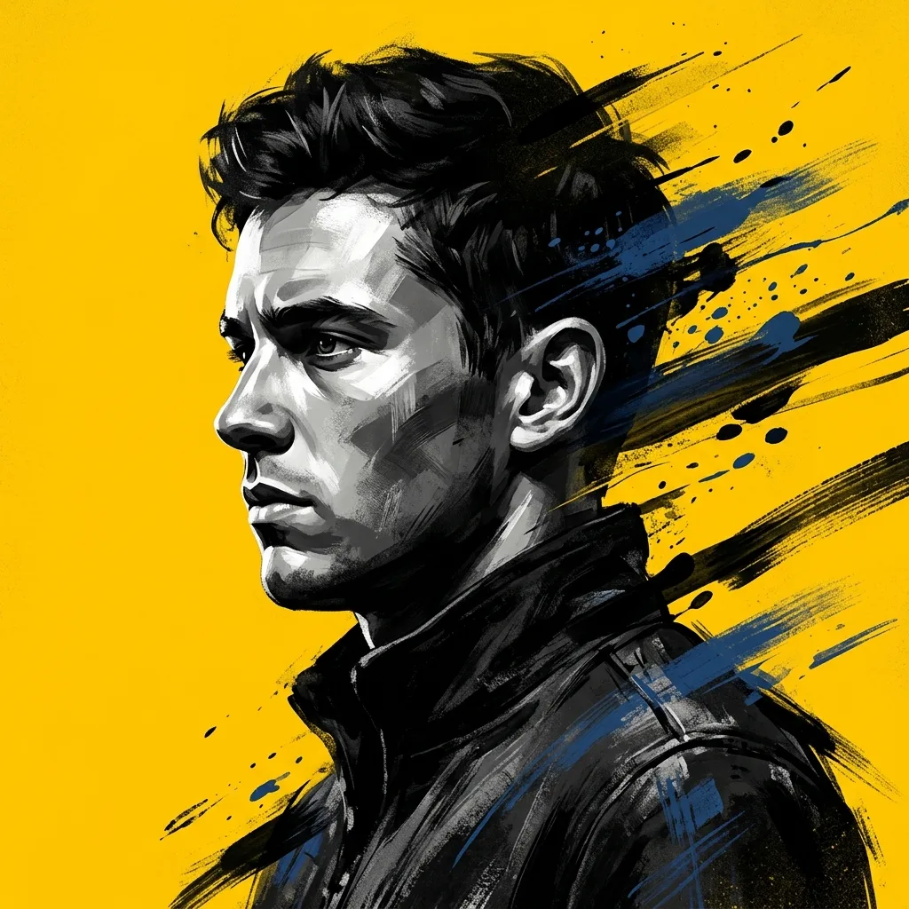

# Bold, high contrast digital portrait of a young man

[← Back to the collection](../../README.md) · Category: [Photography](../../gallery/photography.md) · Model: `Vinano Image Pro` · ID: `vn-00624`

<a href="https://vinano.ai?utm_source=github&utm_medium=readme&utm_campaign=awesome-image-video-prompts-updating&utm_content=prompt-page-image"></a>

<sub>Preview generated with <a href="https://vinano.ai?utm_source=github&utm_medium=readme&utm_campaign=awesome-image-video-prompts-updating&utm_content=prompt-page-caption">vinano.ai</a></sub>

## Prompt

```text
A bold, high contrast digital portrait of a young man in side profile, facing left. The style is expressive and painterly, dynamic brush strokes and paint splashes flowing from the head and shoulders, creating a sense of motion and energy. Strong black shadows define the face, sharp highlights for depth and drama. The background is a solid vibrant yellow, minimal and striking. Accents of deep blue and black paint strokes wrap around the subject, giving a modern street art and sports poster feel. filmic, cinematic lighting, high detail, gritty texture, confident and focused expression, contemporary illustration style, ultra sharp, poster quality. Maintain consistent colour harmony and crisp focus across the whole frame.
```

## Try it on vinano.ai

1. Copy the prompt above.
2. Open **[vinano.ai](https://vinano.ai?utm_source=github&utm_medium=readme&utm_campaign=awesome-image-video-prompts-updating&utm_content=prompt-page-try)**, paste it into the image generator and pick a model.
3. Swap any placeholders (brand, product, city, person…) for your own details, then generate.

More prompts like this: [Photography gallery](../../gallery/photography.md) · [all categories](../../README.md#contents)
