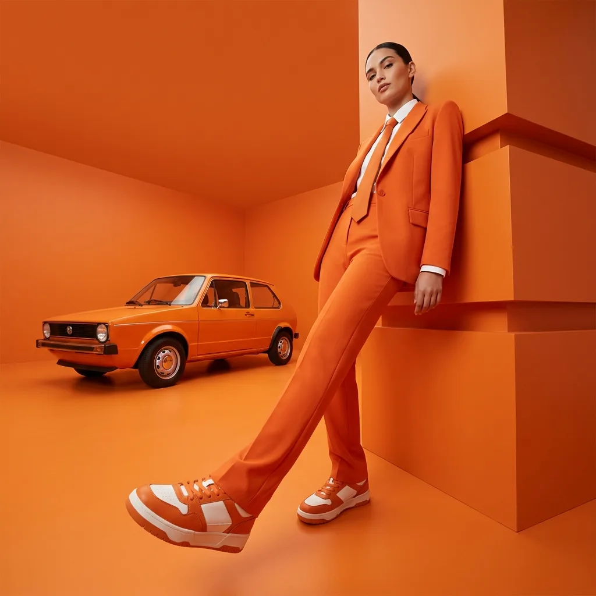

# High-fashion editorial photography of a woman the uploaded face

[← Back to the collection](../../README.md) · Category: [Photography](../../gallery/photography.md) · Model: `Vinano Image v2` · ID: `vn-00631`

<a href="https://vinano.ai?utm_source=github&utm_medium=readme&utm_campaign=awesome-image-video-prompts-updating&utm_content=prompt-page-image"></a>

<sub>Preview generated with <a href="https://vinano.ai?utm_source=github&utm_medium=readme&utm_campaign=awesome-image-video-prompts-updating&utm_content=prompt-page-caption">vinano.ai</a></sub>

## Prompt

```text
High-fashion editorial photography of a woman the uploaded face as reference, leaning casually against a geometric orange wall her right leg extended forward. She wears a tailored bright orange suit, matching tie, crisp white shirt, and chunky orange sneakers. Her styling is sleek and confident, a modern, polished look. The environment is a surreal, refined minimalist room seamless orange surfaces, featuring a vintage orange hatchback parked mid-ground left. Captured from a low-angle a 24mm wide-angle lens for strong forced perspective, emphasizing the foreground sneaker a deep depth of field. Soft, diffused studio lighting casts clean shadows, enhancing the vibrant, highly saturated monochromatic orange palette sharp white accents, contrasting matte suit fabrics against smooth leather shoes and the glossy finish of the car. Maintain consistent colour harmony and crisp focus across the whole frame.
```

## Try it on vinano.ai

1. Copy the prompt above.
2. Open **[vinano.ai](https://vinano.ai?utm_source=github&utm_medium=readme&utm_campaign=awesome-image-video-prompts-updating&utm_content=prompt-page-try)**, paste it into the image generator and pick a model.
3. Swap any placeholders (brand, product, city, person…) for your own details, then generate.

More prompts like this: [Photography gallery](../../gallery/photography.md) · [all categories](../../README.md#contents)
