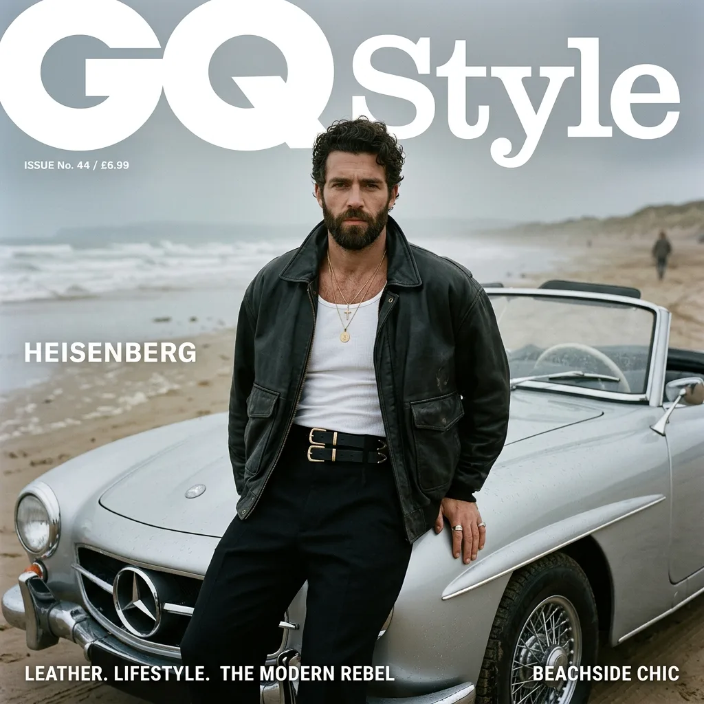

# Fashion editorial portrait of male model for a GQ

[← Back to the collection](../../README.md) · Category: [Photography](../../gallery/photography.md) · Model: `Vinano Image Pro` · ID: `vn-00634`

<a href="https://vinano.ai?utm_source=github&utm_medium=readme&utm_campaign=awesome-image-video-prompts-updating&utm_content=prompt-page-image"></a>

<sub>Preview generated with <a href="https://vinano.ai?utm_source=github&utm_medium=readme&utm_campaign=awesome-image-video-prompts-updating&utm_content=prompt-page-caption">vinano.ai</a></sub>

## Prompt

```text
A cinematic fashion editorial portrait of male model for a GQ Style magazine cover. He is leaning against the hood of a vintage 1960s silver convertible on a hazy, overcast beach.

Subject & Pose: A male model a well-groomed dark beard and messy, curly dark hair. He is looking directly at the camera an intense, neutral expression. He is wearing a heavy, oversized black leather bomber jacket large utility pockets, worn open over a white ribbed tank top and high-waisted black trousers double-buckle belt detailing. Two thin gold necklaces small pendants hang mid-chest.

Setting & Composition: Outdoor beach setting a very shallow depth of field. The background shows a desaturated, sandy shore and a pale, misty sky a soft horizon line. The car is a polished metallic silver, reflecting the flat light of the sky. The camera angle is at eye-level, framing the subject from the waist up.

Lighting & Color: Soft, diffused daylight a moody, cinematic color grade. The palette is dominated by muted earth tones, blacks, and silvers. High-end film grain is visible throughout.

Typography (Overlay): Large, bold white "GQ Style" logo across the top in a classic serif font. Smaller white sans-serif text on the mid-left reads "HEISENBERG"

Preserve realistic proportions and depth for a confident, professional finish.
```

## Try it on vinano.ai

1. Copy the prompt above.
2. Open **[vinano.ai](https://vinano.ai?utm_source=github&utm_medium=readme&utm_campaign=awesome-image-video-prompts-updating&utm_content=prompt-page-try)**, paste it into the image generator and pick a model.
3. Swap any placeholders (brand, product, city, person…) for your own details, then generate.

More prompts like this: [Photography gallery](../../gallery/photography.md) · [all categories](../../README.md#contents)
