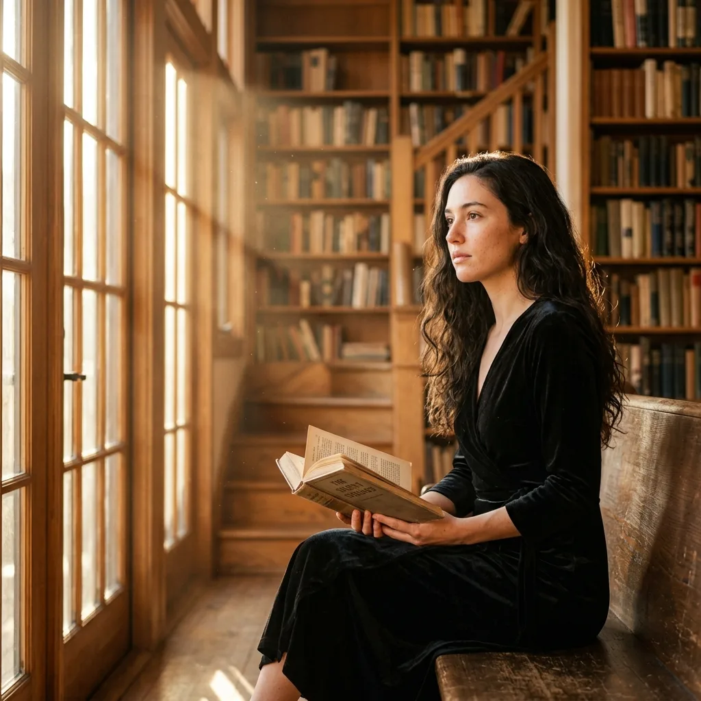

# Seated sideways on a bench, holding an open book

[← Back to the collection](../../README.md) · Category: [Photography](../../gallery/photography.md) · Model: `Vinano Image Pro` · ID: `vn-00637`

<a href="https://vinano.ai?utm_source=github&utm_medium=readme&utm_campaign=awesome-image-video-prompts-updating&utm_content=prompt-page-image"></a>

<sub>Preview generated with <a href="https://vinano.ai?utm_source=github&utm_medium=readme&utm_campaign=awesome-image-video-prompts-updating&utm_content=prompt-page-caption">vinano.ai</a></sub>

## Prompt

```text
{
 "style": "cinematic realism, high-end editorial photography",
 "subject": {
 "type": "woman",
 "age_range": "mid-20s",
 "pose": "seated sideways on a bench, holding an open book, head turned slightly off-camera",
 "expression": "calm, reflective, distant gaze",
 "wardrobe": "deep black velvet wrap dress, soft texture, natural styling",
 "hair": "long, dark, loose waves, natural volume",
 "makeup": "minimal, realistic skin texture, no plastic smoothing"
 },
 "environment": {
 "location": "sunlit library loft",
 "details": "tall glass windows, wooden shelves filled books, warm interior tones, dust particles visible in air",
 "time_of_day": "golden hour",
 "atmosphere": "quiet, intimate, intellectual"
 },
 "lighting": {
 "type": "strong golden hour backlight",
 "direction": "side-back window light",
 "effects": "natural lens flare, light streaks across frame, soft bloom on highlights, volumetric rays",
 "contrast": "medium-high warm highlights and soft shadow falloff"
 },
 "camera": {
 "shot_type": "medium portrait",
 "angle": "slightly low eye-level",
 "lens": "85mm full-frame",
 "aperture": "f1.8",
 "depth_of_field": "shallow, subject sharp, background creamy blur",
 "focus": "eyes and face plane"
 },
 "color_grading": {
 "palette": "warm amber and honey tones soft neutral shadows",
 "look": "film-like, subtle grain, cinematic dynamic range"
 },
 "composition": {
 "framing": "rule of thirds, subject right-weighted",
 "foreground": "soft blurred flare and book edge",
 "background": "window grid lines and shelves as leading lines",
 "motion": "still subject, drifting light particles"
 },
 "quality": {
 "resolution": "8k",
 "texture": "natural skin detail, realistic fabric texture",
 "rendering": "true-to-life photorealistic, no over-sharpening, no CGI gloss"
 }
}

Maintain consistent colour harmony and crisp focus across the whole frame.
```

## Try it on vinano.ai

1. Copy the prompt above.
2. Open **[vinano.ai](https://vinano.ai?utm_source=github&utm_medium=readme&utm_campaign=awesome-image-video-prompts-updating&utm_content=prompt-page-try)**, paste it into the image generator and pick a model.
3. Swap any placeholders (brand, product, city, person…) for your own details, then generate.

More prompts like this: [Photography gallery](../../gallery/photography.md) · [all categories](../../README.md#contents)
