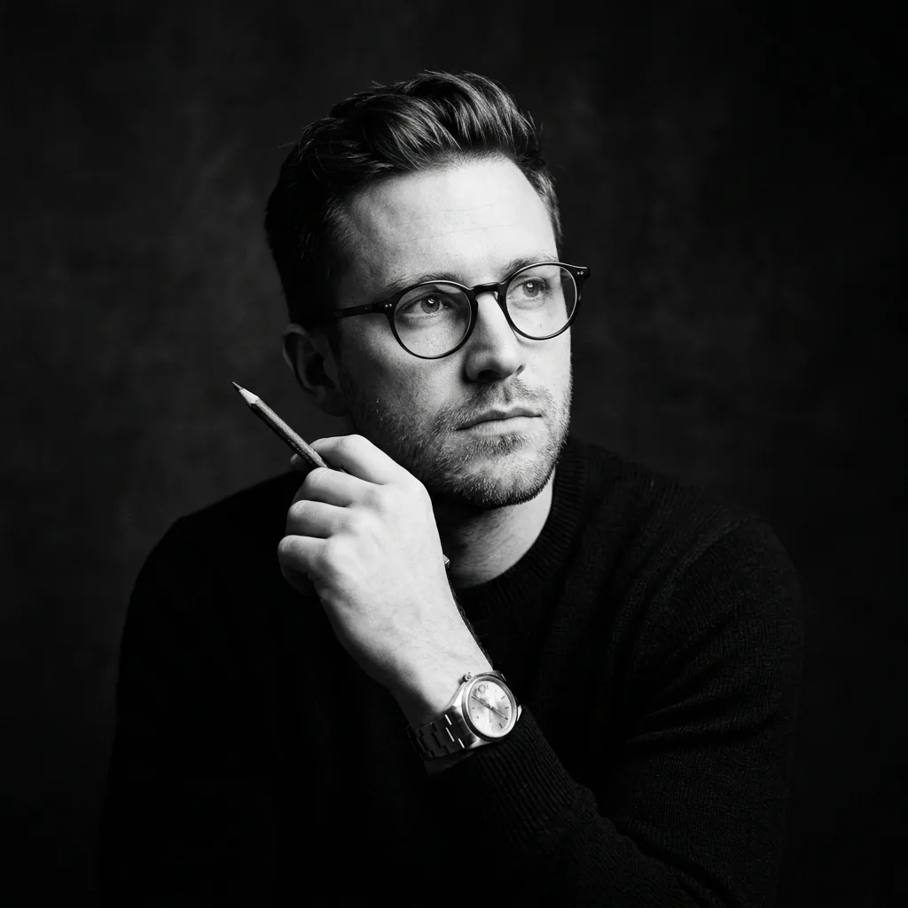

# Dramatic black and white studio portrait of a thoughtful

[← Back to the collection](../../README.md) · Category: [Photography](../../gallery/photography.md) · Model: `Vinano Image v2` · ID: `vn-00640`

<a href="https://vinano.ai?utm_source=github&utm_medium=readme&utm_campaign=awesome-image-video-prompts-updating&utm_content=prompt-page-image"></a>

<sub>Preview generated with <a href="https://vinano.ai?utm_source=github&utm_medium=readme&utm_campaign=awesome-image-video-prompts-updating&utm_content=prompt-page-caption">vinano.ai</a></sub>

## Prompt

```text
A dramatic black and white studio portrait of a thoughtful man short styled hair, light stubble beard, and round eyeglasses, wearing a simple black sweater and a metal wristwatch, holding a pencil near his face, looking slightly upward and to the side, soft Rembrandt lighting from the left, deep shadows, high contrast, dark background, shallow depth of field, cinematic mood, ultra detailed, sharp focus, 85mm lens, f/1.8, professional photography, editorial portrait, minimalistic, moody, fine art photography Preserve realistic proportions and depth for a confident, professional finish.
```

## Try it on vinano.ai

1. Copy the prompt above.
2. Open **[vinano.ai](https://vinano.ai?utm_source=github&utm_medium=readme&utm_campaign=awesome-image-video-prompts-updating&utm_content=prompt-page-try)**, paste it into the image generator and pick a model.
3. Swap any placeholders (brand, product, city, person…) for your own details, then generate.

More prompts like this: [Photography gallery](../../gallery/photography.md) · [all categories](../../README.md#contents)
