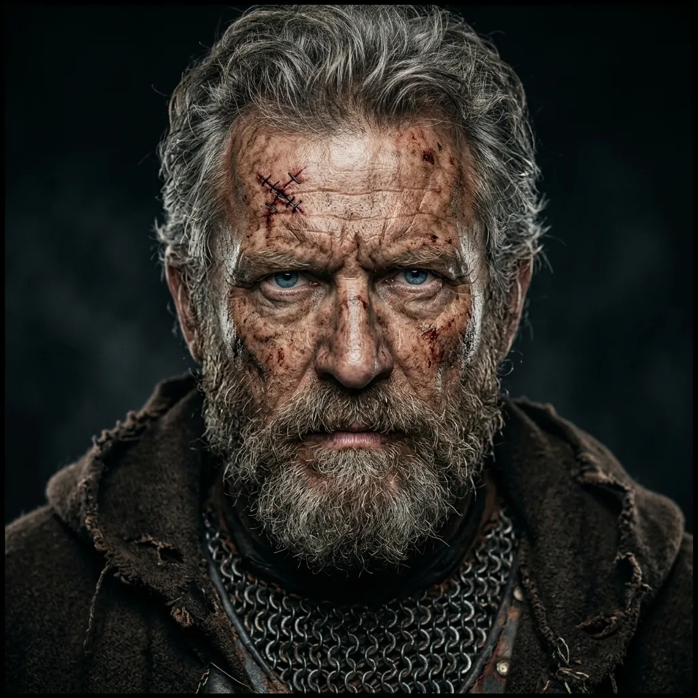

# Close-up portrait of a battle-hardened, elderly medieval warrior, facing

[← Back to the collection](../../README.md) · Category: [Photography](../../gallery/photography.md) · Model: `Vinano Image Pro` · ID: `vn-00642`

<a href="https://vinano.ai?utm_source=github&utm_medium=readme&utm_campaign=awesome-image-video-prompts-updating&utm_content=prompt-page-image"></a>

<sub>Preview generated with <a href="https://vinano.ai?utm_source=github&utm_medium=readme&utm_campaign=awesome-image-video-prompts-updating&utm_content=prompt-page-caption">vinano.ai</a></sub>

## Prompt

```text
A hyper-realistic, cinematic close-up portrait of a battle-hardened, elderly medieval warrior, facing slightly downward but locking eyes the camera through piercing, cold steel-blue eyes full of intensity and defiance. His weathered, deeply wrinkled, sun-damaged skin shows countless scars, cuts, and dried blood stains, including a fresh stitched wound in an X shape on his forehead. His thick, unruly, salt-and-pepper beard and mustache frame his square, rugged jawline; his short, coarse grey hair is matted sweat and dirt. Every pore, wrinkle, and skin imperfection is rendered extreme detail. His nose is strong and slightly crooked, ears scarred and weathered from countless battles. His expression is stern, menacing, full of wisdom and pain, furrowed brows and tightly compressed lips. His body is wrapped in a distressed, heavy brown wool cloak frayed edges, partially covering dark medieval chainmail armor metallic textures

reflecting subtle highlights. The background is dark and moody, pure black a soft atmospheric haze to isolate the subject. Cinematic studio

lighting: single soft key light from the upper camera-left casting dramatic shadows across the face, subtle fill light from below to slightly illuminate the lower facial structure, creating extreme contrast and depth. Slight rim light touches the shoulders and beard edges for separation. Shot a Canon EOS R5 + RF 85mm f/1.2 lens at f/1.2 for ultra-shallow depth of field, sharp razor focus only on the eyes, soft fall-off on beard and shoulders. ISO 100, shutter speed 1/250s.

Color palette: desaturated earth tones, deep browns, muted greys, blood reds, steel blacks. Cinematic color grading: teal and orange tones balanced for dramatic mood, heavy filmic shadows, subtle fine-grain texture for realism. The image feels raw, emotional, like a poster frame from an epic dark fantasy film. --ar 3:4 --v 6.1 --style raw-quality 2 --stylize 50

Keep edges clean and the overall composition balanced for a polished, gallery-ready result.
```

## Try it on vinano.ai

1. Copy the prompt above.
2. Open **[vinano.ai](https://vinano.ai?utm_source=github&utm_medium=readme&utm_campaign=awesome-image-video-prompts-updating&utm_content=prompt-page-try)**, paste it into the image generator and pick a model.
3. Swap any placeholders (brand, product, city, person…) for your own details, then generate.

More prompts like this: [Photography gallery](../../gallery/photography.md) · [all categories](../../README.md#contents)
