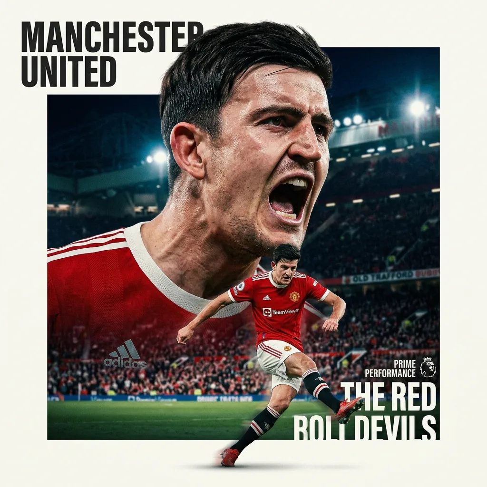

# Football poster elite Premier League key featuring me intense

[← Back to the collection](../../README.md) · Category: [Photography](../../gallery/photography.md) · Model: `Vinano Image Pro` · ID: `vn-00644`

<a href="https://vinano.ai?utm_source=github&utm_medium=readme&utm_campaign=awesome-image-video-prompts-updating&utm_content=prompt-page-image"></a>

<sub>Preview generated with <a href="https://vinano.ai?utm_source=github&utm_medium=readme&utm_campaign=awesome-image-video-prompts-updating&utm_content=prompt-page-caption">vinano.ai</a></sub>

## Prompt

```text
Ultra-realistic cinematic football poster elite Premier League key featuring me intense competitive energy, a dramatic dual-composition layout where a large ultra-detailed hero close-up of the player's face appears in
the background mouth open in a powerful shout, veins slightly visible,
sweat on skin, realistic pores and sharp facial definition, keare slightly turned
and syres focused forward aggressive determination, while in the
foreground the same player appears full body in dynamic football action
such as striking the ball, sprinting or preparing a pass, athletic posture,
natural movement, realistic muscle tension and subtle motion blur on the limbs,
both portraits matching perfectly in identity, face and proportions. The player's
uniComi must be of manchester united, respecting the exact style palette, thop-
edities, elements and posture hyper-realistic football kit texture.

Aim for an editorial, design-driven look with deliberate negative space.
```

## Try it on vinano.ai

1. Copy the prompt above.
2. Open **[vinano.ai](https://vinano.ai?utm_source=github&utm_medium=readme&utm_campaign=awesome-image-video-prompts-updating&utm_content=prompt-page-try)**, paste it into the image generator and pick a model.
3. Swap any placeholders (brand, product, city, person…) for your own details, then generate.

More prompts like this: [Photography gallery](../../gallery/photography.md) · [all categories](../../README.md#contents)
