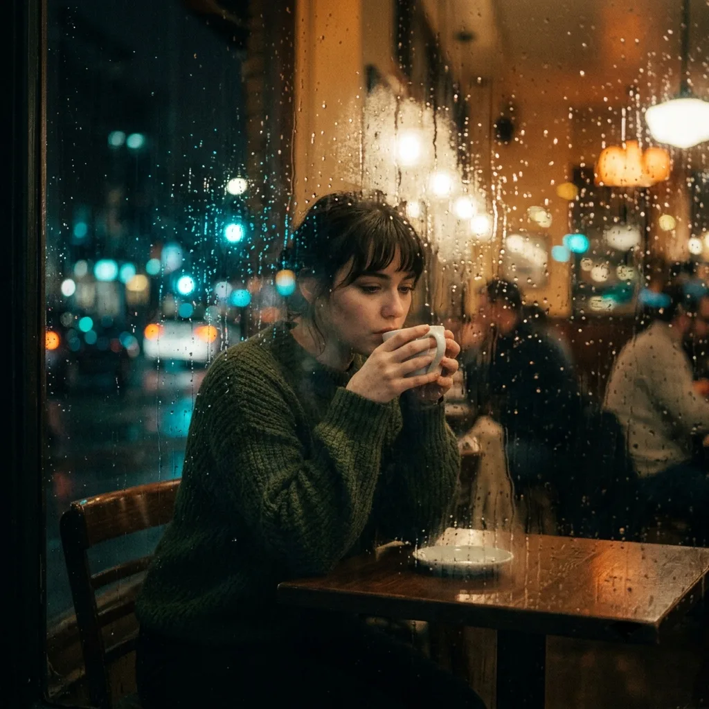

# Moody photograph of a young woman sitting inside

[← Back to the collection](../../README.md) · Category: [Photography](../../gallery/photography.md) · Model: `Vinano Image v2` · ID: `vn-00646`

<a href="https://vinano.ai?utm_source=github&utm_medium=readme&utm_campaign=awesome-image-video-prompts-updating&utm_content=prompt-page-image"></a>

<sub>Preview generated with <a href="https://vinano.ai?utm_source=github&utm_medium=readme&utm_campaign=awesome-image-video-prompts-updating&utm_content=prompt-page-caption">vinano.ai</a></sub>

## Prompt

```text
A cinematic, moody photograph of a young woman sitting inside a café at night, seen through a rain-covered window. Raindrops and condensation blur the glass, creating a dreamy, nostalgic atmosphere. She has soft features, dark hair bangs, and is holding a small white ceramic mug close to her face, sipping a warm drink. Warm interior light contrasts cool teal and blue city lights outside. Shallow depth of field, soft focus, film grain, muted colors, melancholic mood, intimate composition, reflective glass, bokeh lights in the background, realistic photography, 35mm film look, low light, cinematic color grading. Keep edges clean and the overall composition balanced for a polished, gallery-ready result.
```

## Try it on vinano.ai

1. Copy the prompt above.
2. Open **[vinano.ai](https://vinano.ai?utm_source=github&utm_medium=readme&utm_campaign=awesome-image-video-prompts-updating&utm_content=prompt-page-try)**, paste it into the image generator and pick a model.
3. Swap any placeholders (brand, product, city, person…) for your own details, then generate.

More prompts like this: [Photography gallery](../../gallery/photography.md) · [all categories](../../README.md#contents)
