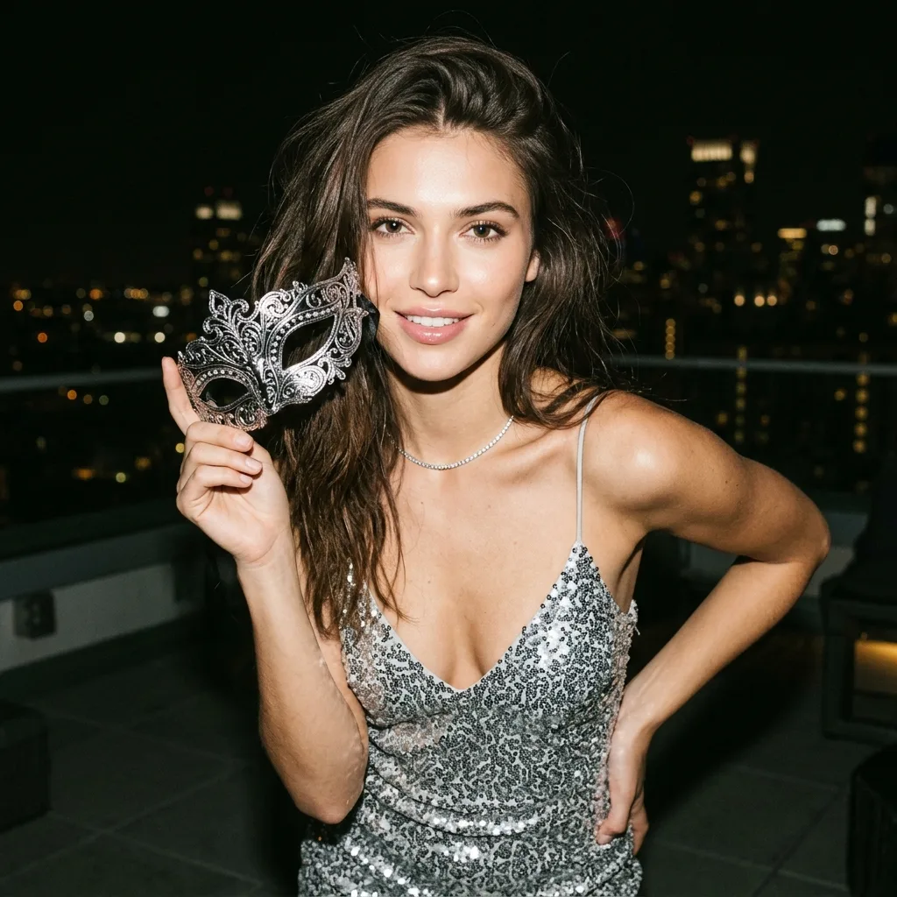

# Exceptionally beautiful young woman, early 20s, magnetic screen presence

[← Back to the collection](../../README.md) · Category: [Photography](../../gallery/photography.md) · Model: `Vinano Image v2` · ID: `vn-00648`

<a href="https://vinano.ai?utm_source=github&utm_medium=readme&utm_campaign=awesome-image-video-prompts-updating&utm_content=prompt-page-image"></a>

<sub>Preview generated with <a href="https://vinano.ai?utm_source=github&utm_medium=readme&utm_campaign=awesome-image-video-prompts-updating&utm_content=prompt-page-caption">vinano.ai</a></sub>

## Prompt

```text
{
 "prompt_configuration": {
 "type": "Ultra true-to-life photorealistic Editorial Portrait",
 "aspect_ratio": "3:4",
 "style_model": "Raw Flash Photography"
 },
 "prompt_structure": {
 "subject_description": {
 "identity": "Exceptionally beautiful young woman, early 20s, magnetic screen presence, effortless confidence.",
 "hair": "Long, thick dark brown hair soft volume, slightly tousled, framing the face and falling forward over both shoulders.",
 "face": "Striking symmetrical face, large expressive eyes intense eye contact, relaxed brows, soft glossy lips slightly parted, natural confident smile.",
 "pose": "Standing very close to the camera a subtle forward lean from the waist. Shoulders gently rolled back and chest naturally lifted. Chin slightly lowered while eyes look straight into the lens for strong intimacy. Right hand raised near cheek level, clearly holding an ornate Venetian masquerade mask angled outward and fully visible. Left hand resting at the hip to accentuate curves."
 },
 "attire_and_accessories": {
 "outfit": "Silver sequin dress thin straps and a deep, elegant neckline that naturally frames cleavage without exaggeration. Fabric catches flash light intense sparkle.",
 "accessories": ["Ornate silver-and-black Venetian masquerade mask detailed filigree, held in the right hand.",
 "Minimal diamond necklace sitting just above the neckline."]
 },
 "environment_and_atmosphere": {
 "setting": "Luxury rooftop or balcony at night.",
 "background": "Very dark, softly blurred city lights no distractions.",
 "lighting": "Direct flash placed slightly above eye level, sculpting the eyes, cheekbones, collarbones, neckline, and mask crisp highlights and clean shadows."
 },
 "technical_specifications": {
 "image_quality": "8K UHD, ultra-true-to-life photorealistic, raw fashion photography.",
 "camera_style": "35mm editorial lens, paparazzi flash aesthetic, cinematic realism.",
 "focus": "Tack-sharp focus on eyes and mask, shallow depth of field.",
 "texture": "Natural skin texture realistic pores, high-detail sequin reflections, sharply defined mask details, natural hair strands."
 }
 }
}

Keep edges clean and the overall composition balanced for a polished, gallery-ready result.
```

## Try it on vinano.ai

1. Copy the prompt above.
2. Open **[vinano.ai](https://vinano.ai?utm_source=github&utm_medium=readme&utm_campaign=awesome-image-video-prompts-updating&utm_content=prompt-page-try)**, paste it into the image generator and pick a model.
3. Swap any placeholders (brand, product, city, person…) for your own details, then generate.

More prompts like this: [Photography gallery](../../gallery/photography.md) · [all categories](../../README.md#contents)
