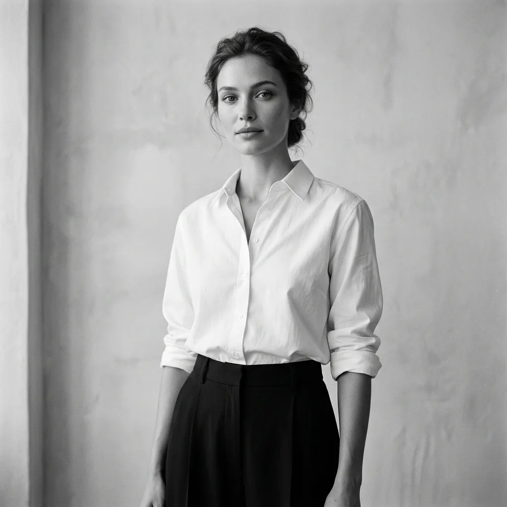

# Use the uploaded reference image STRICTLY to preserve

[← Back to the collection](../../README.md) · Category: [Photography](../../gallery/photography.md) · Model: `Vinano Image Pro` · ID: `vn-00652`

<a href="https://vinano.ai?utm_source=github&utm_medium=readme&utm_campaign=awesome-image-video-prompts-updating&utm_content=prompt-page-image"></a>

<sub>Preview generated with <a href="https://vinano.ai?utm_source=github&utm_medium=readme&utm_campaign=awesome-image-video-prompts-updating&utm_content=prompt-page-caption">vinano.ai</a></sub>

## Prompt

```text
{
 "prompt": "Use the uploaded reference image STRICTLY to preserve the same woman’s face, identity, facial structure, proportions, and natural expression 100% accuracy. No facial alteration, beautification, or identity change.\n\nCreate an ultra-realistic black-and-white soft editorial fashion portrait of an elegant woman in a refined minimalist setting. The composition feels intimate, calm, and timeless, inspired by classic Vogue and Harper’s Bazaar monochrome editorials.\n\nPose & Expression:\nShe stands or leans gently against a neutral textured wall, body slightly angled. Posture is relaxed yet poised. Her expression is serene, introspective, and confident — soft eyes, relaxed lips, no exaggerated emotion. She may gaze slightly away from the camera or directly into the lens quiet intensity.\n\nOutfit & Styling:\nShe wears a refined, minimal outfit — a softly tailored white or ivory shirt/blouse clean lines, paired elegant neutral trousers or a flowing skirt. Fabric textures remain visible and natural, emphasizing realism. No logos, no loud fashion statements — pure quiet luxury.\n\nHair & Makeup:\nHair is styled naturally — loose soft waves, a low bun, or a simple pulled-back look realistic texture. Makeup is minimal editorial: natural skin, subtle highlights, light contour, soft lashes, and neutral lips. No glamour, no heavy styling.\n\nLighting & Mood:\nSoft directional lighting creates gentle highlights and smooth shadows across the face and clothing. Contrast is controlled and elegant, preserving fine skin texture and fabric detail. Lighting feels organic, editorial, and emotionally calm.\n\nBlack & White Treatment:\nClassic monochrome grading rich blacks, soft whites, and smooth mid-tones. Film-inspired tonal range subtle grain for authenticity. No harsh contrast, no crushed shadows.\n\nVisual Style:\nHigh-end fashion editorial photography, timeless black-and-white aesthetic, understated luxury, emotional softness, and artistic restraint.\n\nCamera & Quality:\nProfessional editorial photography, shallow depth of field, cinematic framing, ultra-realistic 8K resolution, sharp subject focus soft background separation.\n\nOverall Feel:\nQuiet confidence, feminine strength, timeless elegance — a refined black-and-white editorial portrait.",

 "style": "black-and-white soft editorial, cinematic realism",
 "lighting": "soft directional light, gentle shadows",
 "color_grade": "classic monochrome, film-inspired tones",
 "background": "minimal neutral textured wall",
 "quality": "ultra-realistic, 8K, editorial detail",
 "camera": "professional fashion photography, shallow depth of field",
 "mood": "calm, timeless, elegant, introspective"
}

Maintain consistent colour harmony and crisp focus across the whole frame.
```

## Try it on vinano.ai

1. Copy the prompt above.
2. Open **[vinano.ai](https://vinano.ai?utm_source=github&utm_medium=readme&utm_campaign=awesome-image-video-prompts-updating&utm_content=prompt-page-try)**, paste it into the image generator and pick a model.
3. Swap any placeholders (brand, product, city, person…) for your own details, then generate.

More prompts like this: [Photography gallery](../../gallery/photography.md) · [all categories](../../README.md#contents)
