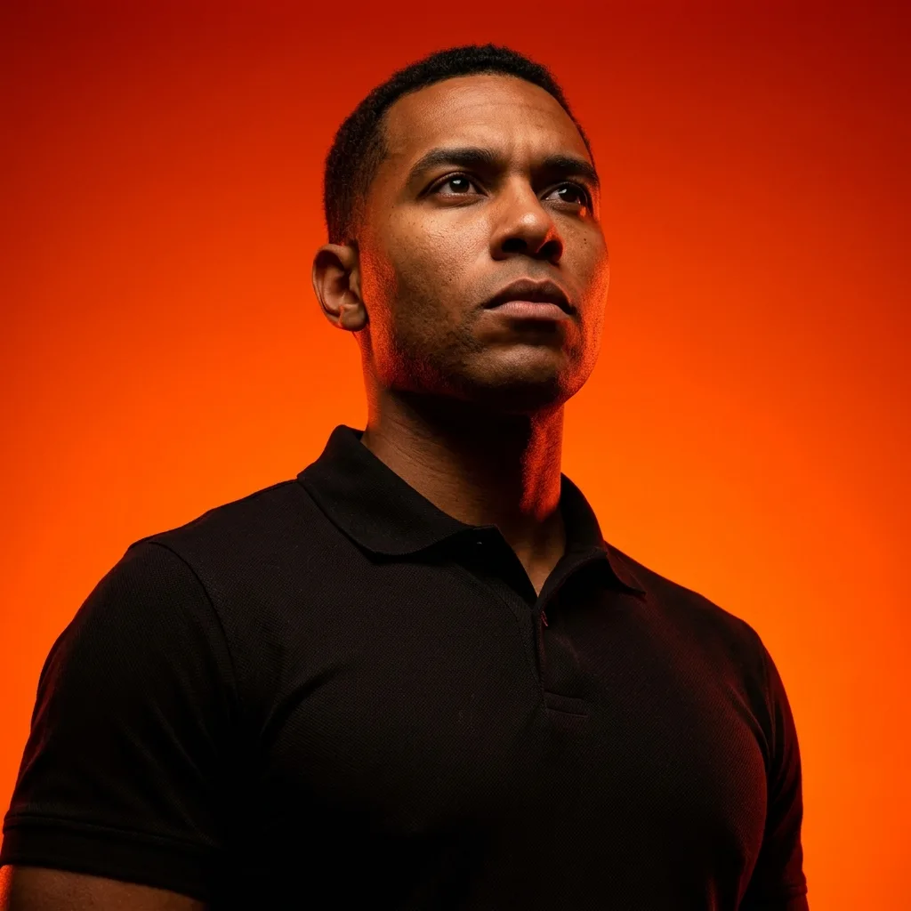

# Photography prompt #653

[← Back to the collection](../../README.md) · Category: [Photography](../../gallery/photography.md) · Model: `Vinano Image v2` · ID: `vn-00653`

<a href="https://vinano.ai?utm_source=github&utm_medium=readme&utm_campaign=awesome-image-video-prompts-updating&utm_content=prompt-page-image"></a>

<sub>Preview generated with <a href="https://vinano.ai?utm_source=github&utm_medium=readme&utm_campaign=awesome-image-video-prompts-updating&utm_content=prompt-page-caption">vinano.ai</a></sub>

## Prompt

```text
ROLE & AESTHETIC:
You are a world-class editorial portrait photographer specializing in dramatic, colorful studio lighting. Your task is to create a powerful, dynamic portrait a “heroic” feel.
IDENTITY ANCHOR (CRITICAL STRICT CONSTRAINT):
Source: Use the person from the ATTACHED REFERENCE PHOTO.
Preservation: You must keep their exact facial features, skin tone, hairstyle, and natural likeness perfectly unchanged.
Universal Application: Apply the lighting and angle to the subject regardless of gender.
WARDROBE & STYLING:
Attire: A premium Black Pique Polo Shirt
Texture: Visible cotton pique mesh texture
Fit: Fitted and sharp
Color: Deep matte black (to contrast the bright background)
Expression: Serious, intense, focused. The subject is looking off-camera into the space above, not directly at the lens.
SCENE & COMPOSITION:
Background: A vibrant, solid orange-red backdrop. It should feature smooth, intense color gradients without any patterns, creating a “hot” atmosphere.
Camera Angle (CRITICAL): Low-angle shot (looking up at the subject). This perspective should make the subject look powerful and dominant.
Framing: Medium close-up (focus on face and shoulders).
LIGHTING (DRAMATIC & COLORFUL):
Palette: Dominated by vibrant orange and deep red hues.
Key Light: Strong, directional lighting that casts deep, dramatic shadows on the face (chiaroscuro effect), emphasizing facial structure.
Rim Light: A strong, dramatic edge light (or color cast) that separates the subject’s shoulders and head from the intensely lit background.
Mood: Mysterious, intense, high-contrast studio aesthetic.
TECHNICAL QUALITY:
Style: true-to-life photorealistic, highly detailed.
Texture: Sharp focus on the face, contrasting the smooth gradients of the background.
Skin: Retain natural pores and texture.

Render with rich micro-detail while keeping the layout uncluttered and intentional.
```

## Try it on vinano.ai

1. Copy the prompt above.
2. Open **[vinano.ai](https://vinano.ai?utm_source=github&utm_medium=readme&utm_campaign=awesome-image-video-prompts-updating&utm_content=prompt-page-try)**, paste it into the image generator and pick a model.
3. Swap any placeholders (brand, product, city, person…) for your own details, then generate.

More prompts like this: [Photography gallery](../../gallery/photography.md) · [all categories](../../README.md#contents)
