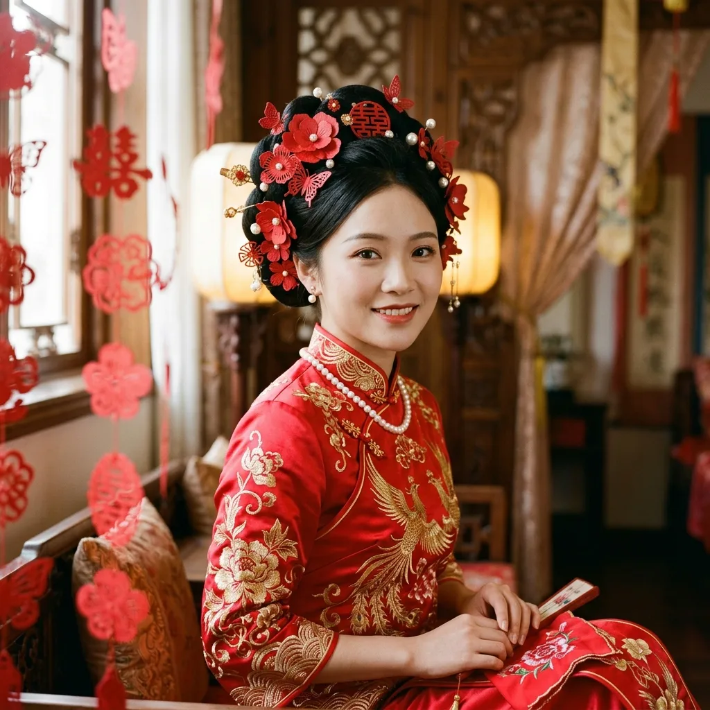

# 宏观风格与媒介 - 核心媒介

[← Back to the collection](../../README.md) · Category: [Photography](../../gallery/photography.md) · Model: `Vinano Image v2` · ID: `vn-00655`

<a href="https://vinano.ai?utm_source=github&utm_medium=readme&utm_campaign=awesome-image-video-prompts-updating&utm_content=prompt-page-image"></a>

<sub>Preview generated with <a href="https://vinano.ai?utm_source=github&utm_medium=readme&utm_campaign=awesome-image-video-prompts-updating&utm_content=prompt-page-caption">vinano.ai</a></sub>

## Prompt

```text
1. 宏观风格与媒介
- 核心媒介: Photography
- 美学流派: Traditional Chinese bridal portrait

2. 主体与IP身份
- 核心主体: Woman updo hairstyle adorned red paper-cut flowers and butterflies, wearing red traditional attire and pearl jewelry
- IP/名人锁定: None

3. 世界逻辑与物理
- 物理法则: Realistic human proportion
- 空间构成: Eye-level perspective, close-up portrait paper-cut decorative foreground

4. 数据与信息层
- 文本提取: None
- 品牌与符号: None

5. 材质与纹理
- 核心材质: Red satin cheongsam, red paper-cut ornaments, white glossy pearls, small white pearl earring
- 触感细节: Smooth satin texture, delicate paper-cut texture, glossy pearl surface

6. 光影与氛围
- 光照模型: Soft side lighting, soft shadows
- 整体氛围: Warm, elegant, traditional Chinese festive atmosphere

7. 技术参数
- 镜头与渲染: 50mm lens
- 构图指令: --ar 4:5

Emphasise material texture and natural light so the final frame feels tactile and premium.
```

## Try it on vinano.ai

1. Copy the prompt above.
2. Open **[vinano.ai](https://vinano.ai?utm_source=github&utm_medium=readme&utm_campaign=awesome-image-video-prompts-updating&utm_content=prompt-page-try)**, paste it into the image generator and pick a model.
3. Swap any placeholders (brand, product, city, person…) for your own details, then generate.

More prompts like this: [Photography gallery](../../gallery/photography.md) · [all categories](../../README.md#contents)
