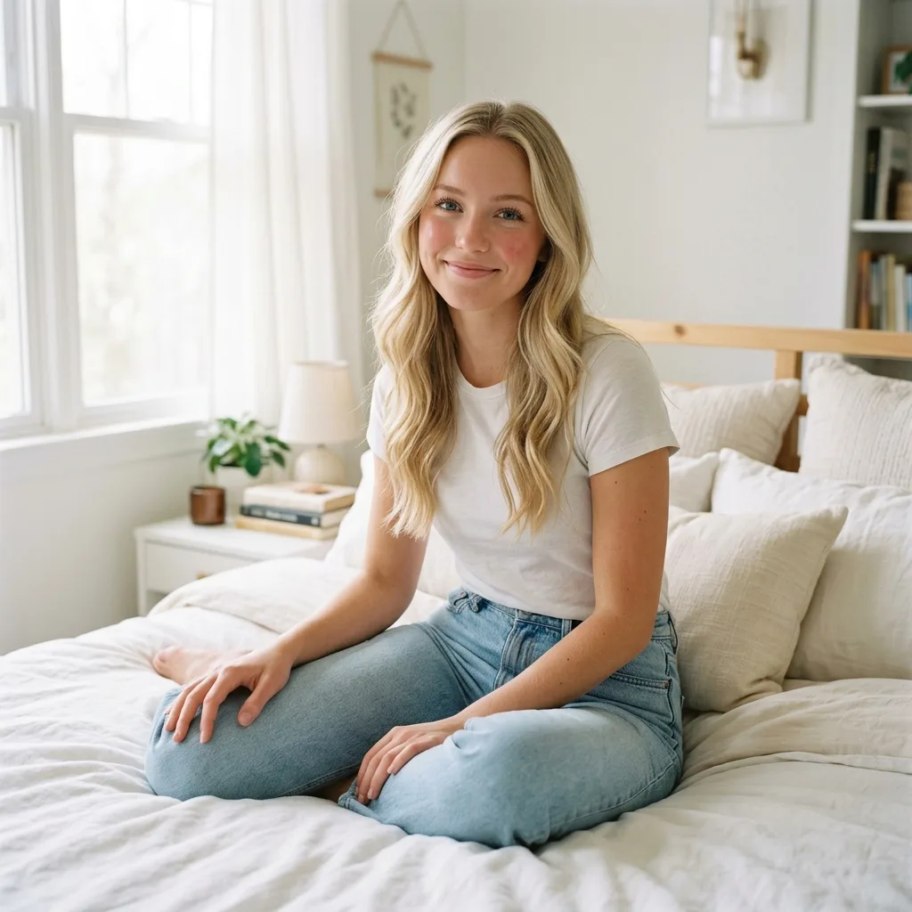

# Cute, innocent young adult blonde woman sitting comfortably

[← Back to the collection](../../README.md) · Category: [Photography](../../gallery/photography.md) · Model: `Vinano Image v2` · ID: `vn-00662`

<a href="https://vinano.ai?utm_source=github&utm_medium=readme&utm_campaign=awesome-image-video-prompts-updating&utm_content=prompt-page-image"></a>

<sub>Preview generated with <a href="https://vinano.ai?utm_source=github&utm_medium=readme&utm_campaign=awesome-image-video-prompts-updating&utm_content=prompt-page-caption">vinano.ai</a></sub>

## Prompt

```text
Cute, innocent young adult blonde woman sitting comfortably on a neatly made bed, relaxed natural posture legs gently bent, shoulders soft and at ease. Long, soft, flowing blonde hair styled in loose natural waves, silky texture, subtle shine, a few delicate strands framing her face. Clear blue eyes a gentle sparkle, long natural lashes, delicate eyebrows, smooth fair complexion a soft healthy glow, subtle blush on cheeks, light pink lips, minimal natural makeup enhancing her youthful features. Calm, sweet, peaceful expression conveying warmth and innocence.

Wearing a clean white short-sleeve cotton shirt, lightweight fabric, neatly tied at the waist natural folds and creases, paired light-wash high-waisted jeans, casual fit, realistic denim texture, visible stitching and seams, effortlessly stylish yet simple.

Bright, cozy bedroom interior filled soft natural light, white and cream color palette, minimal modern decor, neatly arranged pillows, soft linen bedsheets, light wooden bed frame and furniture, a large window nearby sheer curtains gently diffusing the sunlight. Warm morning or late-afternoon sunlight streaming in, creating soft highlights on her hair and skin, gentle shadows for depth, peaceful and intimate atmosphere, calm lifestyle mood.

true-to-life photorealistic, ultra-high detail, hyper-detailed skin texture visible natural pores and softness, realistic hair strands depth and volume, accurate fabric textures, lifelike color tones. Shot on Canon DSLR, 50mm f/1.8 lens, shallow depth of field, creamy natural bokeh background, sharp focus on eyes and face, natural lighting only, no artificial flash. Soft cinematic yet true-to-life color grading, lifestyle editorial photography style, clean balanced composition, vertical framing, realistic perspective, professional photography quality.
--ar 3:4 --stylize 250 --v 6 --q 2

Maintain consistent colour harmony and crisp focus across the whole frame.
```

## Try it on vinano.ai

1. Copy the prompt above.
2. Open **[vinano.ai](https://vinano.ai?utm_source=github&utm_medium=readme&utm_campaign=awesome-image-video-prompts-updating&utm_content=prompt-page-try)**, paste it into the image generator and pick a model.
3. Swap any placeholders (brand, product, city, person…) for your own details, then generate.

More prompts like this: [Photography gallery](../../gallery/photography.md) · [all categories](../../README.md#contents)
