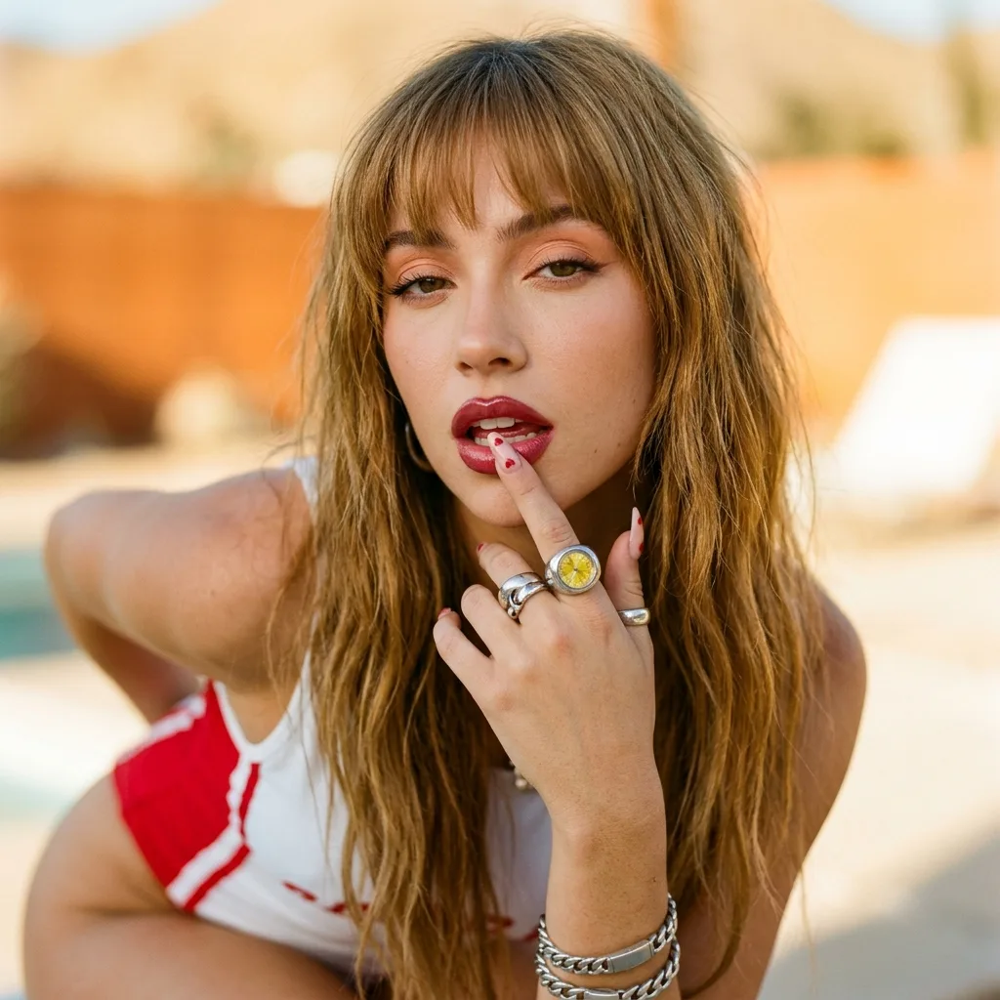

# Confident and sultry

[← Back to the collection](../../README.md) · Category: [Photography](../../gallery/photography.md) · Model: `Vinano Image v2` · ID: `vn-00668`

<a href="https://vinano.ai?utm_source=github&utm_medium=readme&utm_campaign=awesome-image-video-prompts-updating&utm_content=prompt-page-image"></a>

<sub>Preview generated with <a href="https://vinano.ai?utm_source=github&utm_medium=readme&utm_campaign=awesome-image-video-prompts-updating&utm_content=prompt-page-caption">vinano.ai</a></sub>

## Prompt

```text
{
 "image_request": {
 "style": {
 "genre": "Editorial fashion portrait",
 "aesthetic": "2000s retro-pop, Californian summer vibe",
 "mood": "Confident, sultry, youthful",
 "quality": "premium-quality, cinematic",
 "aspect_ratio": "Portrait"
 },
 "identity": {
 "face_lock": "Use the original face exactly as provided",
 "constraints": "Do not change any facial features, proportions, asymmetry, or details",
 "realism": "100% true-to-life photorealistic face preservation"
 },
 "subject": {
 "gender": "Woman",
 "expression": "Confident and sultry",
 "mouth": "Slightly open",
 "gaze": "Direct eye contact the camera"
 },
 "hair": {
 "color": "Soft golden-brown",
 "length": "Long",
 "style": "Shaggy haircut full bangs"
 },
 "pose": {
 "body_position": "Crouching forward",
 "hands": {
 "gesture": "One hand raised to the face",
 "detail": "Finger touching bottom lip"
 },
 "attitude": "Bold, self-assured"
 },
 "fashion": {
 "outfit": "White and red athletic-style bodysuit"
 },
 "makeup": {
 "eyes": "Peach eyeshadow winged eyeliner",
 "lips": "Glossy berry-red lipstick",
 "overall": "Soft, warm-toned editorial makeup"
 },
 "accessories": {
 "jewelry": "Chunky silver jewelry",
 "ring": "Large silver ring yellow watch-face detail",
 "nails": {
 "style": "Long manicured nails",
 "design": "Red heart accents"
 }
 },
 "lighting": {
 "type": "Bright, warm, high-key natural sunlight",
 "shadows": "Soft and natural"
 },
 "environment": {
 "background": "Blurred warm orange and sandy-yellow gradient",
 "suggested_location": "Outdoor desert or poolside atmosphere"
 },
 "camera": {
 "style": "35mm film photography look",
 "focus": "Sharp focus on face and hand",
 "depth_of_field": "Shallow depth of field",
 "color": "Vibrant, cinematic tones"
 },
 "final_notes": {
 "textures": "Natural skin, hair, and fabric detail",
 "editing": "No face alteration, no over-smoothing",
 "overall_feel": "High-fashion cinematic editorial portrait"
 }
 }
}

Maintain consistent colour harmony and crisp focus across the whole frame.
```

## Try it on vinano.ai

1. Copy the prompt above.
2. Open **[vinano.ai](https://vinano.ai?utm_source=github&utm_medium=readme&utm_campaign=awesome-image-video-prompts-updating&utm_content=prompt-page-try)**, paste it into the image generator and pick a model.
3. Swap any placeholders (brand, product, city, person…) for your own details, then generate.

More prompts like this: [Photography gallery](../../gallery/photography.md) · [all categories](../../README.md#contents)
