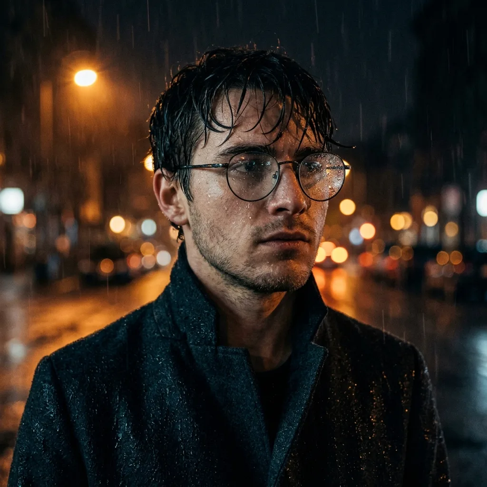

# Close-up portrait of a young man standing in heavy

[← Back to the collection](../../README.md) · Category: [Photography](../../gallery/photography.md) · Model: `Vinano Image v2` · ID: `vn-00670`

<a href="https://vinano.ai?utm_source=github&utm_medium=readme&utm_campaign=awesome-image-video-prompts-updating&utm_content=prompt-page-image"></a>

<sub>Preview generated with <a href="https://vinano.ai?utm_source=github&utm_medium=readme&utm_campaign=awesome-image-video-prompts-updating&utm_content=prompt-page-caption">vinano.ai</a></sub>

## Prompt

```text
Cinematic close-up portrait of a young man standing in heavy rain at night, wearing round metal glasses and a dark coat, wet hair falling across his forehead, light stubble beard. Raindrops clinging to his glasses and skin, dramatic moody lighting warm orange streetlight bokeh in the background, shallow depth of field, intense contemplative expression, gritty noir atmosphere, ultra-realistic, high contrast, detailed skin texture, cinematic color grading, 85mm lens, f/1.8,true-to-life photorealistic, dark urban aesthetic, film still look. Preserve realistic proportions and depth for a confident, professional finish.
```

## Try it on vinano.ai

1. Copy the prompt above.
2. Open **[vinano.ai](https://vinano.ai?utm_source=github&utm_medium=readme&utm_campaign=awesome-image-video-prompts-updating&utm_content=prompt-page-try)**, paste it into the image generator and pick a model.
3. Swap any placeholders (brand, product, city, person…) for your own details, then generate.

More prompts like this: [Photography gallery](../../gallery/photography.md) · [all categories](../../README.md#contents)
