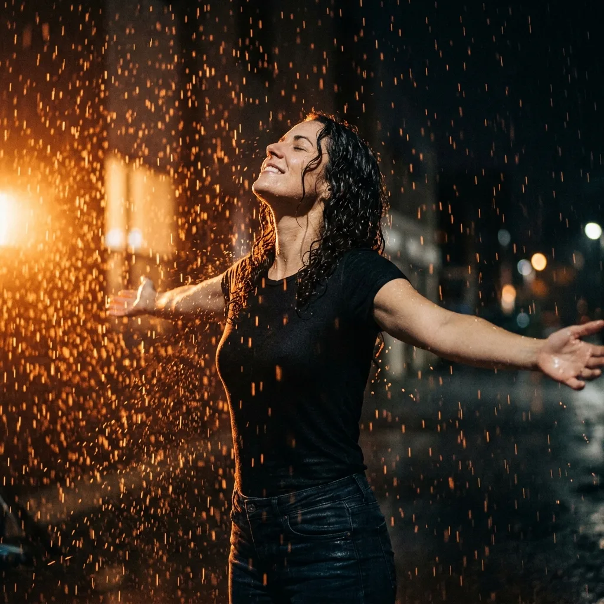

# Portrait of a 32-year-old young woman standing in heavy

[← Back to the collection](../../README.md) · Category: [Photography](../../gallery/photography.md) · Model: `Vinano Image v2` · ID: `vn-00671`

<a href="https://vinano.ai?utm_source=github&utm_medium=readme&utm_campaign=awesome-image-video-prompts-updating&utm_content=prompt-page-image"></a>

<sub>Preview generated with <a href="https://vinano.ai?utm_source=github&utm_medium=readme&utm_campaign=awesome-image-video-prompts-updating&utm_content=prompt-page-caption">vinano.ai</a></sub>

## Prompt

```text
Ultra realistic cinematic portrait of a 32-year-old young woman standing in heavy rain at night, arms open wide and face lifted toward the sky, eyes closed, feeling the rain. Dramatic warm orange backlight illuminating the falling raindrops, creating glowing rain particles around her. Wet black t-shirt tightly fitting on the body, water droplets on her skin. Strong contrast lighting a dark background, orange and golden light shining from the left side like fire or a spotlight. Emotional expression of freedom and peace, cinematic photography style, ultra-detailed, 8K resolution, shallow depth of field, professional studio lighting, rain splash effects, high-contrast shadows, dramatic atmosphere, vertical portrait composition, 85mm lens photography. Keep edges clean and the overall composition balanced for a polished, gallery-ready result.
```

## Try it on vinano.ai

1. Copy the prompt above.
2. Open **[vinano.ai](https://vinano.ai?utm_source=github&utm_medium=readme&utm_campaign=awesome-image-video-prompts-updating&utm_content=prompt-page-try)**, paste it into the image generator and pick a model.
3. Swap any placeholders (brand, product, city, person…) for your own details, then generate.

More prompts like this: [Photography gallery](../../gallery/photography.md) · [all categories](../../README.md#contents)
