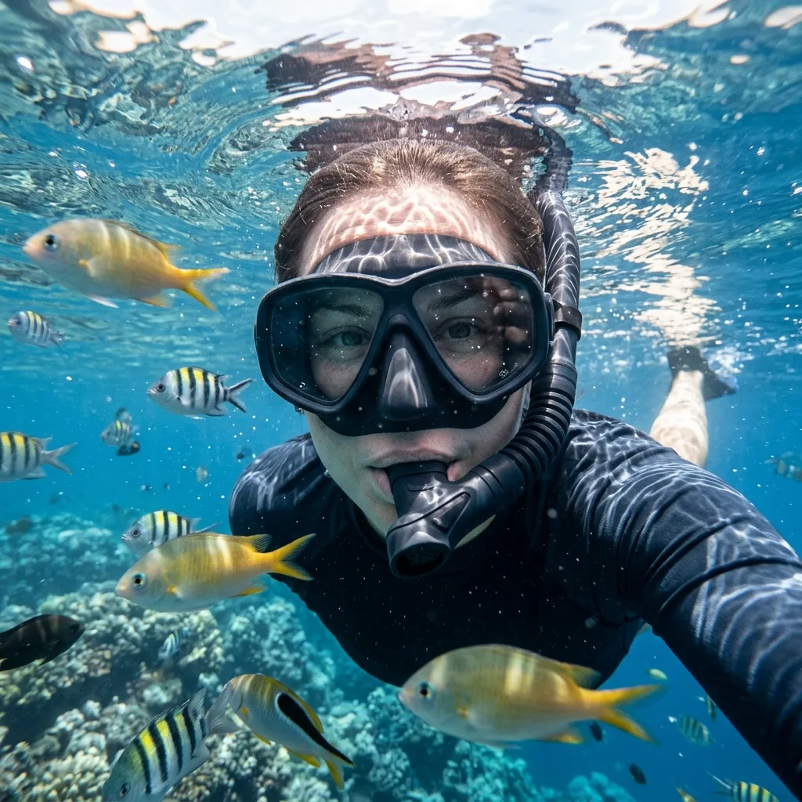

# Underwater close-range portrait captured a wide-angle action camera

[← Back to the collection](../../README.md) · Category: [Photography](../../gallery/photography.md) · Model: `Vinano Image Pro` · ID: `vn-00672`

<a href="https://vinano.ai?utm_source=github&utm_medium=readme&utm_campaign=awesome-image-video-prompts-updating&utm_content=prompt-page-image"></a>

<sub>Preview generated with <a href="https://vinano.ai?utm_source=github&utm_medium=readme&utm_campaign=awesome-image-video-prompts-updating&utm_content=prompt-page-caption">vinano.ai</a></sub>

## Prompt

```text
Create a hyper-realistic underwater close-range portrait captured a wide-angle action camera in a waterproof housing. The camera is very close to the Subject (≈0.5–1 m), positioned slightly below face level and angled upward, wide-angle distortion emphasizing depth while keeping the Subject dominant.

Mid-shot to ¾ body framing. The Subject fills most of the frame, face and upper body clearly visible. Schools of tropical fish swim closely around, some passing near the lens to create layered depth, mild motion blur on fish closest to the camera.

Natural sunlight enters from above, producing bright caustic patterns on the Subject and surrounding water, strong highlights near the surface, and soft blue gradients below. Floating water particles are visible between the camera and Subject, slight refraction distortion around mask edges and hands.

The Subject appears calm and relaxed, floating effortlessly subtle body movement suggesting buoyancy and breathing through the snorkel.

A shallow coral reef is visible below, slightly softened by depth, while nearby fish remain sharper. The water surface shimmers above gentle ripples.

Color behavior reflects natural underwater absorption: dominant blues and aquas, vibrant yellow and black fish patterns retained, and skin tones realistic a slightly cool cast.

The image should feel like a real close-distance snorkeling travel photo intimate, immersive, and authentic.

Do not alter facial structure or identity. The Subject must remain 1000% identical to the reference image.

Render with rich micro-detail while keeping the layout uncluttered and intentional.
```

## Try it on vinano.ai

1. Copy the prompt above.
2. Open **[vinano.ai](https://vinano.ai?utm_source=github&utm_medium=readme&utm_campaign=awesome-image-video-prompts-updating&utm_content=prompt-page-try)**, paste it into the image generator and pick a model.
3. Swap any placeholders (brand, product, city, person…) for your own details, then generate.

More prompts like this: [Photography gallery](../../gallery/photography.md) · [all categories](../../README.md#contents)
