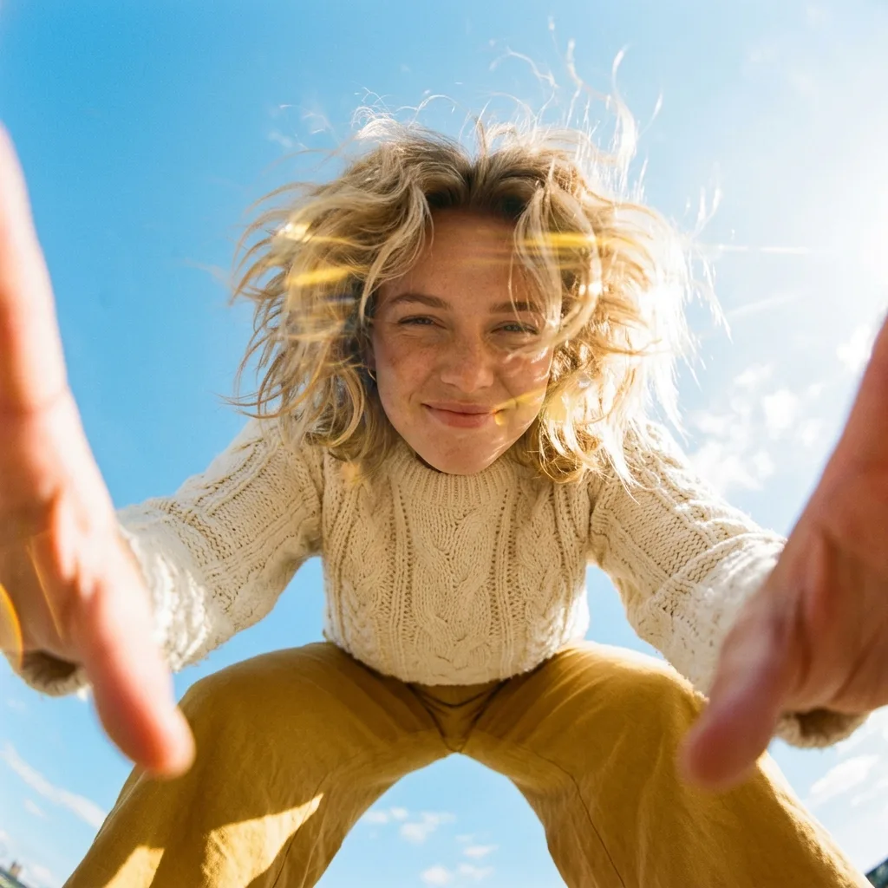

# Ultra wide-angle low-angle portrait shot from ground perspective, young

[← Back to the collection](../../README.md) · Category: [Photography](../../gallery/photography.md) · Model: `Vinano Image v2` · ID: `vn-00673`

<a href="https://vinano.ai?utm_source=github&utm_medium=readme&utm_campaign=awesome-image-video-prompts-updating&utm_content=prompt-page-image"></a>

<sub>Preview generated with <a href="https://vinano.ai?utm_source=github&utm_medium=readme&utm_campaign=awesome-image-video-prompts-updating&utm_content=prompt-page-caption">vinano.ai</a></sub>

## Prompt

```text
Ultra wide-angle low-angle portrait shot from ground perspective, young woman leaning over camera, hands reaching toward lens creating foreground distortion, bright midday sun strong lens flare, clear blue sky background, wind-blown messy hair glowing in backlight, soft freckles and natural skin texture, wearing cozy cream knit sweater and mustard wide-leg pants, filmic, cinematic lighting, shallow depth of field, high detail, 35mm fisheye look, vibrant colors, fashion editorial style Maintain consistent colour harmony and crisp focus across the whole frame.
```

## Try it on vinano.ai

1. Copy the prompt above.
2. Open **[vinano.ai](https://vinano.ai?utm_source=github&utm_medium=readme&utm_campaign=awesome-image-video-prompts-updating&utm_content=prompt-page-try)**, paste it into the image generator and pick a model.
3. Swap any placeholders (brand, product, city, person…) for your own details, then generate.

More prompts like this: [Photography gallery](../../gallery/photography.md) · [all categories](../../README.md#contents)
