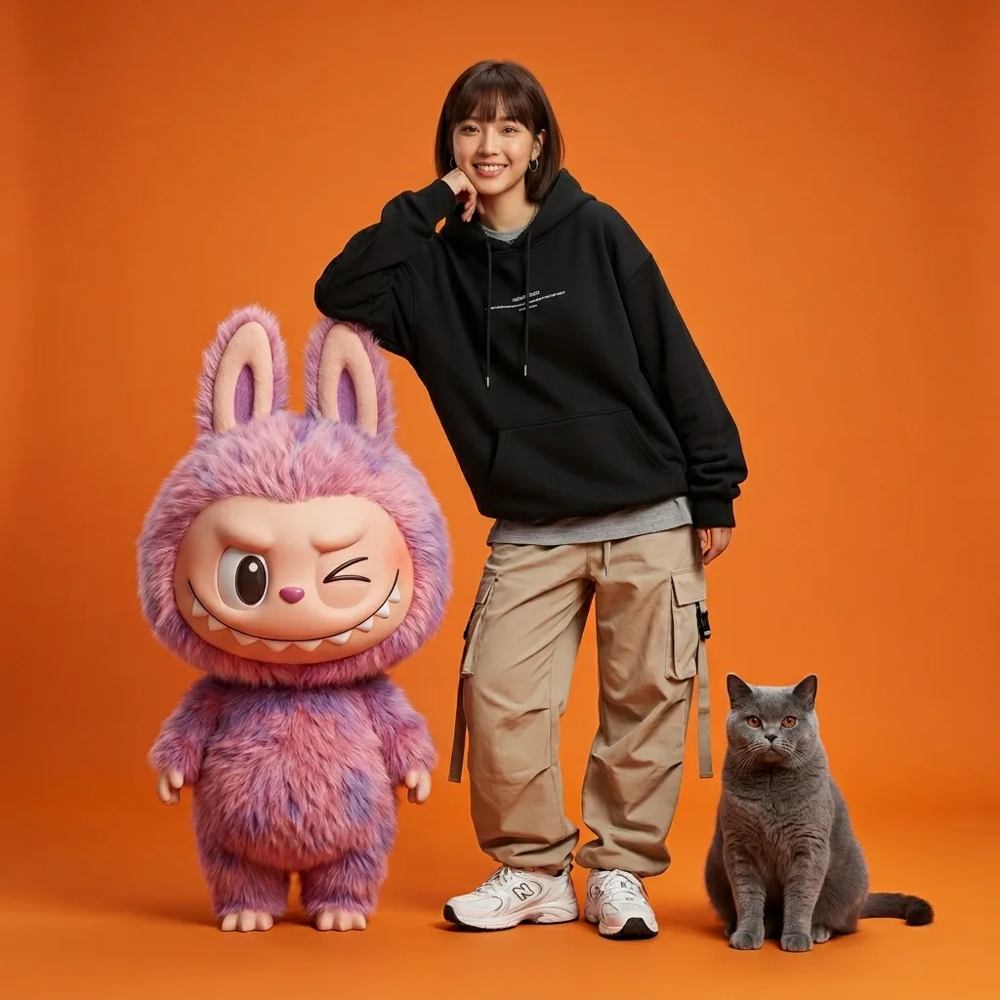

# High-detail studio photoshoot featuring the same person

[← Back to the collection](../../README.md) · Category: [Photography](../../gallery/photography.md) · Model: `Vinano Image Pro` · ID: `vn-00676`

<a href="https://vinano.ai?utm_source=github&utm_medium=readme&utm_campaign=awesome-image-video-prompts-updating&utm_content=prompt-page-image"></a>

<sub>Preview generated with <a href="https://vinano.ai?utm_source=github&utm_medium=readme&utm_campaign=awesome-image-video-prompts-updating&utm_content=prompt-page-caption">vinano.ai</a></sub>

## Prompt

```text
Create a hyper-realistic, high-detail studio photoshoot featuring the same person from the reference photo the exact facial features, skin tone, hairstyle, proportions, and identity fully preserved (no changes to face or structure). She is wearing stylish Gen-Z fashion attire trendy, minimal, modern streetwear. She is leaning casually on a realistic, fluffy, life-sized Labubu character, rendered in soft fur texture playful expression. A British Shorthair cat sits or poses nearby, also hyperrealistic detailed fur and natural posture.

The entire scene is set against a smooth, seamless, vibrant orange studio backdrop professional studio lighting, crisp shadows, clean highlights, and a premium fashion editorial vibe. Ultra-true-to-life photorealistic, flawless skin texture (but unchanged identity), high-end photography style, full-body or mid-shot composition.

Maintain consistent colour harmony and crisp focus across the whole frame.
```

## Try it on vinano.ai

1. Copy the prompt above.
2. Open **[vinano.ai](https://vinano.ai?utm_source=github&utm_medium=readme&utm_campaign=awesome-image-video-prompts-updating&utm_content=prompt-page-try)**, paste it into the image generator and pick a model.
3. Swap any placeholders (brand, product, city, person…) for your own details, then generate.

More prompts like this: [Photography gallery](../../gallery/photography.md) · [all categories](../../README.md#contents)
