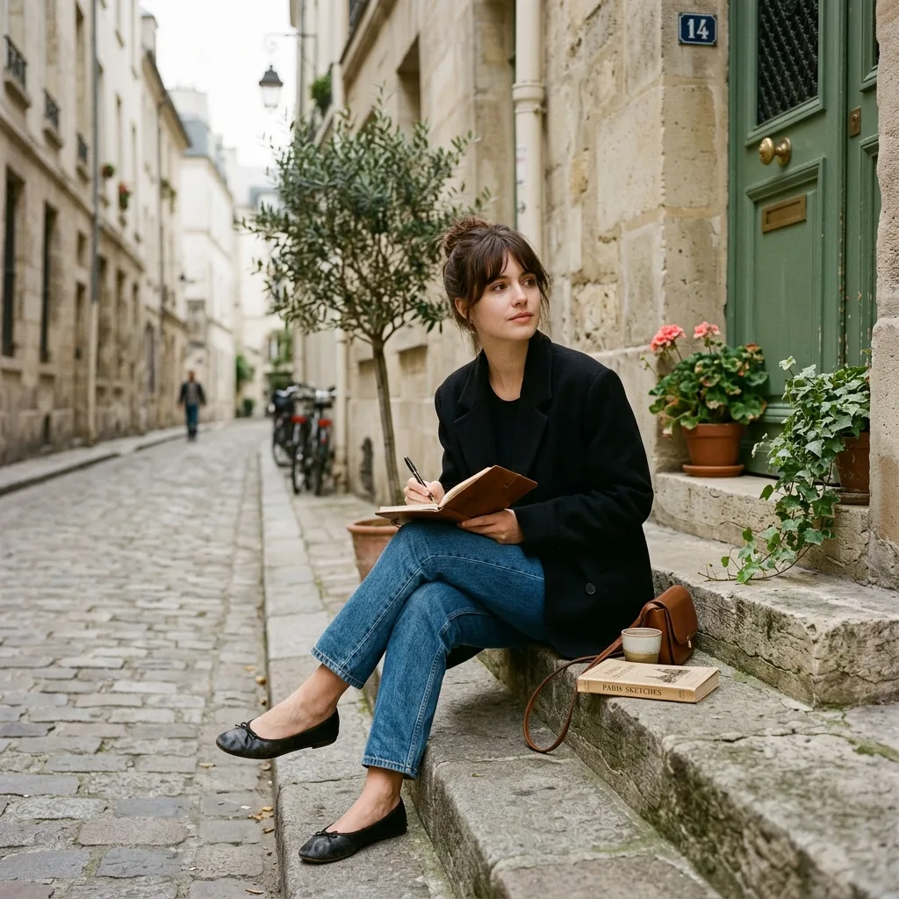

# Young woman sitting on stone steps in a quiet

[← Back to the collection](../../README.md) · Category: [Photography](../../gallery/photography.md) · Model: `Vinano Image v2` · ID: `vn-00680`

<a href="https://vinano.ai?utm_source=github&utm_medium=readme&utm_campaign=awesome-image-video-prompts-updating&utm_content=prompt-page-image"></a>

<sub>Preview generated with <a href="https://vinano.ai?utm_source=github&utm_medium=readme&utm_campaign=awesome-image-video-prompts-updating&utm_content=prompt-page-caption">vinano.ai</a></sub>

## Prompt

```text
{
 "image_generation": {
 "subject": {
 "description": "young woman sitting on stone steps in a quiet old European street",
 "pose": "seated casually on worn stone stairs, legs crossed slightly, holding a notebook and pen",
 "expression": "thoughtful, calm, introspective",
 "action": "writing notes while glancing to the side"
 },
 "appearance": {
 "hair": {
 "color": "dark brown",
 "style": "messy bun soft bangs framing the face"
 },
 "face": {
 "features": "soft natural facial features",
 "makeup": "minimal, natural look"
 }
 },
 "outfit": {
 "top": "black oversized blazer",
 "bottom": "blue straight-leg jeans",
 "shoes": "black ballet flats"
 },
 "accessories": {
 "bag": "small brown leather shoulder bag",
 "objects": ["small notebook",
 "pen",
 "closed book placed beside her"]
 },
 "environment": {
 "setting": "old European alleyway",
 "background": "weathered stone wall, green wooden door, cobblestone street",
 "architecture": "vintage, rustic, historic textures"
 },
 "lighting": {
 "type": "natural daylight",
 "quality": "soft, diffused",
 "mood": "warm, calm, cinematic"
 },
 "camera": {
 "angle": "eye-level",
 "framing": "medium full-body shot",
 "style": "editorial lifestyle photography",
 "focus": "sharp subject subtly textured background",
 "quality": "high resolution, realistic"
 },
 "aesthetic": {
 "style": "Parisian street style",
 "vibe": "artistic, literary, cozy",
 "color_palette": "neutral earth tones, muted greens, stone gray, denim blue"
 }
 }
}

Preserve realistic proportions and depth for a confident, professional finish.
```

## Try it on vinano.ai

1. Copy the prompt above.
2. Open **[vinano.ai](https://vinano.ai?utm_source=github&utm_medium=readme&utm_campaign=awesome-image-video-prompts-updating&utm_content=prompt-page-try)**, paste it into the image generator and pick a model.
3. Swap any placeholders (brand, product, city, person…) for your own details, then generate.

More prompts like this: [Photography gallery](../../gallery/photography.md) · [all categories](../../README.md#contents)
