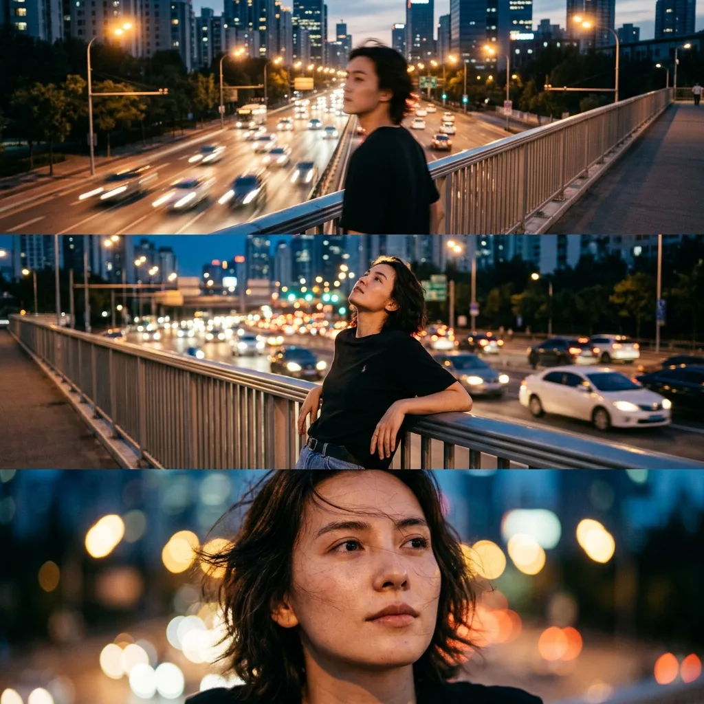

# Use the uploaded photo as the exact identity reference

[← Back to the collection](../../README.md) · Category: [Photography](../../gallery/photography.md) · Model: `Vinano Image v2` · ID: `vn-00682`

<a href="https://vinano.ai?utm_source=github&utm_medium=readme&utm_campaign=awesome-image-video-prompts-updating&utm_content=prompt-page-image"></a>

<sub>Preview generated with <a href="https://vinano.ai?utm_source=github&utm_medium=readme&utm_campaign=awesome-image-video-prompts-updating&utm_content=prompt-page-caption">vinano.ai</a></sub>

## Prompt

```text
use the uploaded photo as the exact identity reference. keep the same person, same face, same facial features, same proportions and natural expression, create a true-to-life photorealistic cinematic triptych portrait (three-frame composition in one image).

scene: night city, bridge over a busy road, moving cars, glowing street lights, evening sky, city skyline in the background. atmosphere: freedom, motion, youth, urban romance, feeling of wind and road. frame 1 (top): wide cinematic shot - the person standing on a bridge above a busy road, slight motion blur from head movement, city lights and cars below, strong urban night mood. frame 2 (middle): medium shot person leaning on the bridge railing, looking up at the sky, relaxed confident pose, cars and headlights glowing behind. frame 3 (bottom): close-up emotional portrait wind in hair, city lights in bokeh behind, thoughtful and dreamy expression. style: real photography, cinematic lifestyle portrait, urban fashion photography. lighting, natural city night lighting, street lamps, car headlights, soft glow on skin. camera: full-frame dslr, 85mm lens look, shallow depth of field. color grading: warm city lights mixed cool blue night tones, film-style mood. ultra true-to-life photorealistic, natural skin texture, real candid moment, no illustration, no cgi, no plastic skin, no text, no logos, no watermark.

Preserve realistic proportions and depth for a confident, professional finish.
```

## Try it on vinano.ai

1. Copy the prompt above.
2. Open **[vinano.ai](https://vinano.ai?utm_source=github&utm_medium=readme&utm_campaign=awesome-image-video-prompts-updating&utm_content=prompt-page-try)**, paste it into the image generator and pick a model.
3. Swap any placeholders (brand, product, city, person…) for your own details, then generate.

More prompts like this: [Photography gallery](../../gallery/photography.md) · [all categories](../../README.md#contents)
