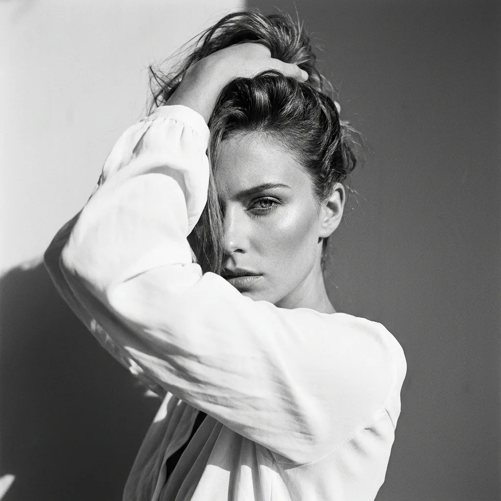

# Use The Uploaded Image Of The Woman As Strict

[← Back to the collection](../../README.md) · Category: [Photography](../../gallery/photography.md) · Model: `Vinano Image v2` · ID: `vn-00685`

<a href="https://vinano.ai?utm_source=github&utm_medium=readme&utm_campaign=awesome-image-video-prompts-updating&utm_content=prompt-page-image"></a>

<sub>Preview generated with <a href="https://vinano.ai?utm_source=github&utm_medium=readme&utm_campaign=awesome-image-video-prompts-updating&utm_content=prompt-page-caption">vinano.ai</a></sub>

## Prompt

```text
Use The Uploaded Image Of The Woman As Strict Facial Reference And Physical Features - Keep Her Real Face Exactly As Provided, Without Alterations Or Stylization. Ensure Seamless, Ultra-realistic Integration In The Final Render. Black And White High-fashion Editorial Portrait Of The Uploaded Person, Wearing A Loose White Blouse. She Poses One Arm Raised, Partially Covering Her Face While Holding Her Hair Up, Creating A Dramatic And Artistic Composition. Her Gaze Is Intense And Captivating, Directly Toward The Camera, Exuding A Strong, Enigmatic Aura.
Background: refined minimalist Plain Wall Sharp Daylight Shadows
Adding Contrast And Depth.
Lighting: Harsh Natural
Sunlight, High-contrast, Emphasizing Facial Contours, Cheekbones, Hair Texture, And Fabric Detail. Pose: Bold And Expressive, Arm Lifted Framing The Face To Emphasize Raw Emotion And High-fashion Editorial Style.
Camera: Eye-level Close-up,
Focusing On Facial Expression, Texture, And Dramatic Shadow Play. Captured As If Canon Eos R5, 85mm F/1.8 Lens - Crisp Detail, Tonal Depth, Fine Grain.
Style: Monochrome, Ultra-realistic, Cinematic, High-fashion
Editorial Photography.ashion editorial photography.

Keep edges clean and the overall composition balanced for a polished, gallery-ready result.
```

## Try it on vinano.ai

1. Copy the prompt above.
2. Open **[vinano.ai](https://vinano.ai?utm_source=github&utm_medium=readme&utm_campaign=awesome-image-video-prompts-updating&utm_content=prompt-page-try)**, paste it into the image generator and pick a model.
3. Swap any placeholders (brand, product, city, person…) for your own details, then generate.

More prompts like this: [Photography gallery](../../gallery/photography.md) · [all categories](../../README.md#contents)
