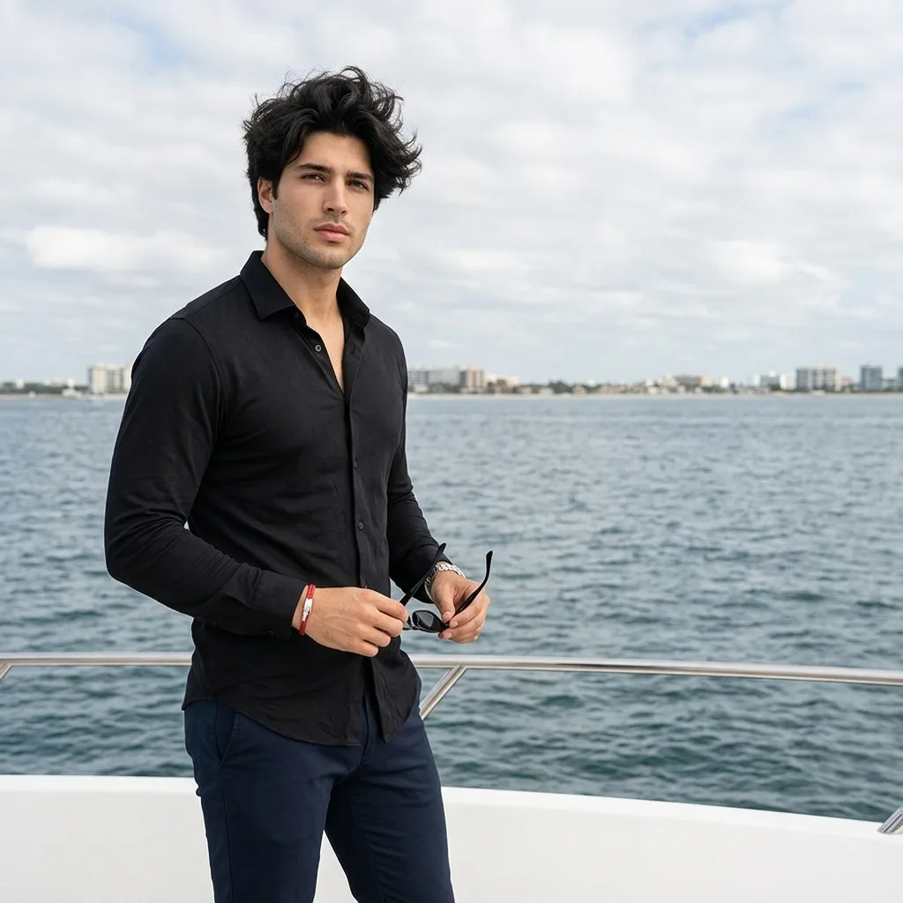

# Relaxed standing posture, torso slightly angled, head turned

[← Back to the collection](../../README.md) · Category: [Photography](../../gallery/photography.md) · Model: `Vinano Image Pro` · ID: `vn-00686`

<a href="https://vinano.ai?utm_source=github&utm_medium=readme&utm_campaign=awesome-image-video-prompts-updating&utm_content=prompt-page-image"></a>

<sub>Preview generated with <a href="https://vinano.ai?utm_source=github&utm_medium=readme&utm_campaign=awesome-image-video-prompts-updating&utm_content=prompt-page-caption">vinano.ai</a></sub>

## Prompt

```text
{ "composition": { "framing": "mid-length portrait from upper thighs to head", "orientation": "vertical", "camera_angle": "eye-level", "subject_position": "left third of the frame", "balance": "subject balanced against expansive seascape on the right", "depth": "moderate depth clear foreground subject and distant cityscape background" }, "subject": { "gender_presentation": "male-presenting", "age_range": "young adult", "pose": "relaxed standing posture, torso slightly angled, head turned to the left", "expression": "neutral to contemplative", "gaze_direction": "looking on camera", "hair": { "color": "dark brown to black", "style": "thick, voluminous, tousled, slightly wavy" }, "skin_tone": "light to medium", "facial_features": "defined jawline, straight nose, full lips, clean-shaven" }, "clothing_and_accessories": { "top": { "type": "long-sleeve button-up shirt", "color": "black", "fit": "slim to regular fit", "details": "top buttons undone, lightweight fabric subtle drape" }, "bottom": { "type": "trousers", "color": "dark navy or black", "fit": "slim fit" }, "accessories": [{ "item": "sunglasses", "color": "black", "held_in": "right hand" }, { "item": "wristwatch", "material": "metal", "worn_on": "left wrist" }, { "item": "bracelet", "color": "red", "worn_on": "right wrist" }] }, "environment": { "setting": "outdoor, on a boat or waterfront deck", "foreground": "white deck surface", "background": { "elements": ["open sea visible water texture", "distant coastal cityscape", "cloud-filled sky"], "horizon_line": "visible and level" } }, "lighting": { "type": "natural daylight", "quality": "soft and diffused", "direction": "overhead slight frontal illumination", "shadows": "minimal, soft-edged" }, "color_palette": { "dominant_colors": ["deep blue", "cyan", "white", "black"], "contrast": "high contrast between dark clothing and bright environment", "saturation": "moderate, natural tones" }, "technical_characteristics": { "focus": "sharp focus on subject", "depth_of_field": "moderate, background slightly softened but recognizable", "image_clarity": "high", "noise": "minimal", "lens_effect": "no visible distortion, likely standard focal length" }, "artistic_style": { "aesthetic": "clean, modern lifestyle photography", "mood": "calm, confident, aspirational", "visual_theme": "luxury travel or leisure" }, "typography": { "text_present": false } } Emphasise material texture and natural light so the final frame feels tactile and premium.
```

## Try it on vinano.ai

1. Copy the prompt above.
2. Open **[vinano.ai](https://vinano.ai?utm_source=github&utm_medium=readme&utm_campaign=awesome-image-video-prompts-updating&utm_content=prompt-page-try)**, paste it into the image generator and pick a model.
3. Swap any placeholders (brand, product, city, person…) for your own details, then generate.

More prompts like this: [Photography gallery](../../gallery/photography.md) · [all categories](../../README.md#contents)
