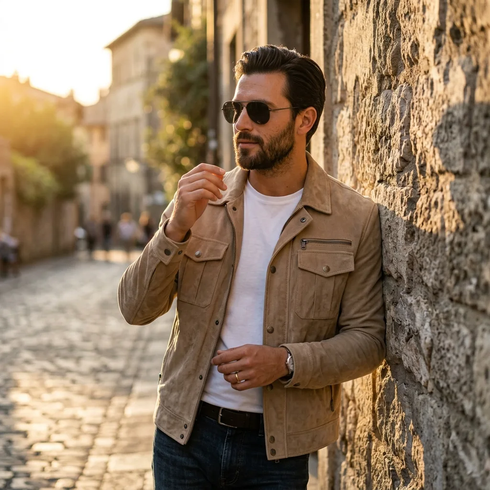

# Golden hour portrait of a stylish man leaning against

[← Back to the collection](../../README.md) · Category: [Photography](../../gallery/photography.md) · Model: `Vinano Image v2` · ID: `vn-00687`

<a href="https://vinano.ai?utm_source=github&utm_medium=readme&utm_campaign=awesome-image-video-prompts-updating&utm_content=prompt-page-image"></a>

<sub>Preview generated with <a href="https://vinano.ai?utm_source=github&utm_medium=readme&utm_campaign=awesome-image-video-prompts-updating&utm_content=prompt-page-caption">vinano.ai</a></sub>

## Prompt

```text
A cinematic golden hour portrait of a stylish man leaning against a textured stone wall, wearing dark sunglasses, a beige suede jacket large front pockets, and a white crew-neck shirt underneath, warm sunlight casting sharp shadows across the wall, soft natural beard, well-groomed dark hair styled back, confident relaxed pose one hand raised near his face, warm earthy color palette, strong side lighting, high contrast highlights and shadows, shallow depth of field, ultra-realistic fashion photography, editorial street style aesthetic, 85mm lens, f/2.0, crisp detail, natural skin tones, 4K resolution. Maintain consistent colour harmony and crisp focus across the whole frame.
```

## Try it on vinano.ai

1. Copy the prompt above.
2. Open **[vinano.ai](https://vinano.ai?utm_source=github&utm_medium=readme&utm_campaign=awesome-image-video-prompts-updating&utm_content=prompt-page-try)**, paste it into the image generator and pick a model.
3. Swap any placeholders (brand, product, city, person…) for your own details, then generate.

More prompts like this: [Photography gallery](../../gallery/photography.md) · [all categories](../../README.md#contents)
