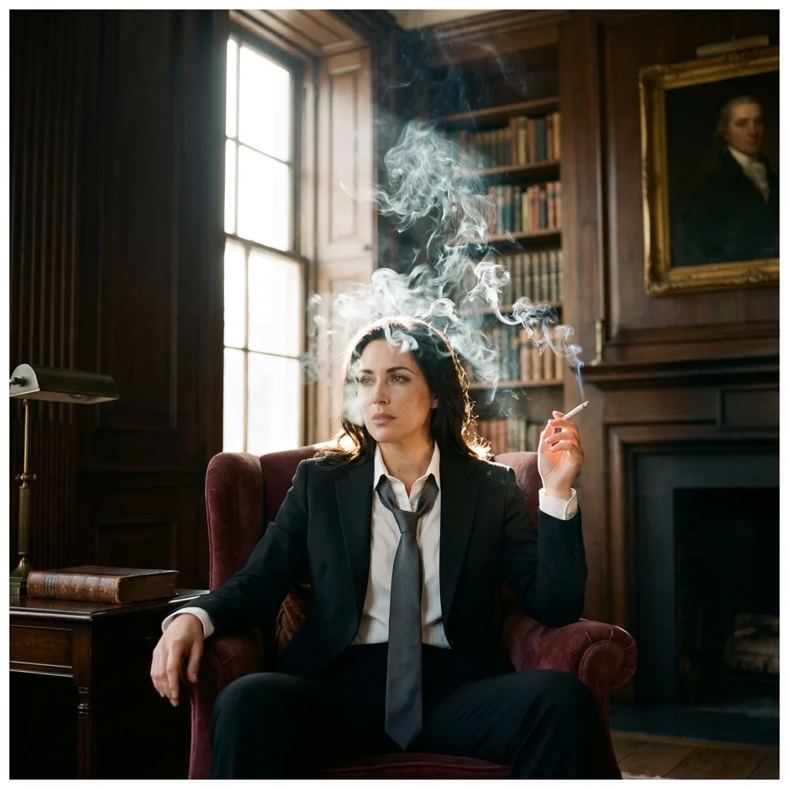

# ​A high-definition cinematic portrait of a sophisticated woman sitting

[← Back to the collection](../../README.md) · Category: [Photography](../../gallery/photography.md) · Model: `Vinano Image Pro` · ID: `vn-00693`

<a href="https://vinano.ai?utm_source=github&utm_medium=readme&utm_campaign=awesome-image-video-prompts-updating&utm_content=prompt-page-image"></a>

<sub>Preview generated with <a href="https://vinano.ai?utm_source=github&utm_medium=readme&utm_campaign=awesome-image-video-prompts-updating&utm_content=prompt-page-caption">vinano.ai</a></sub>

## Prompt

```text
​A high-definition cinematic portrait of a sophisticated woman sitting in a plush, velvet burgundy armchair within a sunlit, vintage study. She is wearing a sharp black tailored suit, a crisp white button-down shirt slightly unbuttoned, and a loosely tied charcoal grey necktie. She holds a cigarette, thick, ethereal plumes of white smoke swirling dramatically around her face and rising toward the ceiling. The lighting is dramatic "chiaroscuro" style, bright sunlight streaming through a large window behind her, creating a glowing rim light on her hair and the smoke. The background features ornate wooden wall panels and a classic framed painting. true-to-life photorealistic, 8k resolution, moody atmosphere.
​Tips for Best Results:
​Aspect Ratio: If your tool supports it, use --ar 9:16 to get that tall, vertical phone-wallpaper look.
​Lighting Keywords: terms like "volumetric lighting" or "backlit" will help emphasize the way the light interacts the smoke.
​Style: If you want it to look more like a movie still, add "shot on 35mm film" to the end.

Aim for an editorial, design-driven look with deliberate negative space.
```

## Try it on vinano.ai

1. Copy the prompt above.
2. Open **[vinano.ai](https://vinano.ai?utm_source=github&utm_medium=readme&utm_campaign=awesome-image-video-prompts-updating&utm_content=prompt-page-try)**, paste it into the image generator and pick a model.
3. Swap any placeholders (brand, product, city, person…) for your own details, then generate.

More prompts like this: [Photography gallery](../../gallery/photography.md) · [all categories](../../README.md#contents)
