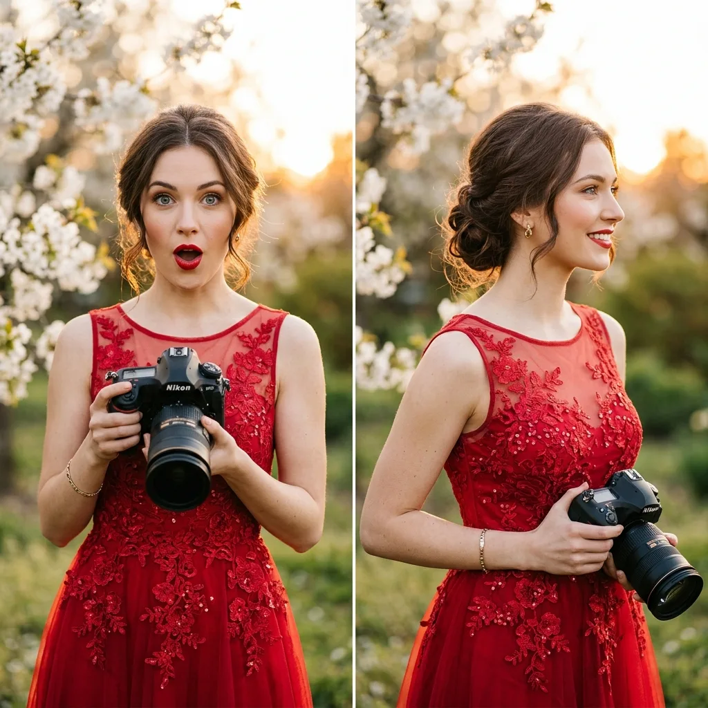

# Young woman an elegant, polished look

[← Back to the collection](../../README.md) · Category: [Photography](../../gallery/photography.md) · Model: `Vinano Image v2` · ID: `vn-00694`

<a href="https://vinano.ai?utm_source=github&utm_medium=readme&utm_campaign=awesome-image-video-prompts-updating&utm_content=prompt-page-image"></a>

<sub>Preview generated with <a href="https://vinano.ai?utm_source=github&utm_medium=readme&utm_campaign=awesome-image-video-prompts-updating&utm_content=prompt-page-caption">vinano.ai</a></sub>

## Prompt

```text
A young woman an elegant, polished look. In one frame, she has an expressive, surprised "O" face; in the other, a soft, confident smile.
​Attire: A vibrant crimson red floor-length gown featuring intricate floral lace embroidery, a sheer neckline, and subtle sequin detailing that catches the light.
​Hair & Makeup: Her hair is styled in a soft, romantic updo loose tendrils. She wears bold red lipstick that perfectly matches her dress and classic, warm-toned eye makeup.
​Setting & Composition:
​Environment: An outdoor garden during golden hour. The background is filled soft-focus white spring blossoms (like cherry or almond trees) and lush greenery.
​Lighting: Backlit by a warm, setting sun, creating a "halo" effect on her hair and a soft, ethereal glow across the scene.
​The Contrast: She is holding or wearing a professional black DSLR camera a large lens. The mechanical, matte-black texture of the camera creates a sharp contrast against the delicate, red lace of the evening gown.
​Technical Details:
​Photography Style: Cinematic portraiture a shallow depth of field (bokeh), making the subject pop against the blurred garden background.
​Composition: A side-by-side diptych showing two different poses: one front-facing and playful, one profile-view and serene.

Render with rich micro-detail while keeping the layout uncluttered and intentional.
```

## Try it on vinano.ai

1. Copy the prompt above.
2. Open **[vinano.ai](https://vinano.ai?utm_source=github&utm_medium=readme&utm_campaign=awesome-image-video-prompts-updating&utm_content=prompt-page-try)**, paste it into the image generator and pick a model.
3. Swap any placeholders (brand, product, city, person…) for your own details, then generate.

More prompts like this: [Photography gallery](../../gallery/photography.md) · [all categories](../../README.md#contents)
