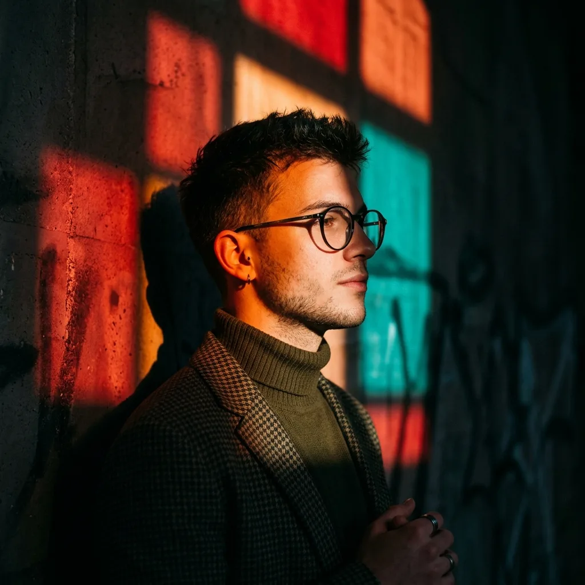

# Portrait of a stylish young person wearing round glasses

[← Back to the collection](../../README.md) · Category: [Photography](../../gallery/photography.md) · Model: `Vinano Image v2` · ID: `vn-00698`

<a href="https://vinano.ai?utm_source=github&utm_medium=readme&utm_campaign=awesome-image-video-prompts-updating&utm_content=prompt-page-image"></a>

<sub>Preview generated with <a href="https://vinano.ai?utm_source=github&utm_medium=readme&utm_campaign=awesome-image-video-prompts-updating&utm_content=prompt-page-caption">vinano.ai</a></sub>

## Prompt

```text
Cinematic portrait of a stylish young person wearing round glasses, standing beside a wall illuminated by bold geometric window light. Strong red, orange, and teal color contrast casting dramatic shadows across the face. Side profile pose, soft contemplative expression, sharp focus on facial features. High contrast lighting hard-edged rectangular light shapes in the background. Moody atmosphere, artistic color blocking, modern editorial photography style. Shot on 85mm lens, f/1.8, ultra-detailed skin texture, shallow depth of field, dramatic rim lighting, 8K resolution. Render with rich micro-detail while keeping the layout uncluttered and intentional.
```

## Try it on vinano.ai

1. Copy the prompt above.
2. Open **[vinano.ai](https://vinano.ai?utm_source=github&utm_medium=readme&utm_campaign=awesome-image-video-prompts-updating&utm_content=prompt-page-try)**, paste it into the image generator and pick a model.
3. Swap any placeholders (brand, product, city, person…) for your own details, then generate.

More prompts like this: [Photography gallery](../../gallery/photography.md) · [all categories](../../README.md#contents)
