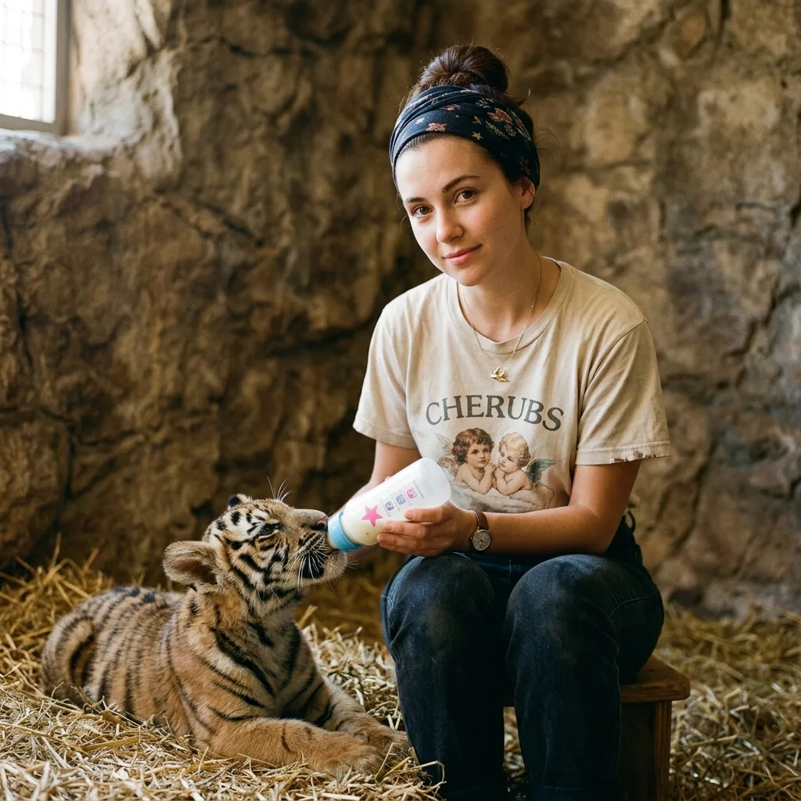

# Seated, torso angled slightly left, head turned right

[← Back to the collection](../../README.md) · Category: [Photography](../../gallery/photography.md) · Model: `Vinano Image v2` · ID: `vn-00702`

<a href="https://vinano.ai?utm_source=github&utm_medium=readme&utm_campaign=awesome-image-video-prompts-updating&utm_content=prompt-page-image"></a>

<sub>Preview generated with <a href="https://vinano.ai?utm_source=github&utm_medium=readme&utm_campaign=awesome-image-video-prompts-updating&utm_content=prompt-page-caption">vinano.ai</a></sub>

## Prompt

```text
{ "scene_type": "lifestyle portrait animal interaction", "composition": { "framing": "medium shot", "orientation": "portrait", "subject_placement": "human subject seated slightly right of center, animal positioned lower left, heads forming a gentle diagonal", "camera_angle": "eye-level", "depth_of_field": "moderate, background softly blurred but still textured", "visual_balance": "balanced by contrast between human face and animal body mass" }, "subjects": { "human": { "gender_presentation": "female", "age_range": "young adult", "pose": "seated, torso angled slightly left, head turned right", "expression": "soft smile, contemplative, calm", "gaze_direction": "on camera ", "skin_tone": "light", "hair": { "color": "brown", "style": "pulled back into bun or ponytail", "accessory": "dark patterned headscarf" }, "clothing": { "top": "light-colored graphic t-shirt cherub illustration", "bottom": "dark pants", "accessories": ["necklace small bird-shaped pendant", "wristwatch"] } }, "animal": { "species": "tiger cub", "size": "juvenile", "fur_pattern": "orange black stripes and white facial markings", "pose": "lying on side, head tilted upward", "interaction": "drinking from bottle held by human" } }, "props": { "bottle": { "type": "baby feeding bottle", "color": "white blue cap", "decoration": "pink star and small graphic icons", "function": "feeding animal" } }, "environment": { "location_type": "indoor, rustic or zoo-like enclosure", "background_material": "rough stone wall", "floor_texture": "straw or hay scattered on ground", "setting_mood": "warm, intimate, caretaking" }, "lighting": { "type": "soft natural or diffused artificial light", "direction": "from front-left", "quality": "warm, even, low contrast", "shadow_behavior": "gentle shadows, no harsh edges" }, "color_palette": { "dominant_colors": ["warm beige", "stone gray", "soft brown", "orange"], "accent_colors": ["black", "white", "blue", "pink"], "overall_tone": "warm and earthy" }, "texture_details": { "stone_wall": "coarse, uneven, aged", "fabric": "soft cotton t-shirt, matte finish", "fur": "dense, plush, clearly defined stripes" }, "stylistic_attributes": { "genre": "documentary-style lifestyle photography", "aesthetic": "natural, candid, emotionally warm", "retouching_level": "minimal, realistic skin and texture preservation" }, "technical_characteristics": { "lens_look": "standard to short telephoto", "focal_length_estimate": "35–50mm", "aperture_estimate": "f/2.8–f/4", "sharpness": "sharp focus on faces", "noise": "low", "dynamic_range": "moderate preserved highlights" }, "emotional_read": { "primary_emotion": "tenderness", "secondary_emotions": ["curiosity", "care", "gentle joy"] }, "use_case_potential": ["editorial storytelling", "animal care advocacy", "lifestyle inspiration", "UGC-style social media content"] } Preserve realistic proportions and depth for a confident, professional finish.
```

## Try it on vinano.ai

1. Copy the prompt above.
2. Open **[vinano.ai](https://vinano.ai?utm_source=github&utm_medium=readme&utm_campaign=awesome-image-video-prompts-updating&utm_content=prompt-page-try)**, paste it into the image generator and pick a model.
3. Swap any placeholders (brand, product, city, person…) for your own details, then generate.

More prompts like this: [Photography gallery](../../gallery/photography.md) · [all categories](../../README.md#contents)
