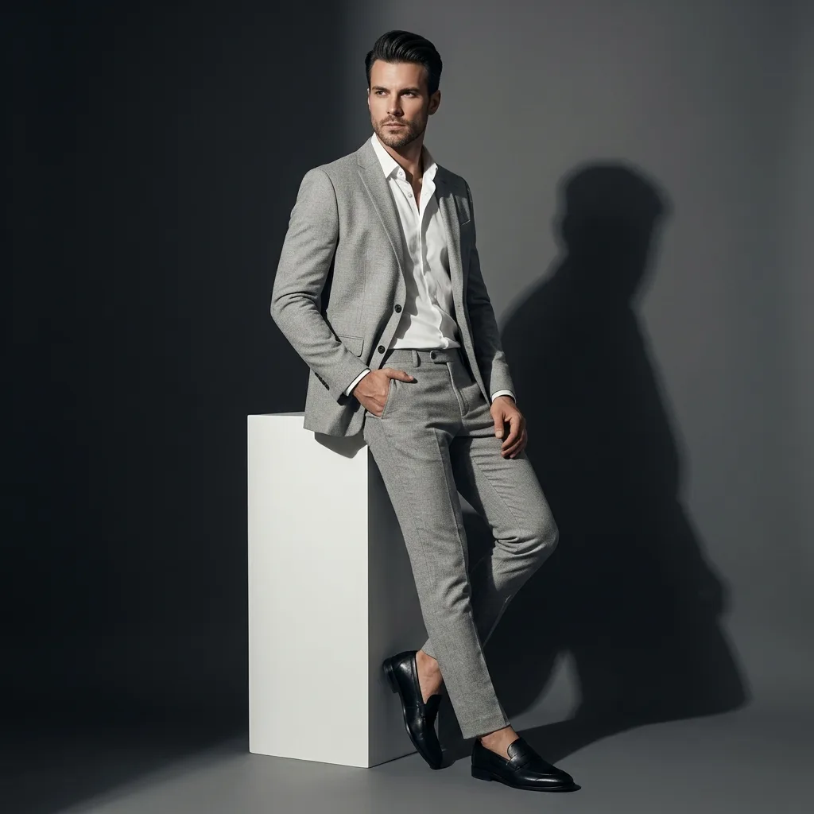

# High-end fashion editorial portrait of an adult man, 100%

[← Back to the collection](../../README.md) · Category: [Photography](../../gallery/photography.md) · Model: `Vinano Image Pro` · ID: `vn-00715`

<a href="https://vinano.ai?utm_source=github&utm_medium=readme&utm_campaign=awesome-image-video-prompts-updating&utm_content=prompt-page-image"></a>

<sub>Preview generated with <a href="https://vinano.ai?utm_source=github&utm_medium=readme&utm_campaign=awesome-image-video-prompts-updating&utm_content=prompt-page-caption">vinano.ai</a></sub>

## Prompt

```text
{
 "prompt": "Ultra-realistic high-end fashion editorial portrait of an adult man, 100% the uploaded reference image for exact face, identity, facial structure, and expression (no changes or stylization). The subject is leaning casually against a tall white rectangular pedestal in a minimal studio environment. Pose must match the reference exactly: body angled sideways, left hip resting on the pedestal, one hand casually placed inside the trouser pocket, the other relaxed by the thigh. One leg straight on the ground, the other slightly bent at the knee, feet crossed naturally at the ankles.\n\nHe is wearing a tailored light grey textured suit slim-fit trousers and a matching blazer, paired a white button-down shirt worn casually open at the collar (no tie). Black leather loafers a visible ankle gap, clean and elegant styling.\n\nFacial details preserved from the reference: sharp masculine jawline, light stubble beard, defined cheekbones, neatly styled dark hair swept back. Expression is serious and calm, eyes looking slightly off-camera to the side.\n\nLighting is dramatic hard side lighting from a single direction, creating strong, sharp shadows and a clear silhouette shadow of the subject projected onto the wall behind him. High-contrast light-and-shadow geometry enhances the cinematic editorial mood.\n\nBackground consists of a smooth dark grey studio wall and floor, refined minimalist and distraction-free, no props other than the pedestal. Luxury fashion magazine aesthetic, ultra-sharp focus, realistic skin texture, fine fabric details, cinematic contrast. DSLR photography look an 85mm lens, shallow depth of field, muted neutral color grading. Vertical composition, premium editorial quality, 8K photorealism.",
 "aspect_ratio": "4:5",
 "resolution": "8K",
 "camera_lens": "85mm",
 "style": "luxury fashion editorial, cinematic",
 "lighting": "dramatic hard side lighting, high contrast",
 "quality": "ultra-realistic, premium",
 "reference_image": "strictly use uploaded image only"
}

Render with rich micro-detail while keeping the layout uncluttered and intentional.
```

## Try it on vinano.ai

1. Copy the prompt above.
2. Open **[vinano.ai](https://vinano.ai?utm_source=github&utm_medium=readme&utm_campaign=awesome-image-video-prompts-updating&utm_content=prompt-page-try)**, paste it into the image generator and pick a model.
3. Swap any placeholders (brand, product, city, person…) for your own details, then generate.

More prompts like this: [Photography gallery](../../gallery/photography.md) · [all categories](../../README.md#contents)
