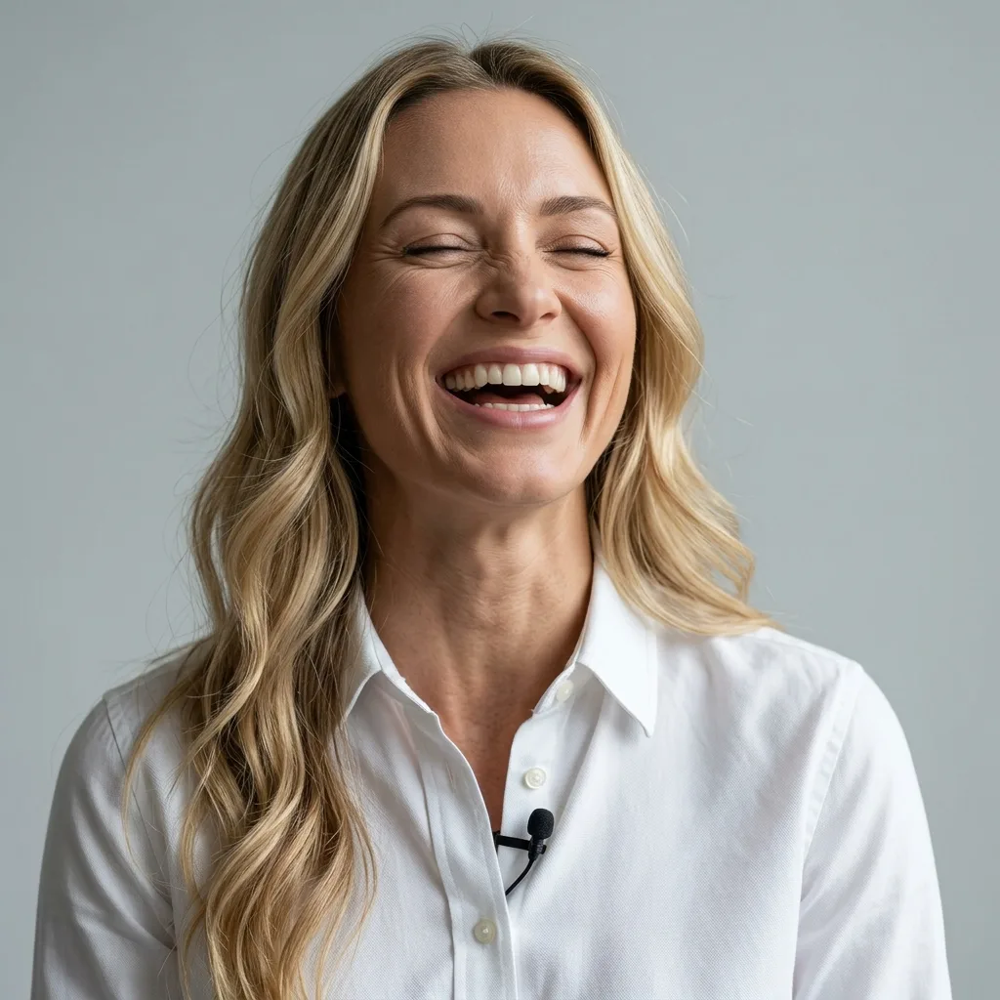

# High-detail, 8K close-up portrait of the same woman

[← Back to the collection](../../README.md) · Category: [Photography](../../gallery/photography.md) · Model: `Vinano Image v2` · ID: `vn-00717`

<a href="https://vinano.ai?utm_source=github&utm_medium=readme&utm_campaign=awesome-image-video-prompts-updating&utm_content=prompt-page-image"></a>

<sub>Preview generated with <a href="https://vinano.ai?utm_source=github&utm_medium=readme&utm_campaign=awesome-image-video-prompts-updating&utm_content=prompt-page-caption">vinano.ai</a></sub>

## Prompt

```text
{
 "action": "image_generation",
 "action_input": {
 "prompt": "A high-detail, 8K close-up portrait of the same woman from the previous images the same facial features and long blonde wavy hair. She is captured in a moment of genuine, joyful laughter her head slightly tilted back and eyes closed. She is wearing a crisp white button-down social shirt a small black lapel microphone attached. The background is a refined minimalist, smooth light gray studio wall. The lighting is soft and professional, highlighting the texture of the fabric and the natural details of her expression. Cinematic quality, realistic skin textures, 2:3 aspect ratio.",
 "aspect_ratio": "2:3"
 }
}

Emphasise material texture and natural light so the final frame feels tactile and premium.
```

## Try it on vinano.ai

1. Copy the prompt above.
2. Open **[vinano.ai](https://vinano.ai?utm_source=github&utm_medium=readme&utm_campaign=awesome-image-video-prompts-updating&utm_content=prompt-page-try)**, paste it into the image generator and pick a model.
3. Swap any placeholders (brand, product, city, person…) for your own details, then generate.

More prompts like this: [Photography gallery](../../gallery/photography.md) · [all categories](../../README.md#contents)
