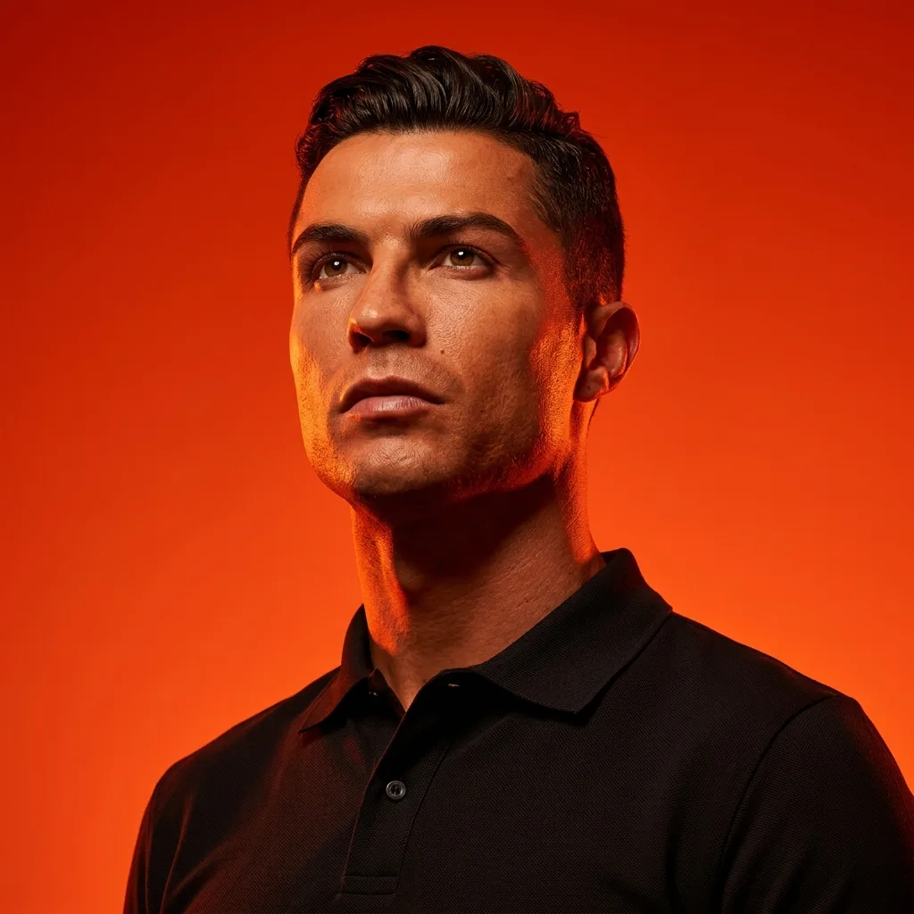

# High-impact editorial studio portrait the person from the attached

[← Back to the collection](../../README.md) · Category: [Photography](../../gallery/photography.md) · Model: `Vinano Image Pro` · ID: `vn-00720`

<a href="https://vinano.ai?utm_source=github&utm_medium=readme&utm_campaign=awesome-image-video-prompts-updating&utm_content=prompt-page-image"></a>

<sub>Preview generated with <a href="https://vinano.ai?utm_source=github&utm_medium=readme&utm_campaign=awesome-image-video-prompts-updating&utm_content=prompt-page-caption">vinano.ai</a></sub>

## Prompt

```text
Create a high-impact editorial studio portrait the person from the attached reference photo as the only identity source.

Preserve the subject’s facial structure, skin tone, proportions, hairstyle, age, and overall likeness exactly as in the reference image. Do not modify, enhance, reshape, beautify, or reinterpret any facial features. Absolute identity accuracy is required.

The subject is framed in a medium close-up (head and shoulders), photographed from a low-angle perspective looking slightly upward to create a powerful, dominant presence. The subject’s gaze is directed off-camera, upward into space, a serious, focused, intense expression.

Wardrobe: premium black pique polo shirt visible cotton mesh texture. The fit is sharp and tailored, deep matte black fabric, structured and clean silhouette.

Background: solid vibrant orange-red studio backdrop smooth, seamless color gradients. No patterns or texture — only rich, intense color creating a heated, dramatic atmosphere.

Lighting: bold, high-contrast studio lighting dominated by orange and deep red tones. Strong directional key light creates dramatic chiaroscuro shadows that emphasize facial structure and jawline. Add a powerful rim light or edge glow separating the shoulders and head from the background. Maintain depth and dimensionality.

Mood: heroic, intense, commanding, cinematic studio aesthetic.

Technical quality: ultra-true-to-life photorealistic, highly detailed, sharp focus on the face, visible natural skin texture and pores, no smoothing. Background gradients smooth and clean.

High resolution, studio-grade quality, professional editorial finish

Emphasise material texture and natural light so the final frame feels tactile and premium.
```

## Try it on vinano.ai

1. Copy the prompt above.
2. Open **[vinano.ai](https://vinano.ai?utm_source=github&utm_medium=readme&utm_campaign=awesome-image-video-prompts-updating&utm_content=prompt-page-try)**, paste it into the image generator and pick a model.
3. Swap any placeholders (brand, product, city, person…) for your own details, then generate.

More prompts like this: [Photography gallery](../../gallery/photography.md) · [all categories](../../README.md#contents)
