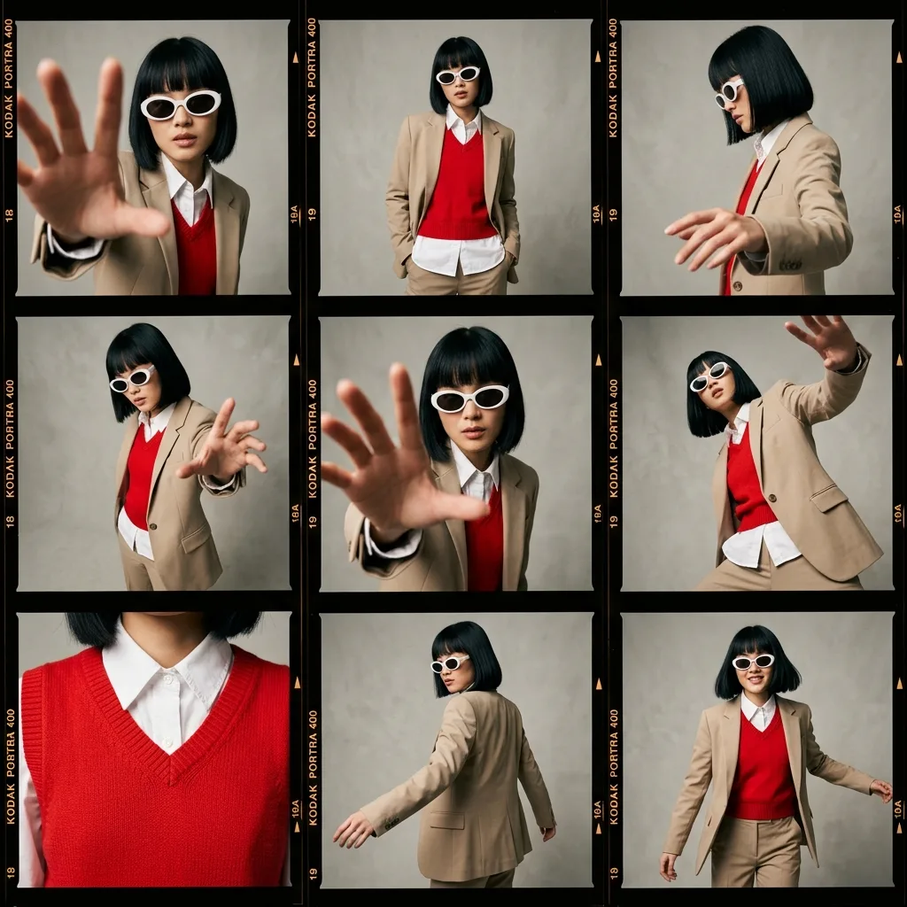

# Fashion contact sheet of a modern woman a sharp

[← Back to the collection](../../README.md) · Category: [Photography](../../gallery/photography.md) · Model: `Vinano Image Pro` · ID: `vn-00726`

<a href="https://vinano.ai?utm_source=github&utm_medium=readme&utm_campaign=awesome-image-video-prompts-updating&utm_content=prompt-page-image"></a>

<sub>Preview generated with <a href="https://vinano.ai?utm_source=github&utm_medium=readme&utm_campaign=awesome-image-video-prompts-updating&utm_content=prompt-page-caption">vinano.ai</a></sub>

## Prompt

```text
Editorial fashion contact sheet of a modern woman a sharp black bob haircut wearing white oval sunglasses, a beige tailored suit over a red sweater vest and white shirt, photographed in a refined minimalist studio a neutral grey backdrop. Multiple frames arranged in a 3×3 grid showing varied angles—front, side, top-down, back view—while the subject repeatedly reaches her hand toward the camera lens, creating strong depth and perspective distortion. Clean high-fashion styling, bold color contrast, soft diffused studio lighting, crisp focus, contemporary magazine aesthetic, 35mm–50mm look, ultra-sharp, high resolution. Render with rich micro-detail while keeping the layout uncluttered and intentional.
```

## Try it on vinano.ai

1. Copy the prompt above.
2. Open **[vinano.ai](https://vinano.ai?utm_source=github&utm_medium=readme&utm_campaign=awesome-image-video-prompts-updating&utm_content=prompt-page-try)**, paste it into the image generator and pick a model.
3. Swap any placeholders (brand, product, city, person…) for your own details, then generate.

More prompts like this: [Photography gallery](../../gallery/photography.md) · [all categories](../../README.md#contents)
