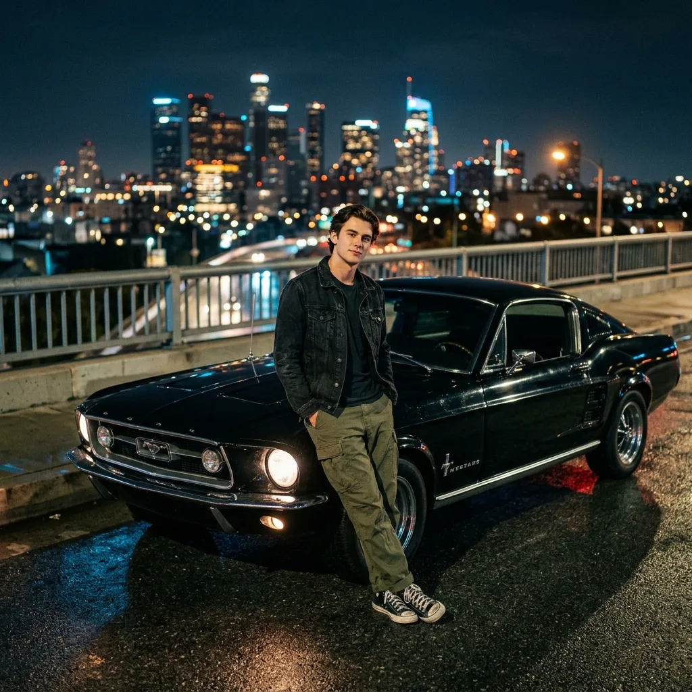

# Night Photo On A Dimly Lit Urban Overpass

[← Back to the collection](../../README.md) · Category: [Photography](../../gallery/photography.md) · Model: `Vinano Image v2` · ID: `vn-00729`

<a href="https://vinano.ai?utm_source=github&utm_medium=readme&utm_campaign=awesome-image-video-prompts-updating&utm_content=prompt-page-image"></a>

<sub>Preview generated with <a href="https://vinano.ai?utm_source=github&utm_medium=readme&utm_campaign=awesome-image-video-prompts-updating&utm_content=prompt-page-caption">vinano.ai</a></sub>

## Prompt

```text
A Cinematic Night Photo On A Dimly Lit Urban Overpass A View Of The City Skyline. In The Foreground, A Young Man Leaning Casually Against A Classic 1960s Ford Mustang Fast-back In A Sleek Black Finish. The Car's Muscu-lar Lines Are Accentuated By The Wet Asphalt Reflecting Neon Signs From Nearby Buildings. The Young Man Is Wearing A Black Trucker Jacket, A Simple Casual T-shirt, Loose Cargo Pants, And Converse Shoes. His Pose Is Re-laxed, One Hand In His Pocket, Looking Di-rectly At The Camera A Cool, Confident Expression.

The Shooting Style Uses A Fujifilm Camera Soft Cinematic Color Tones, A Slight Fine Grain, And Deep Shadows. The Dominant Color Tone Is A Moody Blue-teal, High-lights From Warm Streetlights Creating A Dramatic Contrast. The Depth Of Field Is Shal-low, Sharp Focus On The Young Man And The Mustang, While The City Lights In The Background Blur Into Soft, Cinematic Bokeн, Evoking The Aesthetic Of A Modern Analog Film Snapshot.

Emphasise material texture and natural light so the final frame feels tactile and premium.
```

## Try it on vinano.ai

1. Copy the prompt above.
2. Open **[vinano.ai](https://vinano.ai?utm_source=github&utm_medium=readme&utm_campaign=awesome-image-video-prompts-updating&utm_content=prompt-page-try)**, paste it into the image generator and pick a model.
3. Swap any placeholders (brand, product, city, person…) for your own details, then generate.

More prompts like this: [Photography gallery](../../gallery/photography.md) · [all categories](../../README.md#contents)
