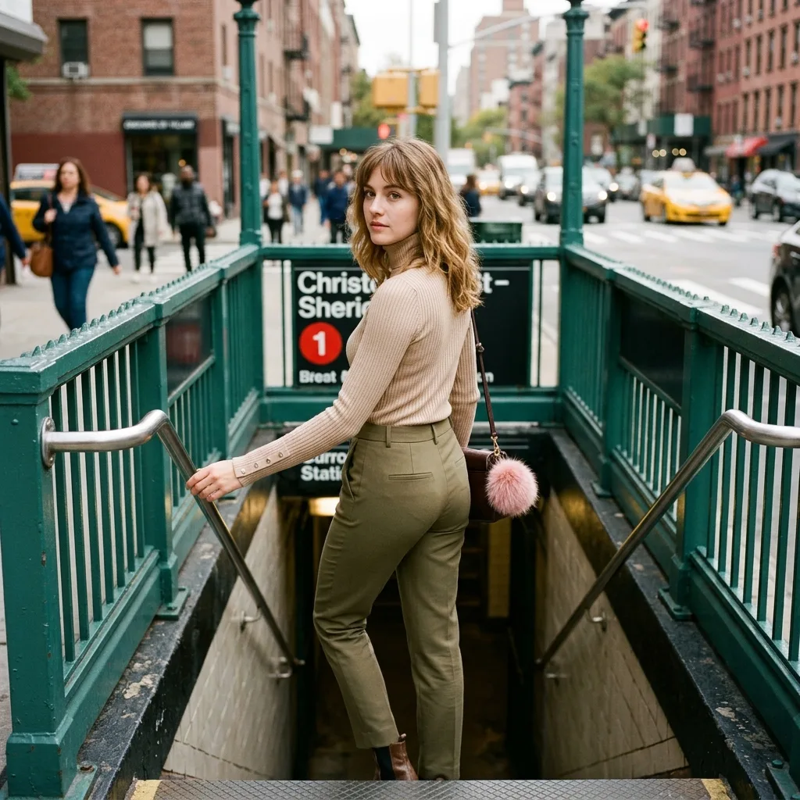

# Young woman standing at the entrance of a subway

[← Back to the collection](../../README.md) · Category: [Photography](../../gallery/photography.md) · Model: `Vinano Image v2` · ID: `vn-00731`

<a href="https://vinano.ai?utm_source=github&utm_medium=readme&utm_campaign=awesome-image-video-prompts-updating&utm_content=prompt-page-image"></a>

<sub>Preview generated with <a href="https://vinano.ai?utm_source=github&utm_medium=readme&utm_campaign=awesome-image-video-prompts-updating&utm_content=prompt-page-caption">vinano.ai</a></sub>

## Prompt

```text
{
 "image_generation": {
 "subject": {
 "description": "young woman standing at the entrance of a subway staircase in a city",
 "pose": "standing on subway steps, body facing downward, head turned back over shoulder",
 "expression": "calm, slightly curious, thoughtful",
 "gaze": "looking directly at the camera"
 },
 "appearance": {
 "hair": {
 "color": "light brown",
 "style": "shoulder-length wavy hair bangs"
 },
 "face": {
 "skin_tone": "fair",
 "makeup": "natural makeup subtle definition"
 },
 "accessories": ["small shoulder bag",
 "pink faux-fur bag accessory"]
 },
 "outfit": {
 "top": "beige fitted ribbed turtleneck sweater button details on sleeves",
 "bottom": "high-waisted olive green tailored pants",
 "footwear": "not visible"
 },
 "environment": {
 "setting": "urban subway entrance",
 "background_elements": ["green metal railings",
 "subway sign reading Christopher St Sheridan Sq",
 "city street pedestrians and taxis"],
 "location_vibe": "busy city atmosphere"
 },
 "lighting": {
 "type": "natural daylight",
 "direction": "soft ambient street lighting",
 "quality": "balanced gentle highlights and shadows"
 },
 "camera": {
 "angle": "slightly elevated eye-level",
 "framing": "three-quarter body shot",
 "lens": "35mm",
 "depth_of_field": "moderate, subject in sharp focus softly blurred background"
 },
 "aesthetic": {
 "style": "urban lifestyle fashion photography",
 "vibe": "cinematic, casual, metropolitan",
 "color_palette": "warm neutrals, olive green, muted city tones"
 },
 "quality": {
 "realism": "highly realistic",
 "resolution": "high resolution",
 "look": "editorial street-style photograph"
 }
 }
}

Maintain consistent colour harmony and crisp focus across the whole frame.
```

## Try it on vinano.ai

1. Copy the prompt above.
2. Open **[vinano.ai](https://vinano.ai?utm_source=github&utm_medium=readme&utm_campaign=awesome-image-video-prompts-updating&utm_content=prompt-page-try)**, paste it into the image generator and pick a model.
3. Swap any placeholders (brand, product, city, person…) for your own details, then generate.

More prompts like this: [Photography gallery](../../gallery/photography.md) · [all categories](../../README.md#contents)
