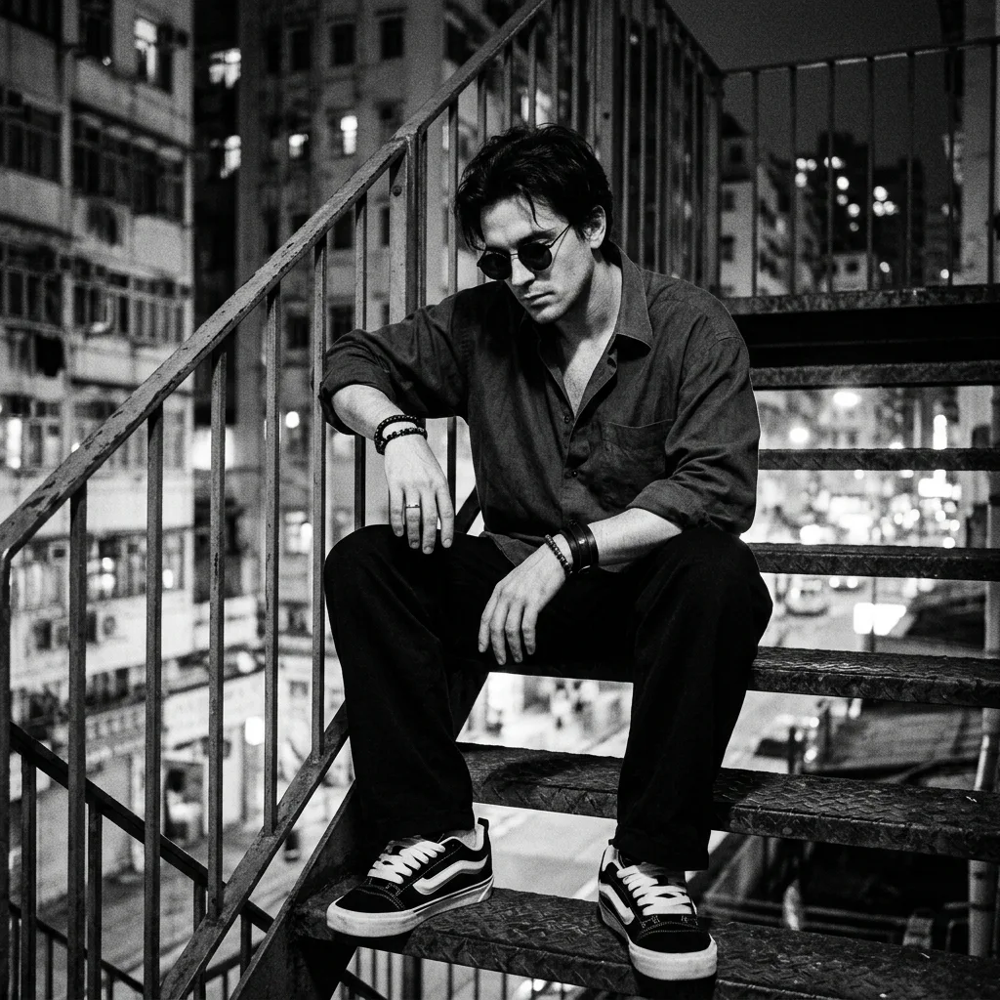

# Portrait without changing the facial features

[← Back to the collection](../../README.md) · Category: [Photography](../../gallery/photography.md) · Model: `Vinano Image v2` · ID: `vn-00734`

<a href="https://vinano.ai?utm_source=github&utm_medium=readme&utm_campaign=awesome-image-video-prompts-updating&utm_content=prompt-page-image"></a>

<sub>Preview generated with <a href="https://vinano.ai?utm_source=github&utm_medium=readme&utm_campaign=awesome-image-video-prompts-updating&utm_content=prompt-page-caption">vinano.ai</a></sub>

## Prompt

```text
Create a portrait without changing the facial features. A black and white artistic photograph of a man in a noir style. The man is sitting on a metal staircase or balcony a cityscape in the background. He is wearing a dark shirt an open collar, dark trousers, chunky sneakers, and sunglasses. Accessories are visible on his hands, including a bracelet. His pose is relaxed, his gaze directed downward. The lighting is high contrast deep shadows. The atmosphere reflects a 90s megacity, strong film grain, street fashion aesthetics, and a grunge mood.
High contrast lighting, film grain, 90s street style aesthetic, gritty noir atmosphere, grainy texture, 35mm film look.

Keep edges clean and the overall composition balanced for a polished, gallery-ready result.
```

## Try it on vinano.ai

1. Copy the prompt above.
2. Open **[vinano.ai](https://vinano.ai?utm_source=github&utm_medium=readme&utm_campaign=awesome-image-video-prompts-updating&utm_content=prompt-page-try)**, paste it into the image generator and pick a model.
3. Swap any placeholders (brand, product, city, person…) for your own details, then generate.

More prompts like this: [Photography gallery](../../gallery/photography.md) · [all categories](../../README.md#contents)
