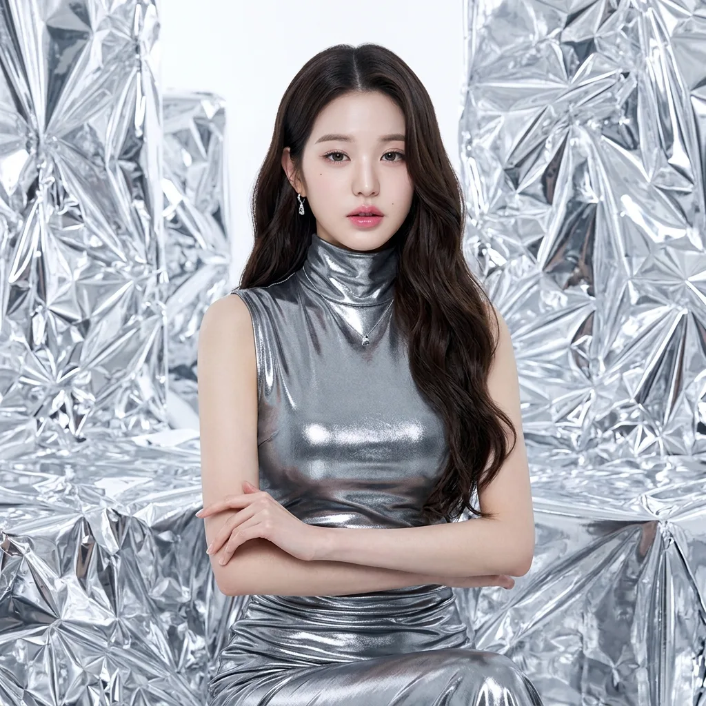

# Image quality

[← Back to the collection](../../README.md) · Category: [Photography](../../gallery/photography.md) · Model: `Vinano Image v2` · ID: `vn-00736`

<a href="https://vinano.ai?utm_source=github&utm_medium=readme&utm_campaign=awesome-image-video-prompts-updating&utm_content=prompt-page-image"></a>

<sub>Preview generated with <a href="https://vinano.ai?utm_source=github&utm_medium=readme&utm_campaign=awesome-image-video-prompts-updating&utm_content=prompt-page-caption">vinano.ai</a></sub>

## Prompt

```text
{
  "meta": {
    "image_quality": "High",
    "image_type": "Photo/Digital Render",
    "resolution_estimation": "1080x1920 (aspect ratio 9:16)"
  },
  "global_context": {
    "scene_description": "Jang Wonyoung of IVE poses in a highly reflective, futuristic environment constructed entirely of crumpled silver metallic foil. She has her signature long, wavy dark hair and doll-like features, including her distinct beauty marks. She is wearing a matching sleeveless, high-neck metallic silver dress. The scene is bathed in bright, diffused white light.",
    "time_of_day": "Indeterminate/Studio lighting",
    "weather_atmosphere": "Clinical/Futuristic/Monochromatic",
    "lighting": {
      "source": "Artificial",
      "direction": "Omnidirectional/Diffused",
      "quality": "Soft but creating high-contrast reflections",
      "color_temp": "Neutral/Cool"
    }
  },
  "color_palette": {
    "dominant_hex_estimates": ["#C0C0C0", "#E5E5E5", "#1A1A1A"],
    "accent_colors": ["Silver", "Chrome", "Dewy Skin Tone"],
    "contrast_level": "High"
  },
  "composition": {
    "camera_angle": "Eye-level",
    "framing": "Medium-shot/Vertical",
    "depth_of_field": "Medium",
    "focal_point": "Jang Wonyoung's face and eyes"
  },
  "objects": [{
      "id": "obj_001",
      "label": "Jang Wonyoung",
      "category": "Person",
      "location": "Center foreground",
      "prominence": "Foreground",
      "visual_attributes": {
        "color": "Fair skin, dark espresso hair",
        "texture": "Dewy glass skin, silky hair, metallic clothing",
        "material": "Skin/Hair/Fabric",
        "state": "Posed",
        "dimensions_relative": "Dominates vertical center"
      },
      "micro_details": ["Signature symmetrical beauty marks",
        "Plump gradient pink lips",
        "Small silver drop earring on left ear",
        "Thin silver necklace a small pendant",
        "Soft shadows under the jawline",
        "Fingers of right hand resting on left forearm"],
      "pose_or_orientation": "Seated/Kneeling, facing forward, arms crossed loosely at waist",
      "text_content": null
    },
    {
      "id": "obj_002",
      "label": "Metallic Dress",
      "category": "Clothing",
      "location": "Center",
      "prominence": "Foreground",
      "visual_attributes": {
        "color": "Polished Silver/Chrome",
        "texture": "Liquid-like, reflective",
        "material": "Synthetic Metallic Fabric",
        "state": "New/Tight-fitting"
      },
      "micro_details": ["Horizontal tension folds across the waist",
        "High turtleneck collar reflecting the chin",
        "Distorted reflection of foil room",
        "Sleeveless cut-outs"],
      "pose_or_orientation": "Form-fitting",
      "text_content": null
    }]
}

Keep edges clean and the overall composition balanced for a polished, gallery-ready result.
```

## Try it on vinano.ai

1. Copy the prompt above.
2. Open **[vinano.ai](https://vinano.ai?utm_source=github&utm_medium=readme&utm_campaign=awesome-image-video-prompts-updating&utm_content=prompt-page-try)**, paste it into the image generator and pick a model.
3. Swap any placeholders (brand, product, city, person…) for your own details, then generate.

More prompts like this: [Photography gallery](../../gallery/photography.md) · [all categories](../../README.md#contents)
