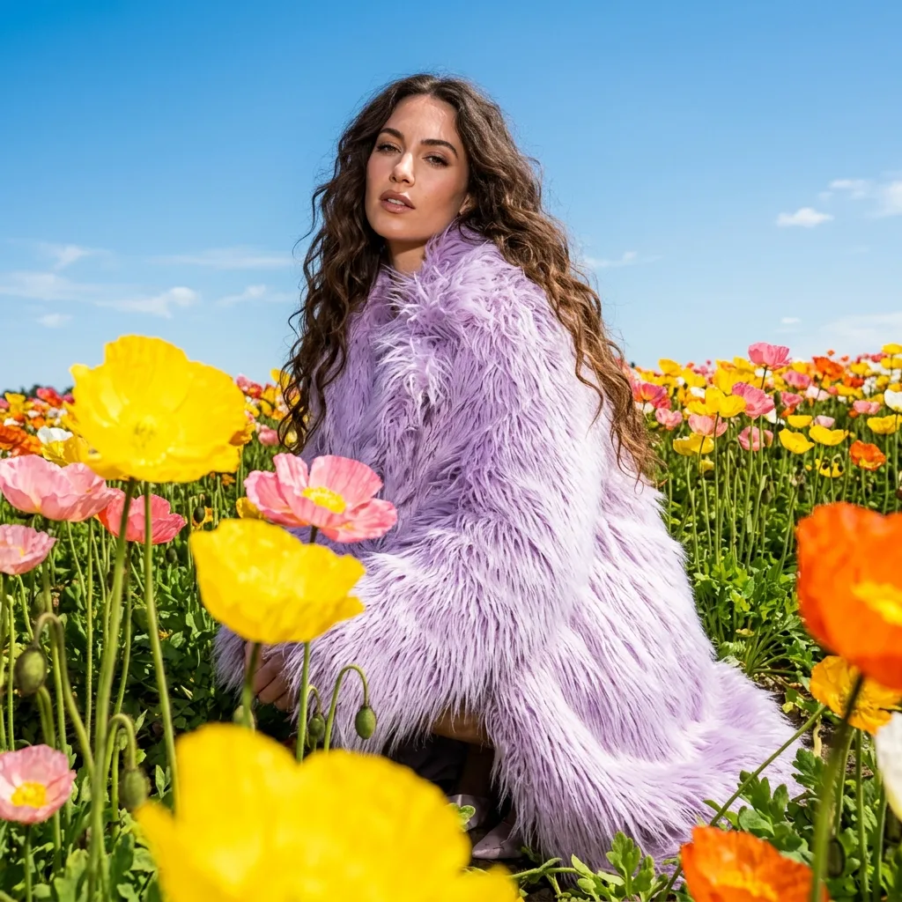

# Use this photo attached to create a striking outdoor

[← Back to the collection](../../README.md) · Category: [Photography](../../gallery/photography.md) · Model: `Vinano Image v2` · ID: `vn-00744`

<a href="https://vinano.ai?utm_source=github&utm_medium=readme&utm_campaign=awesome-image-video-prompts-updating&utm_content=prompt-page-image"></a>

<sub>Preview generated with <a href="https://vinano.ai?utm_source=github&utm_medium=readme&utm_campaign=awesome-image-video-prompts-updating&utm_content=prompt-page-caption">vinano.ai</a></sub>

## Prompt

```text
Use this photo attached to create a striking outdoor fashion portrait set in a vibrant flower field during daylight, captured a digital camera a harsh flash. The camera angle is low and slightly tilted upward, intensifying the scene's energy and drama. The subject has long, loose, dark brown wavy hair cascading over a voluminous, soft, shaggy lavender faux fur coat that drapes naturally over the body. Surrounding the subject are large, colorful poppies in yellow, pink, and orange, some in the foreground and others in the background, creating an immersive field-of-flowers effect. The sky is clear and blue, providing a crisp, contrasting backdrop. The mood is bold, editorial, and whimsical, making the vibrant colors of the outfit and flowers pop starkly against the serene sky. The overall composition should evoke a playful yet high-fashion atmosphere a hint of surrealism, emphasizing texture and color through the use of direct flash photography. Preserve realistic proportions and depth for a confident, professional finish.
```

## Try it on vinano.ai

1. Copy the prompt above.
2. Open **[vinano.ai](https://vinano.ai?utm_source=github&utm_medium=readme&utm_campaign=awesome-image-video-prompts-updating&utm_content=prompt-page-try)**, paste it into the image generator and pick a model.
3. Swap any placeholders (brand, product, city, person…) for your own details, then generate.

More prompts like this: [Photography gallery](../../gallery/photography.md) · [all categories](../../README.md#contents)
