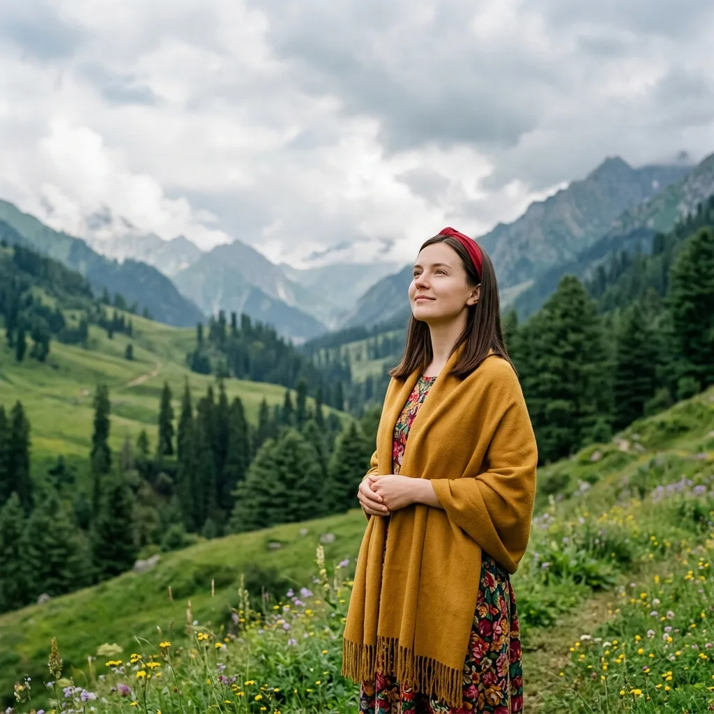

# Young woman standing in a lush green mountain valley

[← Back to the collection](../../README.md) · Category: [Photography](../../gallery/photography.md) · Model: `Vinano Image v2` · ID: `vn-00745`

<a href="https://vinano.ai?utm_source=github&utm_medium=readme&utm_campaign=awesome-image-video-prompts-updating&utm_content=prompt-page-image"></a>

<sub>Preview generated with <a href="https://vinano.ai?utm_source=github&utm_medium=readme&utm_campaign=awesome-image-video-prompts-updating&utm_content=prompt-page-caption">vinano.ai</a></sub>

## Prompt

```text
{
 "image_generation": {
 "subject": {
 "description": "young woman standing in a lush green mountain valley",
 "pose": "standing naturally hands gently together, looking slightly upward",
 "expression": "calm, peaceful, soft smile",
 "gaze": "looking toward the sky"
 },
 "appearance": {
 "hair": {
 "color": "dark brown",
 "style": "straight, shoulder-length a red headband"
 },
 "face": {
 "skin_tone": "fair and natural",
 "makeup": "minimal, natural makeup"
 }
 },
 "outfit": {
 "top": "traditional patterned dress colorful floral design",
 "outerwear": "mustard yellow shawl draped over shoulders"
 },
 "environment": {
 "setting": "green mountainous landscape",
 "background_elements": ["rolling green hills",
 "tall pine trees",
 "misty mountains",
 "cloudy sky",
 "grassy field"]
 },
 "lighting": {
 "type": "natural outdoor light",
 "quality": "soft and diffused",
 "time": "daytime"
 },
 "camera": {
 "angle": "eye-level",
 "framing": "mid shot",
 "depth_of_field": "moderate, background softly blurred"
 },
 "aesthetic": {
 "style": "natural lifestyle photography",
 "vibe": "peaceful, fresh, scenic",
 "color_palette": "green, mustard yellow, earthy tones"
 },
 "quality": {
 "resolution": "high",
 "realism": "true-to-life photorealistic",
 "detail": "high detail"
 }
 }
}

Aim for an editorial, design-driven look with deliberate negative space.
```

## Try it on vinano.ai

1. Copy the prompt above.
2. Open **[vinano.ai](https://vinano.ai?utm_source=github&utm_medium=readme&utm_campaign=awesome-image-video-prompts-updating&utm_content=prompt-page-try)**, paste it into the image generator and pick a model.
3. Swap any placeholders (brand, product, city, person…) for your own details, then generate.

More prompts like this: [Photography gallery](../../gallery/photography.md) · [all categories](../../README.md#contents)
