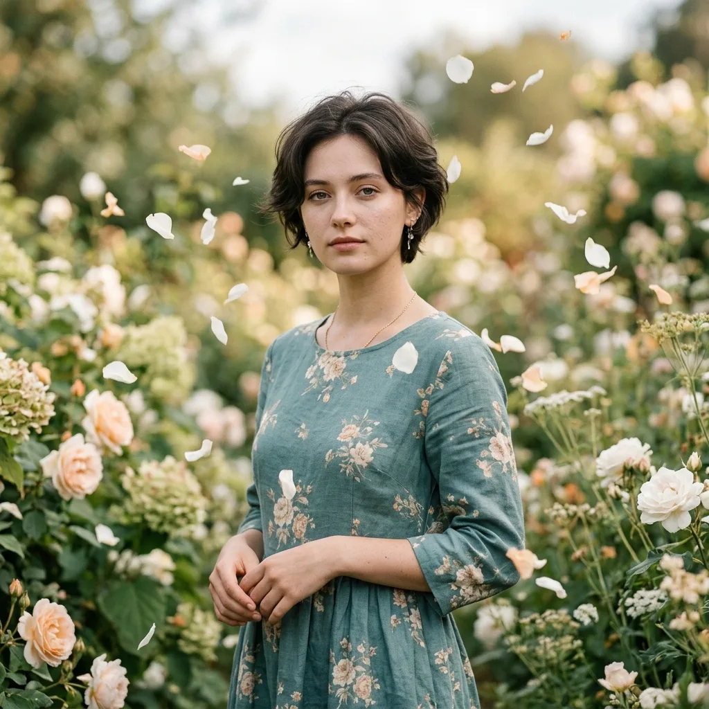

# Lush garden in full bloom

[← Back to the collection](../../README.md) · Category: [Photography](../../gallery/photography.md) · Model: `Vinano Image v2` · ID: `vn-00751`

<a href="https://vinano.ai?utm_source=github&utm_medium=readme&utm_campaign=awesome-image-video-prompts-updating&utm_content=prompt-page-image"></a>

<sub>Preview generated with <a href="https://vinano.ai?utm_source=github&utm_medium=readme&utm_campaign=awesome-image-video-prompts-updating&utm_content=prompt-page-caption">vinano.ai</a></sub>

## Prompt

```text
{
 "Objective": "Create a dreamy fine-art portrait a romantic, ethereal garden atmosphere",
 "PersonaDetails": {
 "Subject": {
 "Type": "Young woman",
 "Hair": "Short, softly tousled dark hair",
 "Expression": "Calm, introspective, slightly melancholic",
 "Gaze": "Looking gently toward the camera",
 "Wardrobe": {
 "Dress": "Muted teal floral dress subtle vintage patterns"
 }
 }
 },
 "SceneDescription": {
 "Location": "Lush garden in full bloom",
 "EnvironmentDetails": ["Abundant flowering plants",
 "Soft greenery filling the frame"],
 "AtmosphericElements": {
 "FloatingPetals": "White and pale peach flower petals drifting through the air",
 "Motion": "Petals caught mid-motion by a gentle breeze"
 }
 },
 "Composition": {
 "Framing": "Waist-up fine-art portrait",
 "Balance": "Elegant, centered composition",
 "DepthOfField": "Shallow depth of field",
 "Background": "Softly blurred garden creamy bokeh"
 },
 "LightingAndColor": {
 "Lighting": "Soft natural light under overcast sky",
 "ColorPalette": ["Muted greens",
 "Soft teals",
 "Pale peach and white accents"],
 "ColorGrading": "Painterly, desaturated, romantic tones"
 },
 "ArtDirection": {
 "Style": "Fine-art photography blended cinematic realism",
 "Aesthetic": "Romantic, ethereal, timeless",
 "TextureQuality": "Ultra-detailed fabric and natural skin texture"
 },
 "PhotographyStyle": {
 "LensLook": "85mm lens perspective",
 "Genre": "Fine-art portrait photography",
 "ImageQuality": "High resolution, refined detail",
 "FocusStyle": "Soft yet precise subject focus"
 },
 "Mood": {
 "Tone": "Dreamy, reflective, poetic",
 "EmotionalFeel": "Gentle melancholy and quiet beauty"
 },
 "NegativePrompt": ["harsh lighting",
 "modern fashion editorial",
 "oversaturated colors",
 "busy background",
 "plastic skin",
 "cartoon",
 "anime"],
 "ResponseFormat": {
 "Type": "Single image",
 "Orientation": "Portrait",
 "AspectRatio": "2:3"
 }
}

Emphasise material texture and natural light so the final frame feels tactile and premium.
```

## Try it on vinano.ai

1. Copy the prompt above.
2. Open **[vinano.ai](https://vinano.ai?utm_source=github&utm_medium=readme&utm_campaign=awesome-image-video-prompts-updating&utm_content=prompt-page-try)**, paste it into the image generator and pick a model.
3. Swap any placeholders (brand, product, city, person…) for your own details, then generate.

More prompts like this: [Photography gallery](../../gallery/photography.md) · [all categories](../../README.md#contents)
