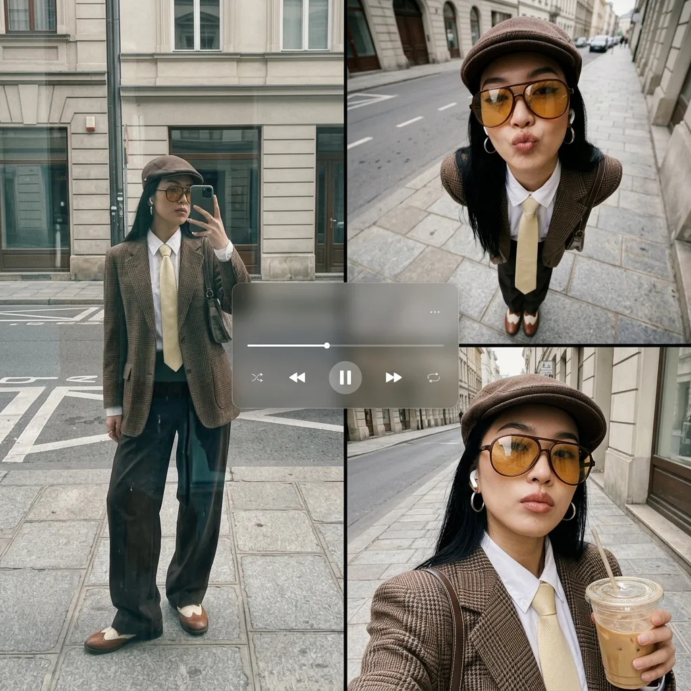

# Transform this image Upload Your Image into a 64K

[← Back to the collection](../../README.md) · Category: [Photography](../../gallery/photography.md) · Model: `Vinano Image Pro` · ID: `vn-00753`

<a href="https://vinano.ai?utm_source=github&utm_medium=readme&utm_campaign=awesome-image-video-prompts-updating&utm_content=prompt-page-image"></a>

<sub>Preview generated with <a href="https://vinano.ai?utm_source=github&utm_medium=readme&utm_campaign=awesome-image-video-prompts-updating&utm_content=prompt-page-caption">vinano.ai</a></sub>

## Prompt

```text
Transform this image [Upload Your Image] into a 64K DSLR shot resolution of A stylish urban fashion collage composed of multiple candid street-style shots arranged in a vertical split layout. The setting is a European-style city street stone-paved sidewalks, historic architecture, and muted neutral tones. The overall atmosphere feels modern, artsy, and lifestyle-driven, blending fashion photography everyday urban moments. The main subject is a fashion-forward young woman (same face as the uploaded image) long black hair, wearing a coordinated vintage-inspired outfit. She has a confident, playful, slightly rebellious attitude expressed through her body language and facial expressions. Her outfit consists of a brown plaid blazer, a white button-up shirt, and a pale yellow tie, paired loose dark trousers and two-tone leather shoes. She accessories a brown fitted cap, large amber-tinted aviator sunglasses, silver hoop earrings, and a small shoulder bag. White wireless earbuds are visible in some frames, reinforcing a casual, modern lifestyle aesthetic.

Left panel: A reflective mirror shot taken through a glass surface, showing the subject (same face as the uploaded image) holding a smartphone up to her face while taking a photo. The reflection slightly distorts the scene, creating layered depth urban elements like street markings and building facades blending into the glass. Top-right panel: A high-angle shot looking down at the subject (same face as the uploaded image) as she leans forward toward the camera, lips pursed in a playful pout, emphasizing her expressive personality and bold eyewear.

Bottom-right panel: A close-up selfie angle where she looks directly into the camera while holding an iced coffee in a clear plastic cup, earbuds in, sunlight softly illuminating her face and sunglasses.

Overlayed across the center of the collage is a refined minimalist music player UI, semi-transparent, displaying a paused or playing track progress bar and controls, adding a digital, lifestyle-tech aesthetic. The interface floats above the imagery, blending seamlessly the collage and reinforcing a "day-in-the-life" mood. Lighting is natural daylight soft shadows. The color palette is muted and earthy browns, greys, yellows-enhanced subtle film grain and a slightly desaturated, editorial color grade. The overall mood is effortlessly cool, candid, and contemporary, mixing street fashion, music culture, and casual city exploration. Style & Quality Tags: Street-style fashion photography, lifestyle editorial, urban aesthetic, candid moments, vintage-inspired outfit, natural light, muted color grading, subtle film grain, modern collage layout, high-resolution, Instagram editorial style.

Octane render & Unreal Engine 5.

Emphasise material texture and natural light so the final frame feels tactile and premium.
```

## Try it on vinano.ai

1. Copy the prompt above.
2. Open **[vinano.ai](https://vinano.ai?utm_source=github&utm_medium=readme&utm_campaign=awesome-image-video-prompts-updating&utm_content=prompt-page-try)**, paste it into the image generator and pick a model.
3. Swap any placeholders (brand, product, city, person…) for your own details, then generate.

More prompts like this: [Photography gallery](../../gallery/photography.md) · [all categories](../../README.md#contents)
