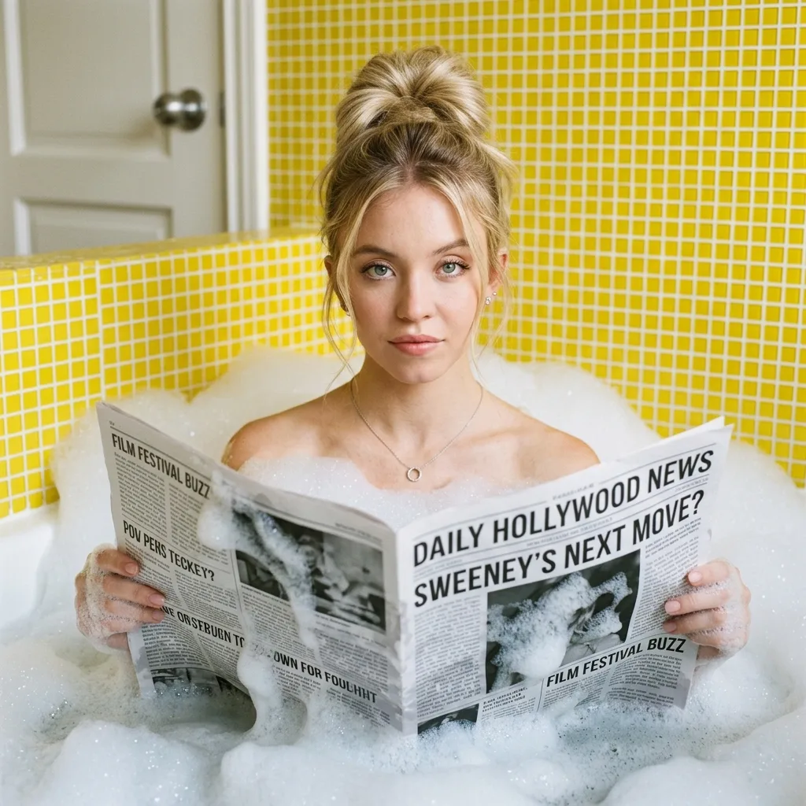

# Young blonde Hollywood actress, similar to Sydney Sweeney, appears

[← Back to the collection](../../README.md) · Category: [Photography](../../gallery/photography.md) · Model: `Vinano Image v2` · ID: `vn-00756`

<a href="https://vinano.ai?utm_source=github&utm_medium=readme&utm_campaign=awesome-image-video-prompts-updating&utm_content=prompt-page-image"></a>

<sub>Preview generated with <a href="https://vinano.ai?utm_source=github&utm_medium=readme&utm_campaign=awesome-image-video-prompts-updating&utm_content=prompt-page-caption">vinano.ai</a></sub>

## Prompt

```text
A young blonde Hollywood actress, similar to Sydney Sweeney, appears inside a bathtub filled foam up to the brim. Her blonde hair is styled in a high, voluminous, slightly messy bun, a few loose strands softly framing her face. She looks directly at the camera a neutral, subtly seductive expression, her lips slightly parted. She wears light, natural makeup, a delicate silver chain necklace a small circular pendant, and small, discreet stud earrings.

Her upper body faces forward, visible above the foam. She holds a large open printed newspaper both hands at chest height, as if reading it. The newspaper is partially covered dense white soap foam, which also gathers around her in thick, fluffy bubbles filling the bathtub. Beneath the foam and the newspaper, she is wearing a green beach top that remains completely hidden.

The scene takes place inside a tiled bathtub. In the background, there is a vibrant wall completely covered small, bright yellow square mosaic tiles. In the left corner of the composition, a slightly out-of-focus white door frame is visible, a silver metallic doorknob.

The lighting is soft, diffused, and even indoor lighting, coming from the front and slightly from above. It creates soft, flattering highlights on her face, shoulders, and hair, very few harsh shadows. The image conveys an eccentric, artistic, editorial atmosphere that feels slightly surreal, yet calm and visually striking.

The color palette highlights the bright yellow tiles, the white foam, the blonde hair, and the gray tones of the newspaper. The photograph is a modern, true-to-life photorealistic editorial portrait cinematic framing. The composition is a medium shot from the upper bust upward, at eye level, a shallow depth of field that keeps the actress and the newspaper in sharp focus while slightly blurring the door handle in the foreground. The image is highly detailed, crisp focus, professional lighting, vibrant high-contrast colors, and extremely premium quality in 8K resolution, in a 4:5 aspect ratio.

Render with rich micro-detail while keeping the layout uncluttered and intentional.
```

## Try it on vinano.ai

1. Copy the prompt above.
2. Open **[vinano.ai](https://vinano.ai?utm_source=github&utm_medium=readme&utm_campaign=awesome-image-video-prompts-updating&utm_content=prompt-page-try)**, paste it into the image generator and pick a model.
3. Swap any placeholders (brand, product, city, person…) for your own details, then generate.

More prompts like this: [Photography gallery](../../gallery/photography.md) · [all categories](../../README.md#contents)
