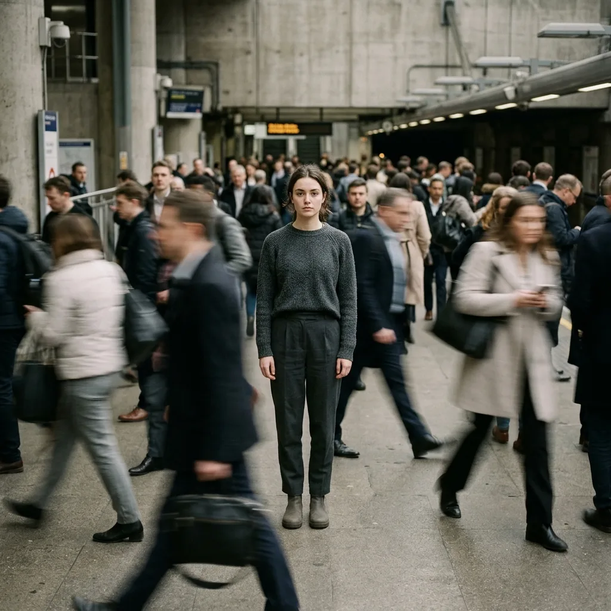

# Motion-blur photography shot on a Leica SL3 a 50mm

[← Back to the collection](../../README.md) · Category: [Photography](../../gallery/photography.md) · Model: `Vinano Image v2` · ID: `vn-00765`

<a href="https://vinano.ai?utm_source=github&utm_medium=readme&utm_campaign=awesome-image-video-prompts-updating&utm_content=prompt-page-image"></a>

<sub>Preview generated with <a href="https://vinano.ai?utm_source=github&utm_medium=readme&utm_campaign=awesome-image-video-prompts-updating&utm_content=prompt-page-caption">vinano.ai</a></sub>

## Prompt

```text
Cinematic motion-blur photography shot on a Leica SL3 a 50mm Summilux at f/2.8, captured from a chest-level frontal angle slow shutter panning.

Lighting setup: flat overcast daylight acting as soft diffusion, allowing long blur trails without harsh contrast.

Color tone: muted concrete greys and pale skin neutrals inspired by A24 films.

Subject: a Gen-Z female model standing completely still, sharp eyes, symmetrical face, real skin pores visible, wearing understated fashion.

Crowd action: hundreds of commuters rushing past in all directions, bodies stretched into smooth horizontal and diagonal blur.

Emotion: quiet rebellion through stillness.

Aesthetic: editorial calm vs chaos.

Post: clean motion physics, fine grain, no glitches, no face distortion, no warped anatomy.

Emphasise material texture and natural light so the final frame feels tactile and premium.
```

## Try it on vinano.ai

1. Copy the prompt above.
2. Open **[vinano.ai](https://vinano.ai?utm_source=github&utm_medium=readme&utm_campaign=awesome-image-video-prompts-updating&utm_content=prompt-page-try)**, paste it into the image generator and pick a model.
3. Swap any placeholders (brand, product, city, person…) for your own details, then generate.

More prompts like this: [Photography gallery](../../gallery/photography.md) · [all categories](../../README.md#contents)
